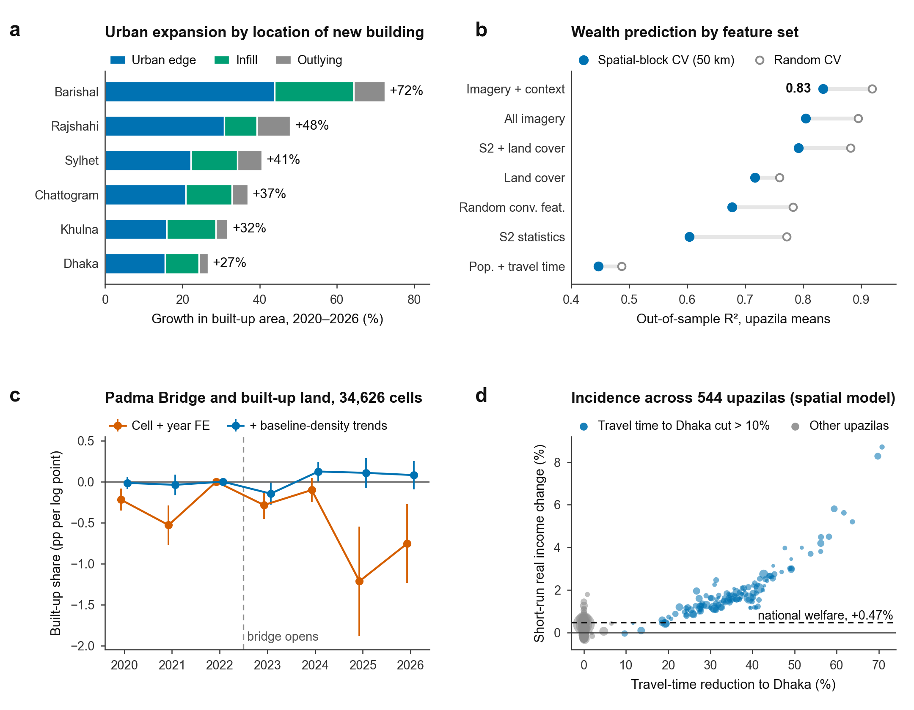
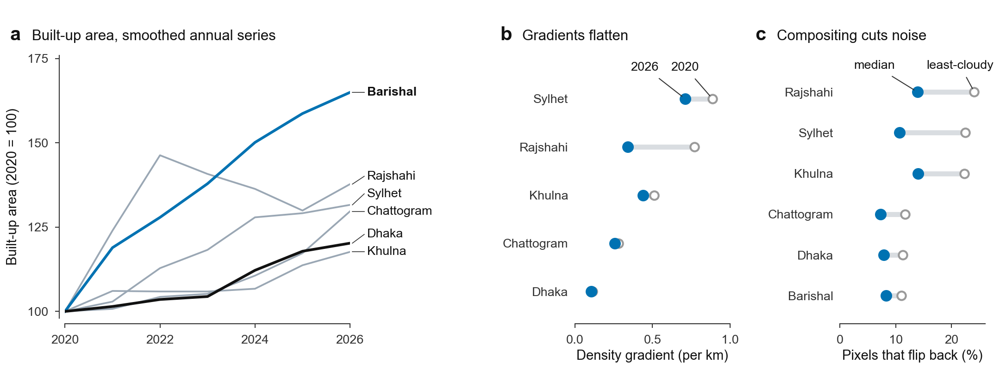

# Too early to see from space: open satellite data and the Padma Bridge

[](https://github.com/lyz44git/bangladesh-geoai/actions/workflows/tests.yml)

**Summary.** Four years after the Padma Bridge opened, satellite imagery shows no detectable effect of the bridge on
built-up land. This study demonstrates that the null result is uninformative about an effect of the size a calibrated
spatial equilibrium model predicts. The evidence is of three kinds, which are kept separate throughout.

- **Measured.** The imagery maps built-up land with F1 = 0.80 on held-out blocks of the six largest cities (0.66 in the
  rural bridge region), registers growth of 27–72% in those cities, and predicts upazila mean wealth out of area with
  R² = 0.83 (0.45 for individual grid cells).
- **Estimated.** Once trends by baseline density are controlled, a one-log-point reduction in travel time to Dhaka
  changes built-up share by 0.06 percentage points (95% CI −0.03 to 0.15 with upazila clusters, −0.11 to 0.23 with
  district clusters).
- **Modeled.** The model implies a coefficient of comparable magnitude (0.059), equivalent to less than half of one
  30 m pixel in a typical 1.2 km cell, whereas the design can detect only effects 2.3 to 4.2 times larger (power of
  8–23%). In the model's scenario national welfare rises by 0.47%, of which three-quarters accrues to the 19% of the
  population in upazilas where travel time to Dhaka fell by about 10% or more. The welfare figures are model output
  and are not tested by the imagery.



**Figure 1 | From measurement to evaluation.** **a**, Measurement: accuracy on held-out areas of the built-up
classifier (F1 against WorldCover, six cities pooled) and of wealth prediction (R² for upazila means against the
Relative Wealth Index; open markers, random folds).
**b**, Description: growth in built-up area in the six largest cities, 2020–2026, by type of expansion. **c**,
Evaluation: event-study estimates of the effect of the bridge on built-up share across 34,626 cells with 95% intervals
(shaded), 2022 as reference; the negative estimates under cell and year fixed effects are absent once trends by
baseline density are controlled. **d**, Interpretation: short-run real income change implied by the spatial
equilibrium model, by upazila (square: the bridge), a model scenario rather than an estimate from the imagery; inset,
the same change against the reduction in travel time to Dhaka. Drawn by
[`figures/make_figure1.py`](figures/make_figure1.py) from the committed result tables and the GADM 4.1 boundaries,
which are not stored here.

Technical report: [`docs/TECHNICAL_REPORT_EN.md`](docs/TECHNICAL_REPORT_EN.md) · Indicator atlas for 544 upazilas:
[`docs/atlas/ATLAS.md`](docs/atlas/ATLAS.md) · [Reproducing the figures from the committed tables](#reproduction)

## Research question and design

The Padma Bridge, a 6.15 km road-rail bridge opened on 25 June 2022, replaced ferry crossings that often involved
hours of queuing and connected the southwestern divisions to Dhaka. Ex-ante appraisals projected national GDP gains
above 1%. Household surveys that could test this projection become available only years later, whereas satellite
imagery is free, annual and covers every upazila.

The study asks whether such imagery can support an early evaluation. The design follows the logic of measurement
validation: establish the accuracy of the measure, confirm that it registers change where change is expected, apply it
to the bridge, and then determine whether the test could have detected the effect that a model predicts.

| Step | Question | Approach | Answer |
|---|---|---|---|
| 1. Measure | Is the measure accurate? | U-Net trained on WorldCover labels; wealth prediction under 50 km spatial-block cross-validation | Yes for cities and for upazila means; not for individual grid cells |
| 2. Describe | Does it register change where rapid change is expected? | Built-up area in the six largest cities, 2020–2026 | Yes: growth of 27–72%, mostly at the urban edge |
| 3. Evaluate | Does it register a change where the bridge reduced travel time? | Continuous-treatment difference-in-differences and event study, 34,626 cells × 7 seasons | No detectable effect once selection on trends is removed |
| 4. Interpret | Could the design have detected the expected effect? | Two-sector spatial equilibrium model of 544 upazilas; minimum detectable effect and power of the design | No: the minimum detectable effect is 2–4 times the model-implied effect; the model implies a welfare gain of +0.47% |

## 1. Measurement: accurate for cities and for upazila means

Two measures are derived from the imagery. Built-up land is the outcome of steps 2 to 4; wealth is a product in its
own right and an input to the model of step 4. Both are evaluated on areas excluded from training, built-up land
against ESA WorldCover and wealth against the Meta Relative Wealth Index.

**Built-up land.**

| Built-up classifier, six cities pooled (spatially held-out blocks) | Precision | Recall | F1 |
|---|---|---|---|
| U-Net | 0.86 | 0.75 | 0.80 |
| Gradient boosting, default threshold | 0.52 | 0.96 | 0.67 |

- **The U-Net exceeds gradient boosting in every city** (Figure 2a); at its default threshold, gradient boosting
  overstates built-up area.
- **Stability over time depends on compositing more than on the classifier** (Figure 2b). Relative to least-cloudy
  compositing, the phenology-balanced design lowers the year-to-year reversal rate by 25–52% and the trend-residual
  standard deviation by 29–75% across the six cities. Without it, seasonal variation would register as urban change and
  contaminate the event study in step 3.
- **Accuracy declines where settlement is sparse.** In the rural Padma region (1.3% built-up), the U-Net reaches
  F1 = 0.66 (precision 0.79, recall 0.56).
- **The patch-level split of the U-Net has a negligible effect on its score.** Training patches of 64 pixels are
  assigned to the fold that covers most of their pixels, so 7.1% of test pixels lie inside a training patch and 2.2%
  inside a validation patch. Excluding them changes pooled F1 from 0.797 to 0.793 in the re-run, and city scores by
  between −0.02 and +0.01 ([`scripts/11_patch_fold_check.py`](scripts/11_patch_fold_check.py)).

**Wealth.**

| Wealth prediction (Meta Relative Wealth Index) | R², grid cells | R², upazila means |
|---|---|---|
| Spatial blocks (50 km) | 0.45 | 0.83 |
| Random folds | 0.50 | 0.92 |

- **Random cross-validation overstates wealth accuracy** for every feature set (Figure 2c). The spatial-block figures
  are the relevant ones for areas without labels. Upazila figures refer to population-weighted means over the 504
  upazilas with at least three labeled cells; for individual grid cells the same model reaches 0.45.
- **Predicted wealth largely reflects the built environment** (Figure 2d). In the best imagery model, built-up land
  cover alone accounts for 31% of the gain.
- **The index also sets relative wages in the spatial model of step 4.** The imagery model indicates that this input
  can be largely reproduced from imagery out of area.


**Figure 2 | Measurement.** **a**, F1 of the built-up classifier against WorldCover on spatially held-out blocks, by
city, for the U-Net and for gradient boosting at its default threshold. **b**, Share of built-up pixels classified as
non-built in the following year, 2020–2026, under least-cloudy and phenology-balanced compositing. **c**,
Out-of-sample R² for upazila mean wealth by feature set under 50 km spatial-block and random cross-validation. **d**,
Wealth predicted from imagery and context for each grid cell by a model fitted without its 50 km block; inset,
predicted against labeled upazila means (unweighted means of 534 upazilas; the R² of 0.83 refers to population-weighted
means over the 504 upazilas with at least three cells). Panel d is drawn from the re-run described under Reproduction.

## 2. Description: cities grew 27–72%, mostly at the edge

Applied to the six largest cities, where rapid growth is expected, the same pipeline registers growth of 27–72% over
six years. The cities serve as a positive control for step 3: they establish that the measure registers change where
change is large.

| City | Built-up growth, 2020–2026 | Built-up area added | Share of new built-up land at the edge |
|---|---|---|---|
| Dhaka | +27% | 95 km² | 58% |
| Chattogram | +37% | 30 km² | 57% |
| Khulna | +32% | 8 km² | 50% |
| Rajshahi | +48% | 9 km² | 64% |
| Sylhet | +41% | 7 km² | 55% |
| Barishal | +72% | 5 km² | 61% |

Relative and absolute growth rank the cities differently: Barishal grows fastest (+72%) and adds 5 km², whereas Dhaka
grows slowest (+27%) and adds 95 km², more than the other five cities combined (59 km²). Edge expansion accounts for
50–64% of new built-up land (Figure 3). In Dhaka and Chattogram the largest additions
lie 4–7 km from the center (Figure 4b), and radial density gradients flatten in every city with a measurable gradient
(Figure 4c).

The contrast with the bridge corridor is material to step 4. Built-up area in the six cities grows by 4.0–9.5% a year
from a large base. The rural areas served by the bridge start from 0.37% built-up, so even a large proportional
response adds very little built-up land in absolute terms.


**Figure 3 | Built-up land in six cities.** For each city, left, the Sentinel-2 dry-season composite for 2026 in
natural color and, right, built-up land in 2020 and land added by 2026 from the U-Net maps, over the same area. Each
pair gives the growth in built-up area and the built-up area in 2020 and 2026; scale bars, 10 km. The maps alone are
available at full size in [`outputs/figures/urban_change_maps.png`](outputs/figures/urban_change_maps.png). Drawn by
[`figures/make_city_pairs.py`](figures/make_city_pairs.py) from the re-run described under Reproduction; contains
modified Copernicus Sentinel data (2026).



**Figure 4 | Form of urban growth.** **a**, Built-up area by city from the smoothed annual maps, 2020 = 100. **b**,
Built-up share added between 2020 and 2026 by distance from the city center. **c**, Density gradient of built-up
share in 2020 and 2026; Barishal is omitted because its 2020 gradient is not defined. Panel b is drawn from the re-run
described under Reproduction.

## 3. Evaluation: no detectable effect of the bridge on built-up land

In the four years after opening, areas with larger reductions in travel time to Dhaka did not add built-up land
detectably faster than comparable areas. Treatment is the modeled reduction in travel time to Dhaka (log points;
Figure 5a), which varies continuously across 34,626 cells. The table gives the effect of a one-log-point reduction on
built-up share, in percentage points.

| Specification | Coefficient | 95% CI | Randomization p |
|---|---|---|---|
| (1) Cell and year fixed effects | −0.339 | −0.58 to −0.10 | 0.008 |
| (2) + year × baseline-built bin, distance, water | 0.060 | −0.03 to 0.15 | 0.92 |
| (3) + division × year fixed effects | −0.002 | −0.13 to 0.12 | 0.98 |
| (2) with district clusters | 0.060 | −0.11 to 0.23 | |

Randomization p-values permute upazila-mean exposure across upazilas within divisions (1,000 permutations).

- **The negative naive estimate reflects selection on trends** (Figure 5b). Treated areas are far more rural (0.37% built-up before
  opening against 2.22%) and add fewer percentage points each year. Once trends are allowed to differ by baseline
  density, the two pre-period coefficients are close to zero (−0.015 and −0.038, with standard errors of 0.038 and 0.064)
  and the pooled estimate is a null. With only two pre-period coefficients, this is a limited test of parallel trends.
- **The null holds in every continuous-treatment variant** (Figure 5c): alternative ferry speeds, the outcome defined
  as mean probability, the exclusion of cells near the bridge or near Dhaka, and the rural subsample. Year by year,
  the coefficient is −0.15 in 2023 and between +0.08 and +0.12 in 2024–2026; only 2023 and 2024 are individually
  distinguishable from zero, and the estimates do not grow over time.
- **One variant is positive.** A binary version of (2), which compares cells above 0.2 log points with the rest, gives
  0.097 percentage points (CI 0.02 to 0.17, upazila clusters). It was not re-estimated with district clusters or by
  randomization inference and discards the variation in exposure on which the main specification rests; it is reported
  as an exception rather than as evidence of an effect.

A null estimate admits two interpretations: either the bridge did not alter where built-up land is added, or the
response is too small for this design to detect. Step 4 uses a spatial equilibrium model to distinguish between them.


**Figure 5 | The bridge.** **a**, Reduction in modeled travel time to Dhaka on a 500 m grid, from least-cost routes
with and without the bridge. **b**, Event-study coefficients with 95% intervals for three specifications, 2022 as
reference; the 2018–2019 estimates rest on an older image archive and are not comparable. **c**, The coefficient under
the three main specifications and under alternative choices applied to specification (2), with 95% intervals; the
binary-treatment row compares cells above 0.2 log points with the rest, in percentage points, and is a different
estimand. Panel a is drawn from the re-run described under Reproduction.

## 4. Interpretation: the model-implied effect is below the detection threshold, and the implied welfare gain is +0.47%

A spatial equilibrium model implies an effect on built-up land of the same magnitude as the point estimate and well
below the minimum detectable effect of the design. The null is therefore uninformative about an effect of the predicted
size, although it does exclude substantially larger ones.

- **Model-implied effect** (Figure 6a). At full long-run adjustment the model implies a coefficient of 0.059, against a point
  estimate of 0.060. The implied coefficient is obtained by regressing the model's predicted change in built-up share
  on treatment intensity across the same region, so general-equilibrium effects on comparison areas are reflected in
  it. The two numbers come from different regressions (a cross-section of upazilas in the model, a cell panel with
  fixed effects in the data) and the estimate's interval is wide, so their agreement to the second decimal is not in
  itself evidence for the model. For a cell at the mean treatment intensity of treated cells (travel-time reduction above about 5%), this
  corresponds to 0.026 percentage points of built-up share: about 0.4 of one 30 m pixel in a cell of 1,600 pixels, of
  which about 6 were built-up before the bridge.
- **Detection threshold** (Figure 6b). At 80% power in a two-sided 5% test, the minimum detectable coefficient is 0.13 with
  upazila clustering and 0.25 with district clustering, 2.3 and 4.2 times the model-implied value. Power against the
  model-implied value is 17–23% and 8–10% respectively, and 6–9% if only half of the long-run adjustment has occurred.
  The estimate does exclude coefficients above 0.15 (upazila clustering), about 2.6 times the model-implied value.
- **Welfare, a model scenario** (Figure 6c). National welfare rises by 0.47% at the main parameters (0.30–0.79% across
  the parameter grid). The figure covers goods trade only and excludes passenger time savings and commuting. Omitting
  the local non-traded sector raises the gain to 0.79%, about 70% higher. The imagery does not test these figures:
  reweighting 600 parameter draws by the estimate leaves them essentially unchanged.
- **Incidence, in the same scenario** (Figure 6d). The 19% of the population in treated upazilas (travel-time reduction of about 10% or more) receives
  75% of the total gain: real income rises by 1.9% there and by 0.15% elsewhere. The gains are not progressive. With
  upazilas ordered by the Relative Wealth Index into fifths of the population, real income rises by 0.27% in the
  poorest fifth, 0.58–0.61% in the third and fourth, and 0.43% in the richest. Upazilas holding 29% of the population
  incur small losses through trade diversion (population-weighted mean −0.16%), most of them in Rajshahi and Rangpur;
  61% of the poorest fifth lives in such upazilas. The index also sets baseline wages in the model, so the ranking is
  not independent of the model's inputs.


**Figure 6 | Interpretation.** **a**, The model-implied effect in a cell at the mean treatment intensity, shown to
scale in a 1.2 km cell of 1,600 pixels (schematic; positions illustrative). **b**, Model-implied coefficient with the
90% interval across 600 parameter draws, the estimate with 95% intervals under two clustering choices, and the minimum
detectable effect at 80% power (bars). **c**, National welfare gain when one parameter at a time is varied; the
dashed line marks the main parameters. **d**, Long-run population change by upazila; inset, short-run real income gain
by wealth fifth of the population.

## Conclusions

### Principal findings

1. **The measurement is adequate for city monitoring and for ranking upazilas.** Free imagery maps built-up land
   (F1 = 0.80 against WorldCover in cities, 0.66 in the rural bridge region) and upazila mean wealth (out-of-area
   R² = 0.83 against the Relative Wealth Index). It does not resolve individual grid cells (R² = 0.45).
2. **Early evaluation is not yet feasible.** In the bridge corridor the model-implied effect is less than half a pixel
   per cell, and the minimum detectable effect is two to four times larger. The null reflects the limits of the design
   rather than the absence of an effect.
3. **The model-implied welfare gain is modest and unevenly distributed.** In the model, national welfare rises by
   0.47%; three-quarters of the gain accrues to the 19% of the population in upazilas where travel time to Dhaka fell
   by about 10% or more, and upazilas holding 29% of the population incur small losses.

### Sensitivity of conclusions to common analytical defaults

Each row gives a common default, the conclusion it yields on these data, and the result obtained when the default is
replaced.

| Common default | Conclusion under the default | Result in this study |
|---|---|---|
| Pixel classifier at its default threshold | Built-up share of 13.2% on held-out blocks, against a reference of 7.2% | 6.2% with the U-Net (F1 0.80 against 0.67) |
| Least-cloudy scene selection | 11–24% of built-up pixels revert to non-built in the following year, noise that would be read as urban change | 7–14% with phenology-balanced compositing |
| Random cross-validation of the wealth map | Upazila R² of 0.92 | 0.83 under 50 km spatial blocks, the relevant figure for areas without labels |
| Two-way fixed-effects difference-in-differences | A negative effect of the bridge on built-up land (−0.34, randomization p = 0.008) | Selection on trends: 0.06 (CI −0.03 to 0.15) once trends by baseline density are controlled |
| Interpreting the null as the absence of an effect | The bridge did not alter land use | The minimum detectable effect is 2.3–4.2 times the model-implied effect (power of 8–23%) |
| One-sector trade model | Welfare gain of 0.79% | 0.47% with a local non-traded sector |

### Contribution relative to conventional measurement and evaluation

- **Coverage and frequency.** Censuses are decennial and household surveys are conducted every few years; neither is
  designed to yield annual figures for 544 upazilas. The imagery yields an annual built-up series at 20–30 m and a
  wealth estimate for every upazila from free inputs.
- **An interpretable null.** A reduced-form evaluation alone would report no effect; a structural model alone would
  report a welfare gain that is not confronted with data. Applying both to the same outcome provides the effect size
  against which the test should be assessed and establishes that this design cannot detect it.
- **Incidence.** The model reports gains and losses for each of 544 upazilas, which an aggregate appraisal does not.
- **Transferability.** The model requires only open inputs (population, a road network and a wealth index), so the
  same appraisal can be produced for a proposed corridor before construction and for alternative alignments. Because a
  counterfactual solves in a fraction of a second, uncertainty over parameters can be reported in full, as with the
  600 draws used here, rather than as a single point estimate.

The approach complements survey data and does not replace it. Imagery measures the built environment rather than
consumption: the wealth labels are themselves model-based, accuracy for individual grid cells is low (R² = 0.45), and
vertical growth is not observable at this resolution. The model is calibrated rather than estimated, and the
evaluation is too imprecise to discipline it: reweighting 600 parameter draws by the estimate leaves them essentially
unchanged (effective sample size 597).

### Applications

1. **Monitoring between censuses.** Annual built-up series for cities, provided that scenes are composited by season
   and temporal-consistency diagnostics are reported.
2. **Geographic ranking.** Ranking upazilas by relative wealth, validated with spatial blocks. Because the labels are
   themselves model-based, a ranking should be compared with survey data before it is used to allocate resources, and
   the maps are not sufficiently accurate to target villages or households.
3. **Ex-ante evaluation design.** The expected effect from a calibrated model and the minimum detectable effect of the
   design can be computed before outcome data are collected. In this case the calculation shows that four years of
   built-up imagery could not have resolved the question.
4. **Appraisal of other corridors,** with gains and losses reported by region and a non-traded sector included.

More generally, the same sequence applies wherever an outcome is measured with a learned proxy and treatment is
assigned by location: validate the proxy on held-out areas, verify its stability over time, confirm that it registers
a change of known magnitude, and compute the minimum detectable effect before interpreting a null.

### Conditions for detecting the effect

- **Greater precision.** 80% power requires a standard error of about 0.021, against 0.048 with upazila clustering
  and 0.089 with district clustering.
- **An outcome with a higher signal-to-noise ratio.** Building footprints, night-time lights or land prices may
  respond more strongly than built-up share at 30 m; this is not tested here.
- **A longer horizon and a second shock.** Adjustment accumulates over time, and the Padma rail link (2023–24)
  provides a second change in access. A re-evaluation after 2028 is the natural next step.

## Limitations

- **Measurement.** Built-up accuracy is measured against ESA WorldCover and wealth accuracy against the Relative
  Wealth Index. Both are satellite- or model-derived products rather than ground or household surveys, so F1 and R²
  measure agreement with those products.
- **Description.** The city growth rates are not benchmarked against an independent series, and the maps record
  horizontal expansion only: growth through taller buildings is not observed.
- **Evaluation.** Treatment varies smoothly over space, and the Dhaka–Mawa–Bhanga expressway (2020) and the Padma rail
  link (2023–24) cannot be separated from the bridge. Only three comparable pre-opening seasons exist (2020–2022),
  because the 2018–2019 archive comes from a different processing baseline.
- **Interpretation.** The spatial model is static, covers goods trade only and is calibrated rather than estimated.
  Its welfare figures exclude passenger time savings and commuting, and the evaluation is too imprecise to test them.

## Code map

| Step | Module | Code | What it does |
|---|---|---|---|
| 1 | Compositing | `src/geoai/stac.py`, `composite.py` | Phenology-balanced dry-season composites with orbit-aware scene selection and gap filling |
| 1 | Built-up mapping | `builtup.py`, `labels.py`, `scripts/02_builtup.py` | U-Net and gradient-boosting classifiers trained on WorldCover labels, validated on spatially held-out blocks |
| 1 | Wealth mapping | `features.py`, `mosaiks.py`, `models.py`, `scripts/05_wealth.py` | Predicting the Relative Wealth Index from imagery under 50 km spatial-block cross-validation |
| 1 | Split check | `scripts/11_patch_fold_check.py` | Share of test pixels inside U-Net training patches, and the score without them |
| 2 | Urban expansion | `scripts/03_urban_expansion.py` | Growth, infill / edge / outlying decomposition, radial density gradients, temporal-consistency diagnostics |
| 3 | Travel time | `travel.py`, `scripts/04_travel_time.py` | 500 m least-cost travel time to Dhaka with and without the bridge |
| 3 | Causal design | `econ.py`, `scripts/06_padma_causal.py` | Continuous-treatment difference-in-differences and event study, with randomization inference |
| 4 | Spatial model | `qse.py`, `scripts/07_spatial_model.py` | Two-sector quantitative spatial equilibrium for 544 upazilas, solved by exact hat algebra; sensitivity and Bayesian reweighting |
| 4 | Power and incidence | `scripts/09_power.py`, `scripts/10_incidence.py` | Power and minimum detectable effect of the causal design against the model-implied effect; gains by wealth fifth, by treatment status and by sign |
| | Atlas and figures | `scripts/08_atlas.py`, `figures/` | Upazila indicator atlas; the figures in this README and the report |

## Reproduction

```bash
python -m venv .venv && source .venv/bin/activate
pip install -e ".[dev]"            # add ".[dl]" for the U-Net (PyTorch)
```

**From the committed tables** (a few minutes; no imagery is downloaded):

```bash
curl -LO https://geodata.ucdavis.edu/gadm/gadm4.1/json/gadm41_BGD_3.json.zip && unzip gadm41_BGD_3.json.zip
python figures/make_figure1.py gadm41_BGD_3.json    # Figure 1
python scripts/09_power.py                          # power and minimum detectable effect
python scripts/10_incidence.py                      # gains by wealth fifth, by treatment status and by sign
pytest -q
```

**Full pipeline** (downloads Sentinel-2 scenes and the other open inputs):

```bash
python scripts/00_fetch_overture.py                                                      # transport network
for aoi in cities padma national; do python scripts/01_build_composites.py $aoi; done     # Sentinel-2 composites
for stage in labels cities calibrate-gbm padma; do python scripts/02_builtup.py $stage; done
python scripts/03_urban_expansion.py
python scripts/04_travel_time.py
python scripts/05_wealth.py
python scripts/06_padma_causal.py
python scripts/07_spatial_model.py times            # travel-time matrices with and without the bridge
python scripts/07_spatial_model.py model            # calibration, counterfactuals, Bayesian reweighting
python scripts/08_atlas.py gadm41_BGD_3.json
python scripts/11_patch_fold_check.py               # after the cities stage of 02_builtup.py
```

The pipeline runs on a four-CPU machine without a GPU. Raw data and intermediate rasters go to a git-ignored `data/`
folder; result tables and figures are in `outputs/`.

The remaining figures in this README, the report and the atlas are drawn by
`python figures/make_report_figures.py gadm41_BGD_3.json`. It also reads the pipeline rasters in `data/` (or in the
folder named by `GEOAI_DATA`) for the wealth, travel-time and city maps, and falls back to upazila-level maps without
them. Figure 3 is drawn by `python figures/make_city_pairs.py` and needs the city composites and
built-up maps.

**Reproduction check.** The pipeline was re-run from the raw data on a separate machine on 16 November 2026 for the six
cities, the national composite and the wealth study (steps 1–2 and the travel-time model; the Padma-region composites
and the causal and model steps were not re-run). Classifier scores reproduced within 0.005 and the headline wealth R²
within 0.003; across all feature sets the largest change was +0.05 (Sentinel-2 statistics alone). City growth
reproduced within 2.0 percentage points. The published tables are unchanged. The re-run also identified two issues, now
fixed or documented:

- `01_build_composites.py` now calls the orbit-aware gap filling (`composite.fill_gaps`) after each composite. Without
  it, eastern Khulna had no clear observation in 2026 and its built-up area was understated by more than half.
- On macOS, LightGBM, PyTorch and scikit-learn can load three different OpenMP runtimes, and U-Net training then hangs
  at the first epoch. Linking all three to one runtime (for example PyTorch's `libomp.dylib`) avoids it; Linux is not
  affected.

## Tests

```bash
pytest -q
```

19 offline unit tests cover the grid, compositing, labels, features, models, the fixed-effects estimators, the power
calculations and the equilibrium solver (one needs PyTorch and is skipped without it). They run on every push.

## Data and licenses

All inputs are openly available. No data are stored in this repository; the scripts stream or download them.

| Source | Use | License |
|---|---|---|
| Sentinel-2 L2A (ESA/Copernicus), via AWS Open Data and the Earth Search STAC API | Annual dry-season composites, 2018–2026 | Copernicus Sentinel data terms (free use with attribution) |
| ESA WorldCover 2020 and 2021, 10 m | Built-up training labels, land-cover shares, water mask | CC BY 4.0 |
| Meta Relative Wealth Index (Chi et al. 2022), via HDX | Wealth-mapping target (26,544 grid points) | CC BY-NC 4.0 |
| Flowminder/WorldPop Bangladesh 1 km poverty map (2011) | Alternative target and external benchmark | CC BY 4.0 |
| Meta/CIESIN High Resolution Settlement Layer | Population by cell and upazila | CC BY 4.0 |
| Overture Maps transportation | Road, rail and ferry network for the travel-time model | ODbL 1.0 |
| GADM 4.1 | Districts and upazilas | Free for academic and non-commercial use; no redistribution |

Attribution: contains modified Copernicus Sentinel data (2018–2026); © ESA WorldCover project / contains modified
Copernicus Sentinel data (2020, 2021) processed by the ESA WorldCover consortium; © OpenStreetMap contributors,
Overture Maps Foundation.

No boundary files or source rasters are redistributed here. Tables, maps and the atlas in `outputs/` and `docs/` are
derived aggregates; those that include the Relative Wealth Index inherit its non-commercial terms, and the maps use
GADM boundaries under its academic-use terms.

**Use.** This is a non-commercial research project. The data and all derived outputs in this repository are used
for research only.

## License

Code is released under the MIT License (see `LICENSE`). The datasets and the derived outputs keep the terms listed
under Data and licenses.

## Notes

Developed with an AI-assisted coding workflow. The research questions, analysis plans and interpretation of results
were led by the author. Three material errors caught by the verification protocol (observation-level binning, an
overview-based population raster and an orbit-coverage gap) are documented in the technical report.
