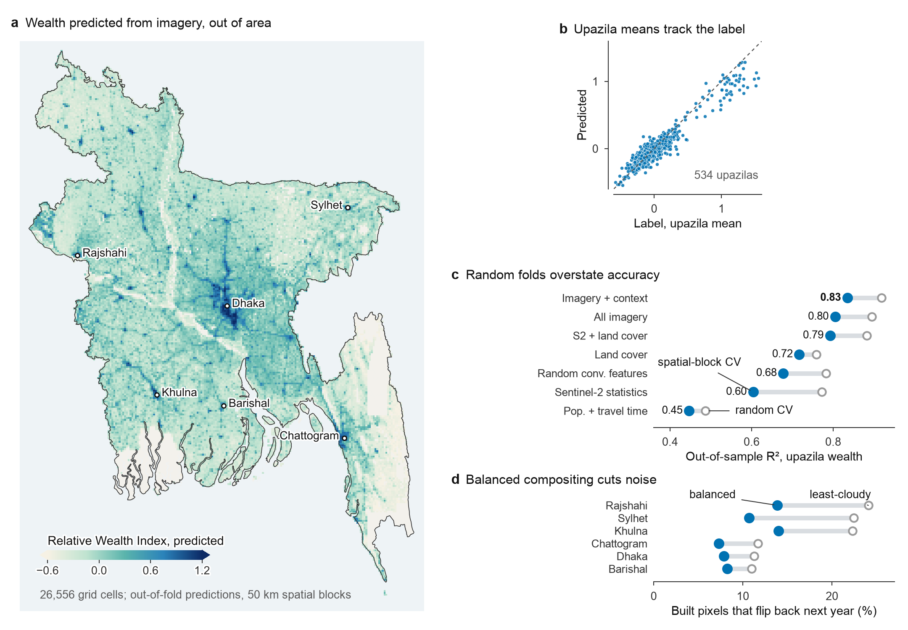
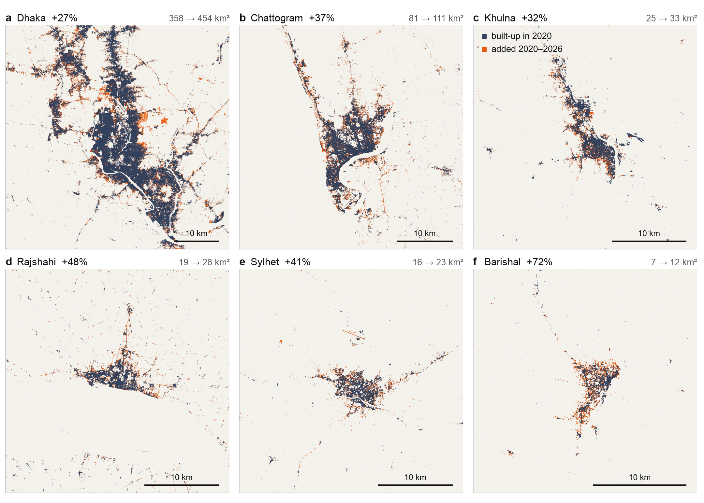

# Too early to see from space: open satellite data and the Padma Bridge

[](https://github.com/lyz44git/bangladesh-geoai/actions/workflows/tests.yml)

**Summary.** Four years after the Padma Bridge opened, satellite imagery shows no detectable effect of the bridge on
built-up land. This study shows why that finding says little about the bridge. A spatial equilibrium model calibrated on
the same data implies an effect of under half a 30 m pixel in a typical 1.2 km cell, and the evaluation design could
only have detected an effect two to four times larger (power of 8–23%). The imagery is not the weak link: it maps
built-up land with F1 = 0.80, registers growth of 27–72% in the six largest cities, and predicts sub-district wealth
out of area with R² = 0.83. The model puts the national welfare gain from the bridge at +0.47%, three-quarters of it
going to the 19% of the population in the upazilas where travel time to Dhaka fell by about 10% or more.


**Figure 1 | From measurement to evaluation.** **a**, Measurement: out-of-sample R² for upazila wealth by feature
set under 50 km spatial-block (filled) and random (open) cross-validation. **b**, Description: growth in built-up
area in the six largest cities, 2020–2026, split by where the new building is. **c**, Evaluation: event-study
estimates of the bridge's effect on built-up share across 34,626 cells with 95% intervals (shaded), 2022 as
reference; the negative naive estimates vanish once trends by baseline density are controlled. **d**,
Interpretation: short-run real income change implied by the spatial equilibrium model, by upazila (square: the
bridge); inset, the same change against the reduction in travel time to Dhaka. Drawn by
[`figures/make_figure1.py`](figures/make_figure1.py) from the committed result tables and the GADM 4.1 boundaries,
which are not stored here.

Technical report: [`docs/TECHNICAL_REPORT_EN.md`](docs/TECHNICAL_REPORT_EN.md) · Indicator atlas for 544 upazilas:
[`docs/atlas/ATLAS.md`](docs/atlas/ATLAS.md)

## Research question and design

The Padma Bridge, a 6.15 km road-rail bridge opened on 25 June 2022, replaced ferry crossings that often involved
hours of queuing and connected the southwestern divisions to Dhaka. Ex-ante appraisals projected national GDP gains
above 1%. Household surveys that could test this projection become available only years later, whereas satellite
imagery is free, annual and covers every upazila.

The study asks whether such imagery can support an early evaluation. It proceeds as a measurement study would:
validate the instrument, confirm that it registers change where change is expected, apply it to the bridge, and then
ask whether the test could have detected the effect a model predicts.

| Step | Question | Approach | Answer |
|---|---|---|---|
| 1. Measure | Is the instrument accurate? | U-Net trained on WorldCover labels; wealth prediction under 50 km spatial-block cross-validation | Yes, for city monitoring and upazila-level targeting |
| 2. Describe | Does it register change where rapid change is expected? | Built-up area in the six largest cities, 2020–2026 | Yes: growth of 27–72%, mostly at the urban edge |
| 3. Evaluate | Does it register a change where the bridge shortened travel? | Continuous-treatment difference-in-differences and event study, 34,626 cells × 7 seasons | No detectable effect once selection on trends is removed |
| 4. Interpret | Could it have? | Two-sector spatial equilibrium model of 544 upazilas; minimum detectable effect and power of the design | No: the design detects only effects 2–4 times the model's prediction; the model implies a welfare gain of +0.47% |

## 1. Measurement: accuracy is sufficient for monitoring and targeting

Built-up maps are accurate at city scale and stable from year to year once compositing removes seasonal variation,
and imagery predicts upazila wealth in areas the model has not seen.

| Built-up classifier, six cities pooled (spatially held-out blocks) | Precision | Recall | F1 |
|---|---|---|---|
| U-Net | 0.86 | 0.75 | 0.80 |
| Gradient boosting, default threshold | 0.52 | 0.96 | 0.67 |

| Wealth prediction (Meta Relative Wealth Index) | R², grid cells | R², upazila means |
|---|---|---|
| Spatial blocks (50 km) | 0.45 | 0.83 |
| Random folds | 0.50 | 0.92 |

- **Stability over time depends on compositing more than on the classifier.** Relative to least-cloudy compositing,
  the phenology-balanced design lowers the year-to-year reversal rate by 25–52% and the trend-residual standard
  deviation by 29–75% across the six cities. Without it, seasonal variation would register as urban change and
  contaminate the event study in step 3.
- **Accuracy declines where settlement is sparse.** In the rural Padma region (1.3% built-up), the U-Net reaches
  F1 = 0.66 (precision 0.79, recall 0.56).
- **Random cross-validation overstates wealth accuracy.** The spatial-block figures are the ones that apply to areas
  without labels. In the best imagery model, built-up land cover alone accounts for 31% of the gain, so the wealth map
  is to a large extent a map of the built environment.

The wealth index also sets relative wages in the spatial model of step 4. The imagery model shows that this input can
be largely reproduced from imagery out of area.



## 2. Description: cities grew 27–72%, mostly at the edge

Applied to the six largest cities, where rapid growth is expected, the same pipeline registers growth of 27–72% in six
years. The cities serve as a positive control for step 3: the instrument does register change where change is large.

| City | Built-up growth, 2020–2026 | Share of new built-up land at the edge |
|---|---|---|
| Dhaka | +27% | 58% |
| Chattogram | +37% | 57% |
| Khulna | +32% | 50% |
| Rajshahi | +48% | 64% |
| Sylhet | +41% | 55% |
| Barishal | +72% | 61% |

Edge expansion accounts for 50–64% of new built-up land, and radial density gradients flatten in every city with a
measurable gradient. In Dhaka and Chattogram the largest additions lie 4–7 km from the center.

The contrast with the bridge corridor matters for what follows. Built-up area in the six cities grows by 4.0–9.5% a
year from a large base. The rural areas the bridge reaches start from 0.37% built-up, so even a large proportional
response adds very little built-up land in absolute terms.




## 3. Evaluation: no detectable effect of the bridge on built-up land

In the four years after opening, areas whose trip to Dhaka became shorter did not add built-up land detectably faster
than comparable areas. Treatment is the modeled reduction in travel time to Dhaka (log points), which varies
continuously across 34,626 cells. The table gives the effect of a one-log-point reduction on built-up share, in
percentage points.

| Specification | Coefficient | 95% CI | Randomization p |
|---|---|---|---|
| (1) Cell and year fixed effects | −0.339 | −0.58 to −0.10 | 0.008 |
| (2) + year × baseline-built bin, distance, water | 0.060 | −0.03 to 0.15 | 0.92 |
| (3) + division × year fixed effects | −0.002 | −0.13 to 0.12 | 0.98 |
| (2) with district clusters | 0.060 | −0.11 to 0.23 | |

- **The negative naive estimate reflects selection on trends.** Treated areas are far more rural (0.37% built-up before
  opening against 2.22%) and add fewer percentage points each year. Once trends are allowed to differ by baseline
  density, the pre-trends disappear and the estimate is a null.
- **The null is robust** to ferry speed, the outcome definition, and dropping cells near the bridge or near Dhaka. A
  binary-treatment version of (2) is positive (0.097, CI 0.03 to 0.17) but does not survive district clustering or
  randomization inference.

A null has two possible readings: the bridge did not change where building happens, or it did and the change is too
small for this design to detect. Step 4 uses a spatial model to tell them apart.


## 4. Interpretation: the effect is too small to detect, and the model implies a gain of +0.47%

A spatial model predicts an effect on built-up land of almost exactly the size estimated, and that effect is far below
what the design can detect. The null is therefore uninformative about the bridge.

- **What the model predicts.** At full long-run adjustment the model implies a coefficient of 0.059, almost exactly the
  point estimate of 0.060. For a typical treated cell this is 0.026 percentage points of built-up share: about 0.4 of
  one 30 m pixel in a cell of 1,600 pixels, of which about 6 were built-up before the bridge.
- **What the design can detect.** With 80% power the design detects a coefficient of 0.13 with upazila clustering and
  0.25 with district clustering, 2.3 and 4.2 times the model's prediction. Against the prediction itself, power is
  17–23% and 8–10%.
- **Welfare.** National welfare rises by 0.47% at the main parameters (0.30–0.79% across the parameter grid). Omitting
  the local non-traded sector raises the gain to 0.79%, about 70% higher.
- **Who gains.** The 19% of the population in treated upazilas receives 75% of the total gain: real income rises 1.9%
  there and 0.15% elsewhere. The gains do not favor the poor. By wealth fifth of the population, real income rises
  0.27% in the poorest fifth, 0.58–0.61% in the third and fourth, and 0.43% in the richest. Upazilas holding 29% of
  the population lose slightly through trade diversion (−0.16% on average), most of them in Rajshahi and Rangpur, and
  61% of the poorest fifth lives in them.


## Takeaways

### What the study shows

1. **Measurement works.** Free imagery maps built-up land (F1 = 0.80) and upazila wealth (out-of-area R² = 0.83)
   accurately enough for annual city monitoring and for allocating resources across upazilas.
2. **Early evaluation does not, yet.** In the bridge corridor the expected effect is under half a pixel per cell, and
   the design detects only effects two to four times larger. The null is a statement about the design, not about the
   bridge.
3. **The model's answer is a modest and uneven gain.** National welfare rises by 0.47%. Three-quarters of the gain goes
   to the 19% of the population nearest the bridge, and upazilas holding 29% of the population lose slightly.

### What the usual shortcuts would have concluded

Each row is a common default, the conclusion it produces on these data, and the result once the default is replaced.

| Common default | What it would have concluded | What the study finds instead |
|---|---|---|
| Pixel classifier at its default threshold | 13.2% of the six cities is built-up, where the reference is 7.2% | 6.2% with the U-Net (F1 0.80 against 0.67) |
| Least-cloudy scene selection | 11–24% of built-up pixels revert to non-built the next year, noise that reads as urban change | 7–14% with phenology-balanced compositing |
| Random cross-validation of the wealth map | Upazila R² of 0.92 | 0.83 under 50 km spatial blocks, the figure that applies to areas without labels |
| Two-way fixed-effects difference-in-differences | The bridge reduced built-up growth (−0.34, randomization p = 0.008) | Selection on trends: 0.06 (CI −0.03 to 0.15) once trends by baseline density are controlled |
| Reading the null as "no effect" | The bridge did not change land use | The design detects only effects 2.3–4.2 times the model's prediction (power of 8–23%) |
| One-sector trade model | A welfare gain of 0.79% | 0.47% once a local non-traded sector is included |

### What this adds to conventional measurement and evaluation

- **Coverage and frequency.** Censuses arrive once a decade and household surveys every few years, and neither is
  designed to give annual figures for 544 upazilas. The imagery gives an annual built-up series at 20–30 m and a wealth
  estimate for every upazila, from free inputs.
- **A null that can be interpreted.** A reduced-form evaluation alone would report "no effect". A structural model
  alone would report a welfare gain that nothing tests. Putting both on the same outcome gives the effect size the test
  should be held to, and shows that this design cannot detect it.
- **Incidence.** The model reports gains and losses for each of 544 upazilas, which an aggregate appraisal does not.
- **Speed and reuse.** Each counterfactual solves in 0.03 seconds and the travel-time matrices for six network
  scenarios take about eight minutes, so another corridor can be appraised by editing the network and the study area.

It does not replace surveys. Imagery measures the built environment, not consumption: the wealth labels are themselves
model-based, accuracy for individual grid cells is low (R² = 0.45), and vertical growth is invisible at this
resolution. The model is calibrated, not estimated, and the evaluation was too imprecise to discipline it: reweighting
600 parameter draws by the estimate left them essentially unchanged (effective sample size 597).

### Where the approach applies

1. **Monitoring between censuses.** Annual built-up series for cities, provided scenes are composited by season and
   temporal-consistency diagnostics are reported alongside.
2. **Geographic targeting.** Ranking upazilas for the allocation of resources, validated with spatial blocks. The maps
   are not accurate enough to target villages or households.
3. **Planning an evaluation before the data arrive.** The expected effect from a calibrated model and the minimum
   detectable effect of the design can be computed in advance. Here that calculation shows that four years of built-up
   imagery could not have settled the question.
4. **Appraising other corridors,** with gains and losses reported by region and a non-traded sector included.

The same sequence applies wherever an outcome is measured with a learned proxy and treatment is assigned by place:
validate the proxy on held-out areas, check that it is stable over time, confirm that it registers a change of known
size, and compute the minimum detectable effect before interpreting a null.

### What would make the effect visible

- **A more precise estimate.** 80% power needs a standard error of about 0.021, against 0.048 with upazila clustering
  and 0.089 with district clustering.
- **An outcome with more signal.** Building footprints, night-time lights or land prices may respond more strongly
  than built-up share at 30 m.
- **Time and a second shock.** Adjustment accumulates, and the Padma rail link (2023–24) adds a second change in
  access. A re-evaluation after 2028 is the natural next step.

## Limitations

- Wealth labels are model-based gridded layers, not household survey microdata.
- The 2018–2019 Sentinel-2 archive comes from a different processing baseline and cannot extend the pre-period; a
  placebo opening in 2020 fails for that measurement reason.
- Treatment varies smoothly over space, and the Dhaka–Mawa–Bhanga expressway (2020) and the Padma rail link
  (2023–24) cannot be separated from the bridge.
- The spatial model is static, covers goods trade only and is calibrated, not estimated; its welfare numbers exclude
  passenger time savings and commuting.

## Code map

| Step | Module | Code | What it does |
|---|---|---|---|
| 1 | Compositing | `src/geoai/stac.py`, `composite.py` | Phenology-balanced dry-season composites with orbit-aware scene selection and gap filling |
| 1 | Built-up mapping | `builtup.py`, `labels.py`, `scripts/02_builtup.py` | U-Net and gradient-boosting classifiers trained on WorldCover labels, validated on spatially held-out blocks |
| 1 | Wealth mapping | `features.py`, `mosaiks.py`, `models.py`, `scripts/05_wealth.py` | Predicting the Relative Wealth Index from imagery under 50 km spatial-block cross-validation |
| 2 | Urban expansion | `scripts/03_urban_expansion.py` | Growth, infill / edge / outlying decomposition, radial density gradients, temporal-consistency diagnostics |
| 3 | Travel time | `travel.py`, `scripts/04_travel_time.py` | 500 m least-cost travel time to Dhaka with and without the bridge |
| 3 | Causal design | `econ.py`, `scripts/06_padma_causal.py` | Continuous-treatment difference-in-differences and event study, with randomization inference |
| 4 | Spatial model | `qse.py`, `scripts/07_spatial_model.py` | Two-sector quantitative spatial equilibrium for 544 upazilas, solved by exact hat algebra; sensitivity and Bayesian reweighting |
| 4 | Power and incidence | `scripts/09_power.py`, `scripts/10_incidence.py` | Power and minimum detectable effect of the causal design against the model-implied effect; gains by wealth fifth, by treatment status and by sign |
| | Atlas and figures | `scripts/08_atlas.py`, `figures/` | Upazila indicator atlas; the figures in this README and the report |

## Reproduction

```bash
python -m venv .venv && source .venv/bin/activate
pip install -e ".[dev]"            # add ".[dl]" for the U-Net (PyTorch)

python scripts/00_fetch_overture.py                           # transport network
python scripts/01_build_composites.py cities|padma|national   # Sentinel-2 composites
python scripts/02_builtup.py labels|cities|calibrate-gbm|padma
python scripts/03_urban_expansion.py
python scripts/04_travel_time.py
python scripts/05_wealth.py
python scripts/06_padma_causal.py
python scripts/07_spatial_model.py times                      # travel-time matrices with and without the bridge
python scripts/07_spatial_model.py model                      # calibration, counterfactuals, Bayesian reweighting
python scripts/08_atlas.py
python scripts/09_power.py                                    # reads committed tables only
python scripts/10_incidence.py                                # reads committed tables only
```

The pipeline runs on a four-CPU machine without a GPU. Raw data and intermediate rasters go to a git-ignored `data/`
folder; result tables and figures are in `outputs/`.

The figures in this README, the report and the atlas are drawn by `python figures/make_figure1.py` and
`python figures/make_report_figures.py`. Both need the GADM level-3 boundary file; the second also reads the pipeline
rasters in `data/` for the wealth, travel-time and city maps, and falls back to upazila-level maps without them.

**Reproduction check.** The pipeline was re-run from the raw data on a separate machine on 16 November 2026 for the six
cities, the national composite and the wealth study (steps 1–2 and the travel-time model; the Padma-region composites
and the causal and model steps were not re-run). Classifier scores reproduced within 0.005 and the headline wealth R²
within 0.003; across all feature sets the largest change was +0.05 (Sentinel-2 statistics alone). City growth
reproduced within 2.0 percentage points. The published tables are unchanged. The re-run also identified two issues, now
fixed or documented:

- `01_build_composites.py` now calls the orbit-aware gap filling (`composite.fill_gaps`) after each composite. Without
  it, eastern Khulna had no clear observation in 2026 and its built-up area was understated by more than half.
- On macOS, LightGBM, PyTorch and scikit-learn can load three different OpenMP runtimes, and U-Net training then hangs
  at the first epoch. Linking all three to one runtime (for example PyTorch's `libomp.dylib`) avoids it; Linux is not
  affected.

## Tests

```bash
pytest -q
```

19 offline unit tests cover the grid, compositing, labels, features, models, the fixed-effects estimators, the power
calculations and the equilibrium solver (one needs PyTorch and is skipped without it). They run on every push.

## Data and licenses

All inputs are openly available. No data are stored in this repository; the scripts stream or download them.

| Source | Use | License |
|---|---|---|
| Sentinel-2 L2A (ESA/Copernicus), via AWS Open Data and the Earth Search STAC API | Annual dry-season composites, 2018–2026 | Copernicus Sentinel data terms (free use with attribution) |
| ESA WorldCover 2020 and 2021, 10 m | Built-up training labels, land-cover shares, water mask | CC BY 4.0 |
| Meta Relative Wealth Index (Chi et al. 2022), via HDX | Wealth-mapping target (26,544 grid points) | CC BY-NC 4.0 |
| Flowminder/WorldPop Bangladesh 1 km poverty map (2011) | Alternative target and external benchmark | CC BY 4.0 |
| Meta/CIESIN High Resolution Settlement Layer | Population by cell and upazila | CC BY 4.0 |
| Overture Maps transportation | Road, rail and ferry network for the travel-time model | ODbL 1.0 |
| GADM 4.1 | Districts and upazilas | Free for academic and non-commercial use; no redistribution |

Attribution: contains modified Copernicus Sentinel data (2018–2026); © ESA WorldCover project / contains modified
Copernicus Sentinel data (2020, 2021) processed by the ESA WorldCover consortium; © OpenStreetMap contributors,
Overture Maps Foundation.

No boundary files or source rasters are redistributed here. Tables, maps and the atlas in `outputs/` and `docs/` are
derived aggregates; those that include the Relative Wealth Index inherit its non-commercial terms, and the maps use
GADM boundaries under its academic-use terms.

**Use.** This is a non-commercial research project. The data and all derived outputs in this repository are used
for research only.

## License

Code is released under the MIT License (see `LICENSE`). The datasets and the derived outputs keep the terms listed
under Data and licenses.

## Notes

Developed with an AI-assisted coding workflow. The research questions, analysis plans and interpretation of results
were led by the author. Three material errors caught by the verification protocol (observation-level binning, an
overview-based population raster and an orbit-coverage gap) are documented in the technical report.
