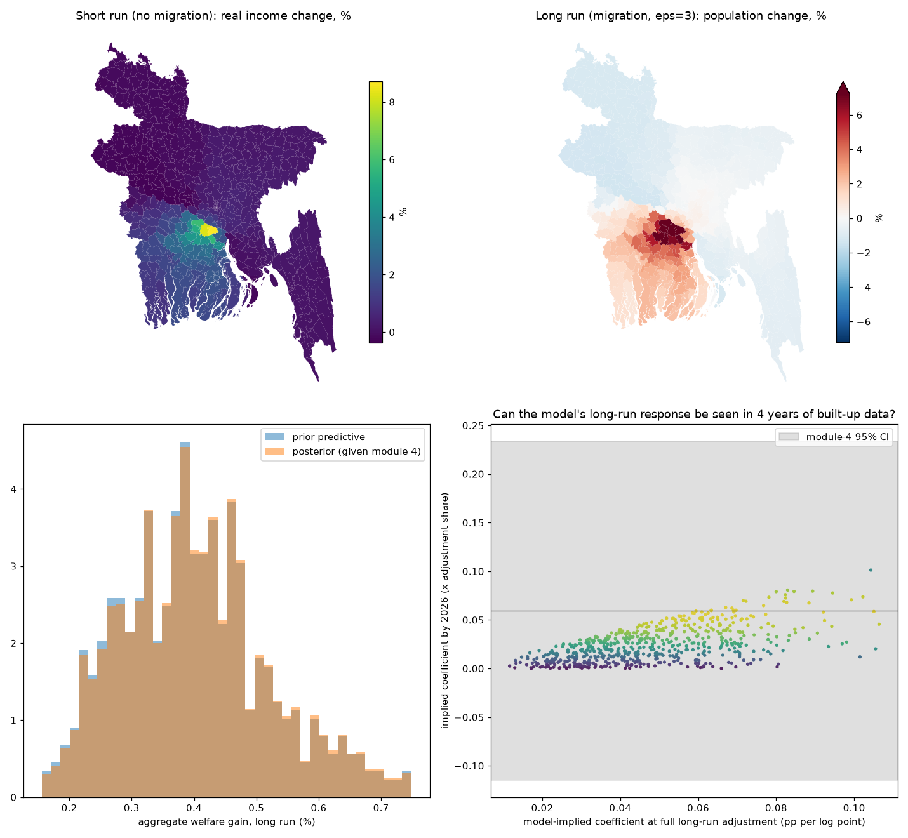

# Urban growth, wealth mapping and the Padma Bridge in Bangladesh

[](https://github.com/lyz44git/bangladesh-geoai/actions/workflows/tests.yml)

A Python package and pipeline that uses open satellite and geospatial data to measure urban expansion, map
sub-district wealth, and evaluate the Padma Bridge (opened 25 June 2022) with a difference-in-differences design and
a quantitative spatial equilibrium model.

> **Takeaway.** Free Sentinel-2 imagery measures built-up land well enough for city-level monitoring (F1 = 0.80) and
> for allocating resources across sub-districts (out-of-area R² = 0.83), but four years of built-up imagery cannot
> detect the bridge's effect: the estimate is a null with 8–23% power against the effect a calibrated spatial model
> implies. The model puts the national welfare gain at +0.47%, concentrated in the south-west.

Full write-up: [`docs/TECHNICAL_REPORT_EN.md`](docs/TECHNICAL_REPORT_EN.md). Indicator atlas for 544 upazilas:
[`docs/atlas/ATLAS.md`](docs/atlas/ATLAS.md) and [`docs/atlas/upazila_indicators.csv`](docs/atlas/upazila_indicators.csv).

## Questions

1. **Measurement.** Can open satellite imagery measure urban growth and local wealth reliably, year by year, at
   sub-district (upazila) level?
2. **Spatial structure.** Are Bangladesh's largest cities growing by densification or by expansion at the edge?
3. **Market access.** Did the Padma Bridge change where building happens in its first four years, how large are the
   welfare gains a spatial model implies, and does the short-run evidence contradict the model?

## Data

All inputs are openly available. No data are stored in this repository; the scripts stream or download them.

| Source | Use | Licence |
|---|---|---|
| Sentinel-2 L2A (ESA/Copernicus), via AWS Open Data and the Earth Search STAC API | Annual dry-season composites, 2018–2026 | Copernicus Sentinel data terms (free use with attribution) |
| ESA WorldCover 2020 and 2021, 10 m | Built-up training labels, land-cover shares, water mask | CC BY 4.0 |
| Meta Relative Wealth Index (Chi et al. 2022), via HDX | Wealth-mapping target (26,544 grid points) | CC BY-NC 4.0 |
| Flowminder/WorldPop Bangladesh 1 km poverty map (2011) | Alternative target and external benchmark | CC BY 4.0 |
| Meta/CIESIN High Resolution Settlement Layer | Population by cell and upazila | CC BY 4.0 |
| Overture Maps transportation | Road, rail and ferry network for the travel-time model | ODbL 1.0 |
| GADM 4.1 | Districts and upazilas | Free for academic and non-commercial use; no redistribution |

Attribution: contains modified Copernicus Sentinel data (2018–2026); © ESA WorldCover project / contains modified
Copernicus Sentinel data (2020, 2021) processed by the ESA WorldCover consortium; © OpenStreetMap contributors,
Overture Maps Foundation.

No boundary files or source rasters are redistributed here. Tables, maps and the atlas in `outputs/` and `docs/` are
derived aggregates; those that include the Relative Wealth Index inherit its non-commercial terms, and the maps use
GADM boundaries under its academic-use terms.

## Method

| Module | Code | What it does |
|---|---|---|
| Compositing | `src/geoai/stac.py`, `composite.py` | Phenology-balanced dry-season composites with orbit-aware scene selection and gap filling |
| Built-up mapping | `builtup.py`, `labels.py`, `scripts/02_builtup.py` | U-Net and gradient-boosting classifiers trained on WorldCover labels, validated on spatially held-out blocks |
| Urban expansion | `scripts/03_urban_expansion.py` | Growth, infill / edge / outlying decomposition, radial density gradients, temporal-consistency diagnostics |
| Wealth mapping | `features.py`, `mosaiks.py`, `models.py`, `scripts/05_wealth.py` | Predicting the Relative Wealth Index from imagery under 50 km spatial-block cross-validation |
| Travel time | `travel.py`, `scripts/04_travel_time.py` | 500 m least-cost travel time to Dhaka with and without the bridge |
| Causal design | `econ.py`, `scripts/06_padma_causal.py` | Continuous-treatment difference-in-differences and event study on 34,626 cells × 7 seasons, with randomization inference |
| Spatial model | `qse.py`, `scripts/07_spatial_model.py` | Two-sector quantitative spatial equilibrium for 544 upazilas, solved by exact hat algebra; sensitivity and Bayesian reweighting |
| Power | `scripts/09_power.py` | Power of the causal design against the model-implied effect |

## Results

### Measurement

| Built-up classifier, six cities pooled (held-out blocks) | Precision | Recall | F1 |
|---|---|---|---|
| U-Net | 0.86 | 0.75 | 0.80 |
| Gradient boosting, default threshold | 0.52 | 0.96 | 0.67 |

In the rural Padma region the U-Net reaches F1 = 0.66 (precision 0.79, recall 0.56). Compared with least-cloudy
compositing, the phenology-balanced design lowers the year-to-year reversal rate by 25–52% and the trend-residual
standard deviation by 29–75% across the six cities, noise that would otherwise be read as urban change.

### Urban expansion, 2020–2026

| City | Built-up growth | Share of new built-up land at the edge |
|---|---|---|
| Dhaka | +27% | 58% |
| Chattogram | +37% | 57% |
| Khulna | +32% | 50% |
| Rajshahi | +48% | 64% |
| Sylhet | +41% | 55% |
| Barishal | +72% | 61% |

Growth is mostly edge expansion, and radial density gradients flatten in every city with a measurable gradient.


### Wealth mapping

| Validation | R², grid cells | R², upazila means |
|---|---|---|
| Spatial blocks (50 km) | 0.45 | 0.83 |
| Random folds | 0.50 | 0.92 |

Random cross-validation overstates accuracy; the spatial-block figures are the ones to use for out-of-area
prediction. Most of the predictive power comes from the built environment.


### The Padma Bridge: causal evidence

Effect of a one-log-point reduction in travel time to Dhaka on built-up share (percentage points):

| Specification | Coefficient | 95% CI | Randomization p |
|---|---|---|---|
| (1) Cell and year fixed effects | −0.339 | −0.58 to −0.10 | 0.008 |
| (2) + year × baseline-built bin, distance, water | 0.060 | −0.03 to 0.15 | 0.92 |
| (3) + division × year fixed effects | −0.002 | −0.13 to 0.12 | 0.98 |
| (2) with district clusters | 0.060 | −0.11 to 0.23 | |

The negative estimate in (1) is selection on trends: treated areas are far more rural (0.37% built-up before opening
against 2.22%) and add fewer percentage points each year. Once baseline-density-specific trends are controlled, the
pre-trends disappear and the effect is a null. A binary-treatment version of (2) is positive (0.097, CI 0.03 to 0.17)
but does not survive district clustering or randomization inference.


### Structural incidence and power

- National welfare gain +0.47% at the main parameters; 0.30–0.79% across the parameter grid, and 0.30–0.55% with the
  non-traded share held at its main value.
- Real income rises 1.9% in treated upazilas and 0.15% elsewhere; Rajshahi and Rangpur lose slightly through trade
  diversion.
- Omitting the local non-traded sector raises the estimated gain to 0.79%, about 70% higher.
- At full long-run adjustment the model implies a built-up coefficient of 0.059, almost exactly the empirical point
  estimate. Against that effect the causal design has 8–10% power with district clustering and 17–23% with upazila
  clustering, so the null is uninformative about welfare.



## Reproduce

```bash
python -m venv .venv && source .venv/bin/activate
pip install -e ".[dev]"            # add ".[dl]" for the U-Net (PyTorch)

python scripts/00_fetch_overture.py                           # transport network
python scripts/01_build_composites.py cities|padma|national   # Sentinel-2 composites
python scripts/02_builtup.py labels|cities|calibrate-gbm|padma
python scripts/03_urban_expansion.py
python scripts/04_travel_time.py
python scripts/05_wealth.py
python scripts/06_padma_causal.py
python scripts/07_spatial_model.py times                      # travel-time matrices with and without the bridge
python scripts/07_spatial_model.py model                      # calibration, counterfactuals, Bayesian reweighting
python scripts/08_atlas.py
python scripts/09_power.py                                    # reads committed tables only
```

The pipeline runs on a four-CPU machine without a GPU. Raw data and intermediate rasters go to a git-ignored `data/`
folder; result tables and figures are in `outputs/`.

## Tests

```bash
pytest -q
```

17 offline unit tests cover the grid, compositing, labels, features, models, the fixed-effects estimators and the
equilibrium solver (one needs PyTorch and is skipped without it). They run on every push.

## Scope

- Wealth labels are model-based gridded layers, not household survey microdata.
- The 2018–2019 Sentinel-2 archive comes from a different processing baseline and cannot extend the pre-period; a
  placebo opening in 2020 fails for that measurement reason.
- Treatment varies smoothly over space, and the Dhaka–Mawa–Bhanga expressway (2020) and the Padma rail link
  (2023–24) cannot be separated from the bridge.
- The spatial model is static, covers goods trade only and is calibrated, not estimated; its welfare numbers are a
  lower bound that excludes passenger time savings and commuting.

## Licence

Code is released under the MIT licence (see `LICENSE`). The datasets and the derived outputs keep the terms listed
under Data.

## Notes

Developed with an AI-assisted coding workflow. The research questions, analysis plans and interpretation of results
were led by the author. Three material errors caught by the verification protocol (observation-level binning, an
overview-based population raster and an orbit-coverage gap) are documented in the technical report.
