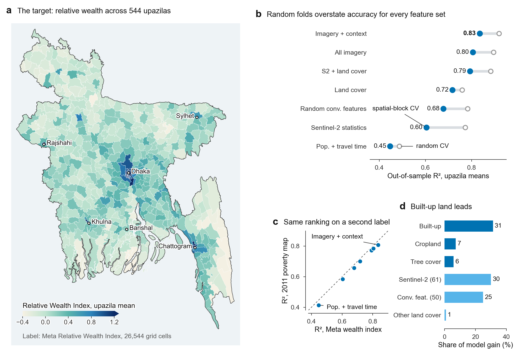
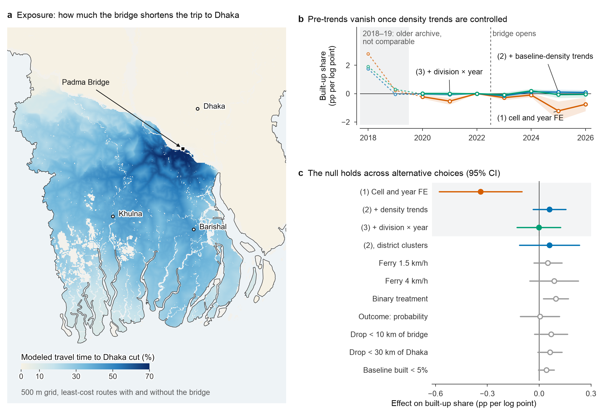

# Can open satellite data evaluate a major transport investment? The Padma Bridge, Bangladesh

[](https://github.com/lyz44git/bangladesh-geoai/actions/workflows/tests.yml)

**Short answer: it can measure, but four years in it cannot yet evaluate.** Free Sentinel-2 imagery measures built-up
land well enough for city monitoring (F1 = 0.80) and predicts sub-district wealth well enough for geographic targeting
(out-of-area R² = 0.83). Four years after the Padma Bridge opened, the same imagery shows no detectable change in
built-up land. A calibrated spatial model explains why: the effect it predicts is one the evaluation design has only
8–23% power to detect. The model puts the national welfare gain at +0.47%, concentrated in the south-west.


**Figure 1 | From measurement to evaluation.** **a**, Measurement: out-of-sample R² for upazila wealth by feature
set under 50 km spatial-block (filled) and random (open) cross-validation. **b**, Description: growth in built-up
area in the six largest cities, 2020–2026, split by where the new building is. **c**, Evaluation: event-study
estimates of the bridge's effect on built-up share across 34,626 cells with 95% intervals (shaded), 2022 as
reference; the negative naive estimates vanish once trends by baseline density are controlled. **d**,
Interpretation: short-run real income change implied by the spatial equilibrium model, by upazila (square: the
bridge); inset, the same change against the reduction in travel time to Dhaka. Drawn by
[`figures/make_figure1.py`](figures/make_figure1.py) from the committed result tables and the GADM 4.1 boundaries,
which are not stored here.

Full write-up: [`docs/TECHNICAL_REPORT_EN.md`](docs/TECHNICAL_REPORT_EN.md) · Indicator atlas for 544 upazilas:
[`docs/atlas/ATLAS.md`](docs/atlas/ATLAS.md)

## The question

The Padma Bridge, a 6.15 km road-rail bridge opened on 25 June 2022, replaced ferry crossings that often involved
hours of queueing and connected the south-western divisions to Dhaka. Ex-ante appraisals projected national GDP gains
above 1%. Household surveys that could check this arrive years later; satellite imagery is free, annual and covers
every upazila. The study asks whether that imagery can support an early evaluation, in four steps, each a
precondition for the next:

| Step | Question | Approach | Answer |
|---|---|---|---|
| 1. Measure | Is imagery accurate enough for annual measures of built-up land and wealth? | U-Net trained on WorldCover labels; wealth prediction under 50 km spatial-block cross-validation | Yes, for city monitoring and upazila-level targeting |
| 2. Describe | What does it show where change is large? | Built-up area in the six largest cities, 2020–2026 | Growth of 27–72%, mostly at the urban edge |
| 3. Evaluate | Did the bridge change where building happens? | Continuous-treatment difference-in-differences and event study, 34,626 cells × 7 seasons | No detectable effect once selection on trends is removed |
| 4. Interpret | Is the null evidence that the bridge had no effect? | Two-sector spatial equilibrium model of 544 upazilas; power of the design against the model's prediction | No: 8–23% power; the model implies a welfare gain of +0.47% |

## 1. Measurement is accurate enough for monitoring and targeting

| Built-up classifier, six cities pooled (spatially held-out blocks) | Precision | Recall | F1 |
|---|---|---|---|
| U-Net | 0.86 | 0.75 | 0.80 |
| Gradient boosting, default threshold | 0.52 | 0.96 | 0.67 |

| Wealth prediction (Meta Relative Wealth Index) | R², grid cells | R², upazila means |
|---|---|---|
| Spatial blocks (50 km) | 0.45 | 0.83 |
| Random folds | 0.50 | 0.92 |

- **Compositing matters more than the classifier for change over time.** Compared with least-cloudy compositing, the
  phenology-balanced design lowers the year-to-year reversal rate by 25–52% and the trend-residual standard deviation
  by 29–75% across the six cities. Without it, seasonal noise would be read as urban change and would contaminate the
  event study in step 3.
- **Accuracy falls where settlement is sparse.** In the rural Padma region (1.3% built-up) the U-Net reaches F1 = 0.66
  (precision 0.79, recall 0.56).
- **Random cross-validation overstates wealth accuracy**; the spatial-block figures are the ones that apply to
  out-of-area prediction. In the best imagery model, built-up land cover alone accounts for 31% of the gain.

The wealth index also sets relative wages in the spatial model of step 4; the imagery model shows that this input
can be largely reproduced from imagery out of area.



## 2. Where change is large, cities grow at the edge

| City | Built-up growth, 2020–2026 | Share of new built-up land at the edge |
|---|---|---|
| Dhaka | +27% | 58% |
| Chattogram | +37% | 57% |
| Khulna | +32% | 50% |
| Rajshahi | +48% | 64% |
| Sylhet | +41% | 55% |
| Barishal | +72% | 61% |

Edge expansion accounts for 50–64% of new built-up land, and radial density gradients flatten in every city with a
measurable gradient. The cities add 4.0–9.5% to their built-up area each year. The rural areas the bridge reaches
start from 0.37% built-up, so any bridge effect on built-up land is small in absolute terms, a fact that matters in
step 4.


## 3. The bridge: no detectable effect on built-up land

Treatment is the modelled reduction in travel time to Dhaka (log points), which varies continuously across 34,626
cells. Effect of a one-log-point reduction on built-up share (percentage points):

| Specification | Coefficient | 95% CI | Randomization p |
|---|---|---|---|
| (1) Cell and year fixed effects | −0.339 | −0.58 to −0.10 | 0.008 |
| (2) + year × baseline-built bin, distance, water | 0.060 | −0.03 to 0.15 | 0.92 |
| (3) + division × year fixed effects | −0.002 | −0.13 to 0.12 | 0.98 |
| (2) with district clusters | 0.060 | −0.11 to 0.23 | |

- **The naive negative estimate is selection on trends.** Treated areas are far more rural (0.37% built-up before
  opening against 2.22%) and add fewer percentage points each year. Controlling for trends by baseline density removes
  the pre-trends, and the estimate becomes a null.
- **The null is robust** to ferry speed, the outcome definition, and dropping cells near the bridge or near Dhaka. A
  binary-treatment version of (2) is positive (0.097, CI 0.03 to 0.17) but does not survive district clustering or
  randomization inference.

A null can mean that the bridge had no effect or that the test could not see one. Step 4 asks which.



## 4. The null is uninformative; the model implies a gain of +0.47%

- **The model's predicted effect sits inside the confidence interval.** At full long-run adjustment the model implies
  a built-up coefficient of 0.059, almost exactly the point estimate of 0.060.
- **The design cannot detect an effect of that size.** Its power is 8–10% with district clustering and 17–23% with
  upazila clustering; 80% power would need a standard error about one-fifth of the district-clustered one.
- **Welfare and incidence.** National welfare rises by 0.47% at the main parameters (0.30–0.79% across the parameter
  grid). Real income rises 1.9% in treated upazilas and 0.15% elsewhere; Rajshahi and Rangpur lose slightly through
  trade diversion.
- **The non-traded sector matters.** Omitting it raises the estimated gain to 0.79%, about 70% higher.


## Implications

1. **Targeting.** Satellite wealth maps are fit for allocating resources across upazilas, provided they are validated
   with spatial-block rather than random cross-validation.
2. **Monitoring.** Any satellite outcome used in a panel needs temporal-consistency diagnostics; the reliability of
   year-to-year change depends more on compositing than on the classifier.
3. **Early evaluation.** Three to four years of built-up imagery should not be read as a verdict on a transport
   investment. The expected effect size and the power of the design should be set out first, for example from a
   calibrated model.
4. **Appraisal.** Spatial models used for appraisal should include a non-traded sector and report gains and losses by
   region.

## Limitations

- Wealth labels are model-based gridded layers, not household survey microdata.
- The 2018–2019 Sentinel-2 archive comes from a different processing baseline and cannot extend the pre-period; a
  placebo opening in 2020 fails for that measurement reason.
- Treatment varies smoothly over space, and the Dhaka–Mawa–Bhanga expressway (2020) and the Padma rail link
  (2023–24) cannot be separated from the bridge.
- The spatial model is static, covers goods trade only and is calibrated, not estimated; its welfare numbers exclude
  passenger time savings and commuting.

## Code map

| Step | Module | Code | What it does |
|---|---|---|---|
| 1 | Compositing | `src/geoai/stac.py`, `composite.py` | Phenology-balanced dry-season composites with orbit-aware scene selection and gap filling |
| 1 | Built-up mapping | `builtup.py`, `labels.py`, `scripts/02_builtup.py` | U-Net and gradient-boosting classifiers trained on WorldCover labels, validated on spatially held-out blocks |
| 1 | Wealth mapping | `features.py`, `mosaiks.py`, `models.py`, `scripts/05_wealth.py` | Predicting the Relative Wealth Index from imagery under 50 km spatial-block cross-validation |
| 2 | Urban expansion | `scripts/03_urban_expansion.py` | Growth, infill / edge / outlying decomposition, radial density gradients, temporal-consistency diagnostics |
| 3 | Travel time | `travel.py`, `scripts/04_travel_time.py` | 500 m least-cost travel time to Dhaka with and without the bridge |
| 3 | Causal design | `econ.py`, `scripts/06_padma_causal.py` | Continuous-treatment difference-in-differences and event study, with randomization inference |
| 4 | Spatial model | `qse.py`, `scripts/07_spatial_model.py` | Two-sector quantitative spatial equilibrium for 544 upazilas, solved by exact hat algebra; sensitivity and Bayesian reweighting |
| 4 | Power | `scripts/09_power.py` | Power of the causal design against the model-implied effect |
| | Atlas and figures | `scripts/08_atlas.py`, `figures/` | Upazila indicator atlas; the figures in this README and the report |

## Reproduce

```bash
python -m venv .venv && source .venv/bin/activate
pip install -e ".[dev]"            # add ".[dl]" for the U-Net (PyTorch)

python scripts/00_fetch_overture.py                           # transport network
python scripts/01_build_composites.py cities|padma|national   # Sentinel-2 composites
python scripts/02_builtup.py labels|cities|calibrate-gbm|padma
python scripts/03_urban_expansion.py
python scripts/04_travel_time.py
python scripts/05_wealth.py
python scripts/06_padma_causal.py
python scripts/07_spatial_model.py times                      # travel-time matrices with and without the bridge
python scripts/07_spatial_model.py model                      # calibration, counterfactuals, Bayesian reweighting
python scripts/08_atlas.py
python scripts/09_power.py                                    # reads committed tables only
```

The pipeline runs on a four-CPU machine without a GPU. Raw data and intermediate rasters go to a git-ignored `data/`
folder; result tables and figures are in `outputs/`.

The figures in this README, the report and the atlas are drawn from the committed tables by
`python figures/make_figure1.py` and `python figures/make_report_figures.py`; both need the GADM level-3 boundary file.

## Tests

```bash
pytest -q
```

17 offline unit tests cover the grid, compositing, labels, features, models, the fixed-effects estimators and the
equilibrium solver (one needs PyTorch and is skipped without it). They run on every push.

## Data and licences

All inputs are openly available. No data are stored in this repository; the scripts stream or download them.

| Source | Use | Licence |
|---|---|---|
| Sentinel-2 L2A (ESA/Copernicus), via AWS Open Data and the Earth Search STAC API | Annual dry-season composites, 2018–2026 | Copernicus Sentinel data terms (free use with attribution) |
| ESA WorldCover 2020 and 2021, 10 m | Built-up training labels, land-cover shares, water mask | CC BY 4.0 |
| Meta Relative Wealth Index (Chi et al. 2022), via HDX | Wealth-mapping target (26,544 grid points) | CC BY-NC 4.0 |
| Flowminder/WorldPop Bangladesh 1 km poverty map (2011) | Alternative target and external benchmark | CC BY 4.0 |
| Meta/CIESIN High Resolution Settlement Layer | Population by cell and upazila | CC BY 4.0 |
| Overture Maps transportation | Road, rail and ferry network for the travel-time model | ODbL 1.0 |
| GADM 4.1 | Districts and upazilas | Free for academic and non-commercial use; no redistribution |

Attribution: contains modified Copernicus Sentinel data (2018–2026); © ESA WorldCover project / contains modified
Copernicus Sentinel data (2020, 2021) processed by the ESA WorldCover consortium; © OpenStreetMap contributors,
Overture Maps Foundation.

No boundary files or source rasters are redistributed here. Tables, maps and the atlas in `outputs/` and `docs/` are
derived aggregates; those that include the Relative Wealth Index inherit its non-commercial terms, and the maps use
GADM boundaries under its academic-use terms.

**Use.** This is a non-commercial research project. The data and all derived outputs in this repository are used
for research only.

## Licence

Code is released under the MIT licence (see `LICENSE`). The datasets and the derived outputs keep the terms listed
under Data and licences.

## Notes

Developed with an AI-assisted coding workflow. The research questions, analysis plans and interpretation of results
were led by the author. Three material errors caught by the verification protocol (observation-level binning, an
overview-based population raster and an orbit-coverage gap) are documented in the technical report.
