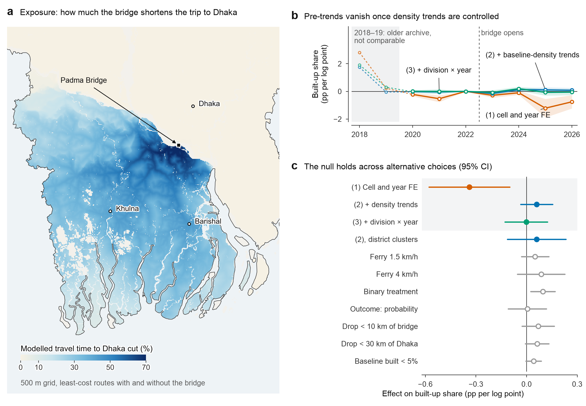

Independent research project · Code, data pipeline, tests and results are in this repository

## Abstract

This report uses open satellite and geospatial data to measure urban expansion, map sub-district wealth, and assess the distributional impact of the Padma Bridge (opened 25 June 2022) in Bangladesh. Annual dry-season Sentinel-2 composites (2018–2026) are classified into built-up land with a U-Net trained on ESA WorldCover labels (F1 = 0.80 on spatially held-out city blocks). A phenology-balanced compositing design roughly halves year-to-year measurement noise, which would otherwise masquerade as urban change. Built-up area in the six largest cities grew by 27% (Dhaka) to 72% (Barishal) between 2020 and 2026, mostly through edge expansion, with flattening density gradients. A machine-learning poverty map explains 45% of cell-level and 83% of upazila-level variation in the Meta Relative Wealth Index under 50 km spatial-block cross-validation, against 50% and 92% under random cross-validation. A continuous-treatment difference-in-differences design on 34,626 grid cells × 7 seasons finds no detectable effect of the bridge on built-up land within four years (0.060 percentage points per log point of travel-time reduction, 95% CI −0.03 to 0.15), after showing that the naive estimate (−0.34) reflects selection on baseline trends. A two-sector quantitative spatial equilibrium model of 544 upazilas, solved by exact hat algebra, puts the national welfare gain at +0.47% (0.30–0.79% across the parameter grid of Table 8; 0.30–0.55% with the non-traded share held at its main value), with real income +1.9% in beneficiary areas and small losses in Rajshahi and Rangpur through trade diversion; omitting the local non-traded sector overstates gains by about 70%. Bayesian reweighting shows the empirical design had only 8–23% power against the model-implied effect, so the null is uninformative about welfare. The accompanying atlas reports 16 indicators for all 544 upazilas.

## 1. Policy context and questions

Bangladesh is one of the fastest-urbanising and most densely populated countries in the world, yet official data on where people live, how cities grow, and who benefits from large public investments are sparse and slow to arrive. The Padma Bridge, a 6.15 km road-rail bridge opened on 25 June 2022, replaced ferry crossings that often involved hours of queueing and were suspended in the monsoon, and connected the south-western divisions to Dhaka. Ex-ante appraisals projected national GDP gains above 1% and regional gains above 2%.

The report asks three questions that sit at the intersection of development and urban economics:

1. **Measurement.** Can free, open satellite imagery measure urban growth and local welfare reliably, year by year, at sub-district (upazila) level?
2. **Spatial structure.** How are Bangladesh's largest cities growing: by densification or by sprawl, and are monocentric density gradients flattening?
3. **Market access and incidence.** Did the bridge change where building happens during its first four years, how large are its welfare gains, who receives them, and does the short-run evidence contradict a calibrated spatial model?

The common thread is *market access and spatial structure*: Section 4.2 describes how cities grow, Section 4.3 shows how much of the spatial distribution of welfare is captured by the built environment, and Sections 4.4–4.6 use one large access shock to test whether transport investment pulls economic activity, and building, into the periphery.

## 2. Data

All inputs are open data (Table 1). No household survey microdata and no fiscal data were used; welfare labels are survey-derived gridded layers.

**Table 1. Data sources**

| Source | Content and resolution | Use |
|---|---|---|
| Sentinel-2 L2A (ESA/Copernicus), via AWS Open Data and the Earth Search STAC API | Optical imagery, 10–20 m; Collection 1 (single processing baseline) for 2020 onward, original L2A archive for 2018–2019 and gap filling | Annual dry-season composites, 2018–2026 |
| ESA WorldCover 2020 (v100) and 2021 (v200) | Land cover, 10 m | Training labels (built-up fraction); land-cover shares; water mask |
| Meta Relative Wealth Index (Chi et al. 2022) | 26,932 points on a ~2.4 km grid; 26,544 used | Wealth-mapping target |
| Flowminder/WorldPop poverty layer (2011) | Survey-based gridded poverty estimates; 25,658 matched points | External benchmark and alternative target |
| Meta/CIESIN High Resolution Settlement Layer (HRSL) | Population, ~30 m; about 370 million native pixels | Population by 1 km cell and upazila, scaled to the 2022 census total (169.83 million) |
| Overture Maps transportation | 257,645 road and ferry segments | Travel-time model, bridge identification |
| GADM 4.1 | Country, 64 districts, 545 upazilas (544 used) | Units of analysis, clustering, atlas |

All layers are placed on a custom transverse Mercator projection centred on 90°E with grid origins snapped to 1 km, so that the 20 m (cities), 30 m (Padma region), 40 m (national), 200 m, 500 m, 1 km and 1.2 km grids nest exactly.

## 3. Methods

### 3.1 Image compositing

Cloud-free observations are scarce during the June–October monsoon, so each year is represented by a dry-season composite (15 November of the previous year to 31 March). Pixels flagged as cloud, shadow or cirrus by the scene classification layer are dropped and the per-pixel median of the remaining observations is taken; the number of clear observations is stored alongside each composite.

Scene selection matters more than it first appears. Selecting the *N* least cloudy scenes per tile gives every year a different mix of acquisition dates: some years are dominated by post-harvest bare fields in November–December, others by flooded boro rice in January–February. A classifier reads these spectral differences as built-up change. The final design therefore splits the season into six equal date windows and keeps the least cloudy scene in each window (preferring Collection 1 and back-filling windows it does not cover from the original archive). A second artefact arises because some MGRS tiles are imaged from two partially overlapping orbits; when per-tile selection picked all scenes from one orbit, 22% of the Khulna window had no clear observation in 2026. An orbit-aware gap-fill re-selects scenes per tile and relative orbit and replaces only the affected pixels.

### 3.2 Built-up classification and validation

Two classifiers are trained against WorldCover built-up fractions: a LightGBM pixel classifier with 28 spectral, index and texture features, and a small U-Net (12 input channels, 64 × 64 patches, soft-label cross-entropy, flips, rotations and radiometric jitter; trained on the 2020 and 2021 seasons on CPU). Accuracy is evaluated on 4 km spatial-block folds so that spatially autocorrelated neighbours cannot leak between training and test sets. Because the LightGBM model is trained on balanced samples it over-predicts at a 0.5 cut-off; its threshold is tuned on a separate fold.

### 3.3 Temporal-consistency diagnostics

Two statistics summarise the reliability of the annual series over 2020–2026: the *reversal rate* (share of pixels built in year *t* and classified non-built in *t*+1; true reversals are rare, so this is mostly noise) and the *trend residual SD* (standard deviation of residuals of log built-up area around a linear trend).

### 3.4 Urban expansion metrics

For six cities (Dhaka, Chattogram, Khulna, Rajshahi, Sylhet, Barishal), annual probabilities are smoothed with a three-year moving median, built-up is treated as persistent, and 2020 and 2026 footprints are compared. New patches are classified with the Landscape Expansion Index (Liu et al. 2010) into infill, edge expansion and outlying development, and a negative-exponential density gradient is fitted to built-up share by distance from the centre.

### 3.5 Wealth mapping

For each RWI grid cell, features are (a) Sentinel-2 band and index statistics, (b) 1,024 MOSAIKS random convolutional features (Rolf et al. 2021), (c) WorldCover land-cover shares and (d) context variables (population and modelled travel time to Dhaka). Gradient boosting and ridge models are evaluated under two cross-validation designs: 50 km spatial blocks, which mimic extrapolation to unsurveyed areas, and random splits. Accuracy is reported at cell level and for upazila means (n = 504).

### 3.6 Travel time and treatment intensity

A 500 m friction surface assigns speeds by Overture road class (motorway 70, trunk 50, primary 40, secondary 30, tertiary 25 km/h; 5 km/h off-road), makes cells with more than 50% water impassable except where a road or ferry route crosses, and gives ferries an effective speed of 2 km/h to fold in waiting time (1.5 and 4 km/h in sensitivity). Least-cost travel time to Dhaka is computed with and without the two motorway segments that form the bridge (8.63 and 9.02 km). Treatment intensity is D = log(travel time without bridge) − log(travel time with bridge).

### 3.7 Causal design

The outcome is the share of each 1.2 km cell classified built-up, on a balanced panel of 34,626 cells × 7 seasons (2020–2026, Collection-1 imagery only; 242,382 observations; 276 upazilas; 39 districts). The reference year is 2022. Three specifications are estimated: (1) cell and year fixed effects; (2) plus year × baseline-built bin (a zero bin and nine quantile bins of pre-opening built-up, defined per cell), year × log distance to Dhaka and year × water share; (3) plus division × year effects. Standard errors are clustered by upazila (and by district as a check). Randomization inference permutes upazila-mean treatment across upazilas within divisions (1,000 draws) using a Frisch–Waugh closed form that reproduces the regression coefficients exactly.

### 3.8 Quantitative spatial equilibrium model

The model (Redding 2016 class) has 544 upazilas producing CES traded varieties whose number is proportional to population (the agglomeration force), a local non-traded sector produced with local labour (expenditure share α_N = 0.30), housing in fixed supply (share 0.25), and Fréchet idiosyncratic location preferences with migration elasticity ε (the long run); the short run holds population fixed. Iceberg trade costs are a power function of bilateral road travel time, computed as a 544 × 544 matrix with and without the bridge. Baseline trade shares are calibrated by Sinkhorn matrix scaling so that sales equal income in every upazila; counterfactuals are solved in exact hat algebra (Dekle, Eaton and Kortum 2007), which absorbs unobserved productivities and amenities into baseline shares. Main parameters are σ = 5, κ = 1 (travel-time elasticity of trade), ε = 3, and a log-wage dispersion of 0.25 across upazilas with wages mapped from the RWI.

### 3.9 Linking the model to the causal estimate

Long-run population changes are translated into built-up changes with a cross-sectional elasticity of built-up share with respect to population density (η = 1.33, SE 0.03). Regressing the implied change on upazila-mean D across the Padma region gives the coefficient the causal design *would* recover at full adjustment. A Bayesian layer draws 600 parameter vectors from priors (σ, κ, ε, α_N, wage dispersion, η, and the share of long-run adjustment completed by 2026), computes the implied coefficient for each, and reweights by the likelihood of the observed estimate. The same draws give the power of the empirical design.

## 4. Results

### 4.1 Measurement accuracy

**Table 2. Built-up classification on spatially held-out blocks (six cities pooled, 4.07 million pixels)**

| Model | Precision | Recall | F1 | IoU | Predicted built share / reference |
|---|---|---|---|---|---|
| LightGBM, threshold 0.5 | 0.52 | 0.96 | 0.67 | 0.51 | 13.2% / 7.2% |
| LightGBM, tuned threshold 0.95 | 0.78 | 0.79 | 0.78 | 0.64 | 7.2% / 7.2% |
| U-Net (two training seasons) | 0.86 | 0.75 | 0.80 | 0.67 | 6.2% / 7.2% |

In the rural Padma region (built share 1.3%), the U-Net reaches precision 0.79 and recall 0.56 (F1 0.66): dispersed settlement is harder to see, and the classifier errs on the side of omission.

The phenology-balanced design roughly halves year-to-year noise (Table 3). Under least-cloudy selection, Dhaka's raw annual built-up area swung by −26% and +48% between adjacent years.

**Table 3. Temporal-consistency diagnostics, 2020–2026, least-cloudy selection → phenology-balanced selection**

| City | Reversal rate | Trend residual SD (log area) |
|---|---|---|
| Dhaka | 0.112 → 0.079 | 0.154 → 0.075 |
| Chattogram | 0.117 → 0.073 | 0.151 → 0.052 |
| Khulna | 0.223 → 0.140 | 0.318 → 0.127 |
| Rajshahi | 0.241 → 0.139 | 0.266 → 0.188 |
| Sylhet | 0.224 → 0.107 | 0.427 → 0.109 |
| Barishal | 0.110 → 0.082 | 0.133 → 0.068 |

This error is non-classical: it is correlated with season and weather, and therefore with the timing of any treatment, so it would contaminate an event study rather than merely attenuate it.

### 4.2 Urban expansion, 2020–2026

**Table 4. Built-up area and expansion form**

| City | Built-up 2020 → 2026 (km²) | Growth | CAGR | New built-up: infill / edge / outlying | Density gradient (per km) 2020 → 2026 |
|---|---|---|---|---|---|
| Dhaka | 358 → 454 | +27% | 4.0% | 33% / 58% / 9% | 0.115 → 0.105 |
| Chattogram | 81 → 111 | +37% | 5.4% | 32% / 57% / 11% | 0.280 → 0.257 |
| Khulna | 25 → 33 | +32% | 4.7% | 40% / 50% / 10% | 0.510 → 0.438 |
| Rajshahi | 19 → 28 | +48% | 6.7% | 18% / 64% / 18% | 0.771 → 0.342 |
| Sylhet | 16 → 23 | +41% | 5.8% | 30% / 55% / 15% | 0.886 → 0.710 |
| Barishal | 7 → 12 | +72% | 9.5% | 28% / 61% / 11% | — → 1.006 |

Edge expansion accounts for 50–64% of new built-up land, infill for 18–40% and outlying development for 9–18%; new development follows radial roads. Secondary cities grow faster than Dhaka, and density gradients flatten in every city where both years can be compared, consistent with suburbanisation in a monocentric framework (lower commuting costs or rising incomes; the data cannot separate the two). Because 10–20 m imagery cannot see vertical densification, Dhaka's +27% is a horizontal measure that understates growth in the core.

### 4.3 Wealth mapping

**Table 5. Out-of-sample R² for the Meta Relative Wealth Index (spatial-block CV; random CV in parentheses)**

| Feature set | Cell level | Upazila means (n = 504) |
|---|---|---|
| Context only (population, travel time) | 0.25 (0.26) | 0.45 (0.49) |
| MOSAIKS (ridge) | 0.27 (0.35) | 0.68 (0.78) |
| Sentinel-2 statistics | 0.27 (0.37) | 0.60 (0.77) |
| Land-cover shares | 0.35 (0.37) | 0.72 (0.76) |
| All imagery features | 0.42 (0.47) | 0.81 (0.90) |
| Imagery + context | **0.45 (0.50)** | **0.84 (0.92)** |

Three findings matter for practice. First, the built environment carries most of the signal: land-cover shares alone explain 35% of cell-level variation and the WorldCover built share accounts for 31% of model gain, while location variables add only 0.03. Imagery-based wealth proxies are, to a large extent, urbanisation proxies. Second, random cross-validation overstates accuracy in unsurveyed areas by about 0.05 at cell level and 0.08–0.09 at upazila level; targeting applications face exactly this extrapolation problem. Third, aggregation to upazilas lifts accuracy above 0.8, which is usable for geographic targeting, whereas cell-level accuracy is not sufficient for within-village targeting. Against the independent survey-based 2011 poverty layer (Spearman 0.41 with the RWI), conclusions are unchanged (imagery + context: 0.47 cell, 0.81 upazila).

### 4.4 The Padma Bridge: causal evidence

Modelled travel time to Dhaka falls from 3.71 to 1.23 hours at Bhanga, from 5.59 to 3.12 hours in Barishal and from 6.03 to 3.55 hours in Khulna, while northern cities are unaffected. Sixty per cent of panel cells have D > 0.05; among them the mean reduction is 36% (D = 0.44). Treated areas are far more rural than the rest of the region: 0.37% built-up before opening against 2.22%.

**Table 6. Pooled difference-in-differences, D × Post (percentage points of built-up share per log point)**

| Specification | Coefficient | 95% CI (upazila clusters) | Randomization p |
|---|---|---|---|
| (1) cell + year FE | −0.339 | [−0.58, −0.10] | 0.008 |
| (2) + year × baseline-built bin, distance, water | **0.060** | [−0.03, 0.15] | 0.92 |
| (3) + division × year FE | −0.002 | [−0.13, 0.12] | 0.98 |
| (2), district clusters | 0.060 | [−0.11, 0.23] | |
| (2), ferry 1.5 / 4 km/h | 0.051 / 0.086 | | |
| (2), binary treatment D > 0.2 | 0.097 | [0.03, 0.17] | |
| (2), excluding cells < 10 km from bridge / < 30 km from Dhaka | 0.069 / 0.062 | | |
| (2), baseline built < 5% / ≥ 5% | 0.041 / 0.812 | | |

The negative coefficient in specification (1) is selection on trends: places with more built-up land add more percentage points each year, so a comparison that ignores baseline density attributes the capital region's faster urbanisation to the absence of treatment. Once baseline-density-specific trends are controlled, pre-trends disappear (2020: −0.015, SE 0.038; 2021: −0.038, SE 0.064) and the effect is a precise null. The upper bound of the confidence interval implies at most about 0.07 percentage points for a typical treated cell over four years, roughly 18% of its baseline level: large, immediate urban expansion can be ruled out, moderate relative growth cannot. Scattered positive signs (binary treatment, rural subsample, the single year 2024) do not survive district clustering or randomization inference, and the event-study shape (a peak in 2024, lower in 2025–26) resembles measurement noise rather than accumulating construction.

The 2018–2019 archive cannot be used to extend the pre-period: it comes from a different processing baseline, pre-period coefficients jump to +1.9 to +2.8 points, and a placebo "opening in 2020" fails for measurement rather than identification reasons.

A specification error found during the work is worth recording: when baseline-built bins were first computed by ranking observations rather than cells, tied zero-built cells moved between bins across years and produced a spurious positive effect of +0.20 points (SE 0.08). Defining bins per cell removed it.

### 4.5 Structural incidence

**Table 7. Counterfactual effects of the bridge, two-sector model, main parameters**

| | Short run (no migration) | Long run (migration, ε = 3) |
|---|---|---|
| National welfare (real-income equivalent) | +0.47% | +0.48% |
| Real income, beneficiary areas (D > 0.1; 19% of population) | +1.9% | — |
| Real income, rest of country | +0.15% | — |
| Population, beneficiary areas | — | +2.6% |
| Population, Dhaka district | — | −0.06% |

By division (population-weighted; short-run real income / long-run population): Barisal +1.8% / +2.4%; Khulna +1.2% / +1.4%; Dhaka +0.9% / +0.7%; Chittagong +0.2% / −0.5%; Sylhet +0.2% / −0.5%; Mymensingh +0.2% / −0.6%; Rangpur −0.1% / −1.2%; Rajshahi −0.2% / −1.2%. The largest gains are in the upazilas at the southern bridgehead (Zanjira +8.7% / +14.7%, Shibchar +8.3% / +13.9%, Sadarpur, Shariatpur Sadar and Bhanga +5–6% / +8–10%).

**Table 8. Sensitivity of national welfare (short run) and beneficiary-area population (long run)**

| Parameter varied | Welfare | Population |
|---|---|---|
| α_N = 0 (one-sector) / 0.15 / 0.30 (main) / 0.45 | 0.79% / 0.63% / 0.47% / 0.31% | +4.6% / +3.5% / +2.6% / +1.7% |
| κ = 0.5 / 1.5 | 0.30% / 0.51% | +1.8% / +2.6% |
| σ = 4.5 / 7 | 0.54% / 0.31% | +3.0% / +1.7% |
| ε = 1.5 / 5 | 0.47% / 0.47% | +1.6% / +3.4% |
| Ferry 1.5 / 4 km/h | 0.55% / 0.31% | +3.0% / +1.7% |
| Wage dispersion 0.15 / 0.35 | 0.47% / 0.48% | +2.4% / +2.8% |

Three economic points follow. The gains are roughly proportional to the traded expenditure share: cheaper goods from elsewhere benefit only the 45% of spending on traded goods, and the local wage increase is partly offset by higher prices of local services (a Balassa–Samuelson-type effect), so the one-sector model overstates aggregate gains by about 70%. The gains are smaller than ex-ante projections because the model covers the goods-trade channel only, with no passenger time savings, commuting or access to services; the numbers are a lower bound. There are losers: Rajshahi and Rangpur lose through trade diversion as south-western producers become more competitive in Dhaka. Migration barely changes aggregate welfare but determines where the gains land.

### 4.6 Does the null contradict the model?

With main parameters the model implies a built-up coefficient of 0.059 points per log point at full long-run adjustment, almost exactly the empirical point estimate of 0.060; across 600 prior draws the implied coefficient is 0.048 (90% interval 0.021–0.081), and no draw exceeds the upper end of the empirical confidence interval. Reweighting by the likelihood of the observed estimate leaves the prior essentially unchanged (effective sample size 597 of 600). The empirical design had 8–10% (district clustering) to 17–23% (upazila clustering) power against the model-implied effect at full adjustment and 6–9% at half adjustment; 80% power would require a standard error of about 0.017–0.021, roughly one-fifth of the district-clustered value (`scripts/09_power.py`, `outputs/tables/padma_power.json`). The null result therefore says that four years of built-up imagery cannot see an effect of the size the model predicts, not that the bridge had none.

## 5. Operational guidance

1. **Geographic targeting.** Satellite wealth maps are fit for allocating resources across upazilas (out-of-area R² ≈ 0.83) but not within villages. Any such map should be validated with spatial-block, not random, cross-validation, and its reliance on the built environment should be stated.
2. **Monitoring with remote sensing.** Report temporal-consistency diagnostics for any satellite-derived outcome used in a panel; the reliability of year-to-year change depends more on compositing design than on the classifier.
3. **Corridor appraisal.** Do not read three to four years of built-up imagery as an early verdict on a transport investment. Pre-register the expected effect size from a calibrated model and the power of the evaluation design.
4. **Incidence.** Appraisal models should include a non-traded sector and report gains and losses by region; the goods-trade channel alone gives a lower bound of about +0.5% nationally here, with losses in the north-west.
5. **Urban land policy.** Growth in the six largest cities is predominantly edge expansion with flattening density gradients; fringe land-use planning and trunk infrastructure are where the margin of development lies.

## 6. Limitations and next steps

Welfare labels are survey-derived gridded layers, not household microdata, and the RWI is itself a model-based index. Wages and the non-traded expenditure share in the structural model are calibrated from proxies and general knowledge, not estimated from household expenditure data; the model is static and covers goods trade only. The causal design is identified from a spatially smooth treatment, so independent variation is limited, and contemporaneous investments (the Dhaka–Mawa–Bhanga expressway in 2020, the Padma rail link in 2023–24) cannot be separated from the bridge. Next steps: calibrate the non-traded share from household expenditure data; add passenger time savings and commuting; estimate the trade elasticity from freight or mobility data; add alternative outcomes (night-time lights, building footprints, land prices); and re-evaluate after 2028 using the rail link as a second shock.

## 7. Reproducibility and the indicator atlas

The pipeline is an open-source Python package (grid, STAC access, compositing, labels, features, models, travel time, fixed-effects econometrics, spatial equilibrium) with nine scripts and 17 offline unit tests. It runs end to end on a four-CPU machine without a GPU; travel-time matrices for six network scenarios take about eight minutes and each equilibrium counterfactual 0.03 seconds, so another corridor can be appraised by editing the network and area-of-interest configuration. The project was built with an LLM-based agentic coding assistant under human direction; a verification protocol of unit tests, closed-form cross-checks and held-out validation caught and corrected three material errors (the observation-level binning above, an overview-based population raster that undercounted cities, and the orbit-coverage gap).

The **Sub-District Indicator Atlas** (Appendix) reports, for each of the 544 upazilas: population and density, Relative Wealth Index, WorldCover built-up share, the modelled travel-time reduction to Dhaka from the bridge, a treatment flag, and the model's short-run wage and real-income changes and long-run population and real-income changes, with division summaries and maps.

## References

- Chi, G., Fang, H., Chatterjee, S. and Blumenstock, J. E. (2022). Microestimates of wealth for all low- and middle-income countries. *Proceedings of the National Academy of Sciences*, 119(3), e2113658119.
- Dekle, R., Eaton, J. and Kortum, S. (2007). Unbalanced trade. *American Economic Review*, 97(2), 351–355.
- Donaldson, D. and Hornbeck, R. (2016). Railroads and American economic growth: A "market access" approach. *Quarterly Journal of Economics*, 131(2), 799–858.
- Ke, G. et al. (2017). LightGBM: A highly efficient gradient boosting decision tree. *Advances in Neural Information Processing Systems*, 30.
- Liu, X., Li, X., Chen, Y., Tan, Z., Li, S. and Ai, B. (2010). A new landscape index for quantifying urban expansion using multi-temporal remotely sensed data. *Landscape Ecology*, 25(5), 671–682.
- Redding, S. J. (2016). Goods trade, factor mobility and welfare. *Journal of International Economics*, 101, 148–167.
- Roberts, D. R. et al. (2017). Cross-validation strategies for data with temporal, spatial, hierarchical, or phylogenetic structure. *Ecography*, 40(8), 913–929.
- Rolf, E., Proctor, J., Carleton, T., Bolliger, I., Shankar, V., Ishihara, M., Recht, B. and Hsiang, S. (2021). A generalizable and accessible approach to machine learning with global satellite imagery. *Nature Communications*, 12, 4392.
- Ronneberger, O., Fischer, P. and Brox, T. (2015). U-Net: Convolutional networks for biomedical image segmentation. *MICCAI 2015*, LNCS 9351, 234–241.
- Sinkhorn, R. and Knopp, P. (1967). Concerning nonnegative matrices and doubly stochastic matrices. *Pacific Journal of Mathematics*, 21(2), 343–348.
- Steele, J. E. et al. (2017). Mapping poverty using mobile phone and satellite data. *Journal of the Royal Society Interface*, 14(127), 20160690.
- Young, A. (2019). Channeling Fisher: Randomization tests and the statistical insignificance of seemingly significant experimental results. *Quarterly Journal of Economics*, 134(2), 557–598.
- Zanaga, D. et al. (2021, 2022). ESA WorldCover 10 m 2020 v100 and 2021 v200. Zenodo.
