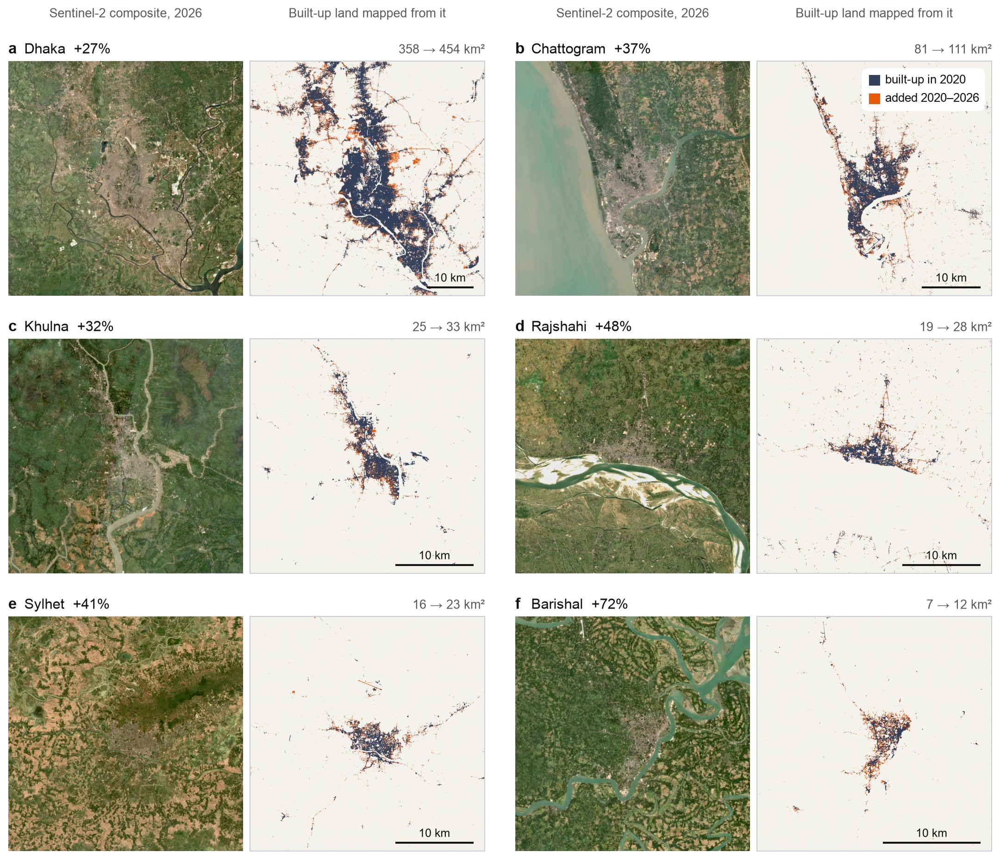
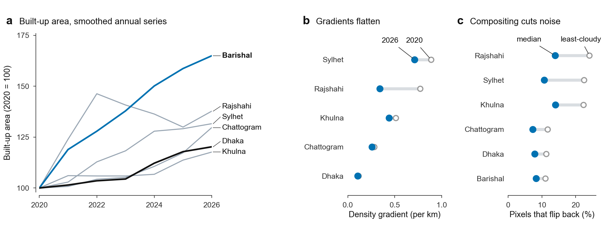
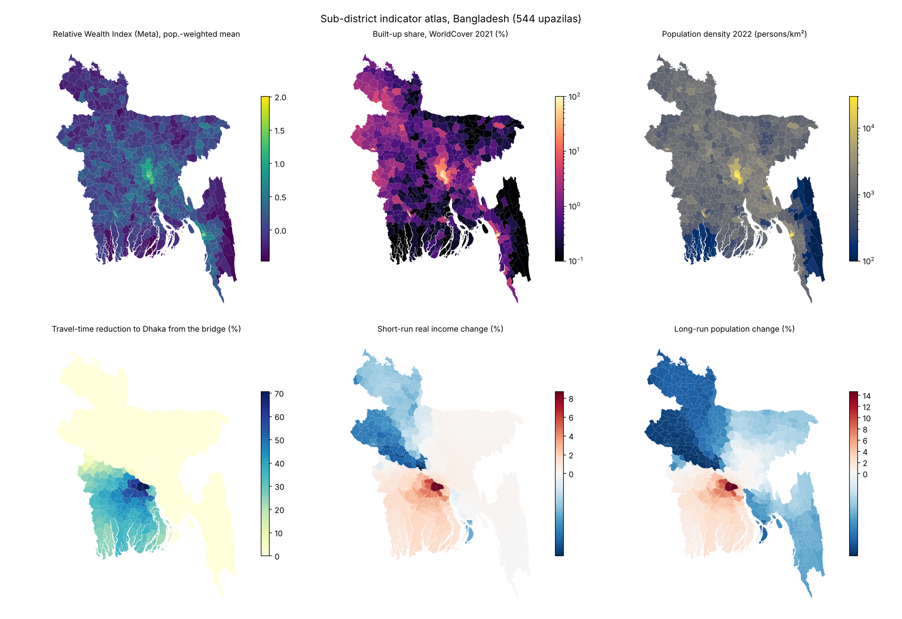
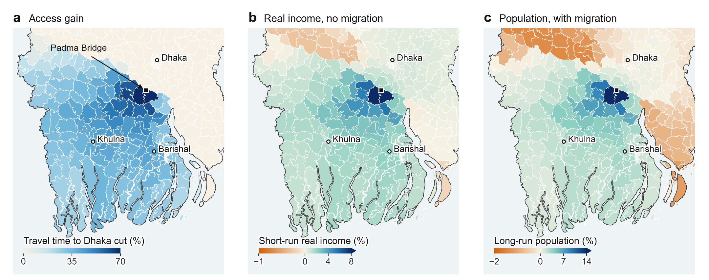

Independent research project · Code, data pipeline, tests and results are in this repository

## Abstract

Four years after the Padma Bridge opened (25 June 2022), satellite imagery shows no detectable effect of the bridge on built-up land in southwestern Bangladesh. This report demonstrates that the null result is uninformative about an effect of the size a calibrated spatial equilibrium model predicts, in four steps that follow the logic of measurement validation. **Measurement:** annual dry-season Sentinel-2 composites (2018–2026) classified by a U-Net trained on ESA WorldCover labels reach F1 = 0.80 on spatially held-out city blocks, a phenology-balanced compositing design roughly halves year-to-year noise, and imagery predicts the Meta Relative Wealth Index with out-of-area R² = 0.45 for grid cells and 0.83 for upazila means (0.50 and 0.92 under random cross-validation, which overstates accuracy). **Description:** applied to the six largest cities as a positive control, the same pipeline registers growth in built-up area of 27% (Dhaka) to 72% (Barishal) between 2020 and 2026, mostly through edge expansion, with flattening density gradients. **Evaluation:** a continuous-treatment difference-in-differences design on 34,626 grid cells × 7 seasons finds no detectable effect of the bridge on built-up land within four years (0.060 percentage points per log point of travel-time reduction, 95% CI −0.03 to 0.15), after showing that the naive estimate (−0.34) reflects selection on baseline trends. **Interpretation:** a two-sector quantitative spatial equilibrium model of 544 upazilas implies an effect of comparable magnitude (0.059), equivalent to about 0.4 of one 30 m pixel in a typical treated cell of 1,600 pixels. The minimum detectable effect of the design is 2.3–4.2 times larger and its power against the model-implied effect is 8–23%; the null is therefore uninformative about an effect of the predicted size, although it excludes effects more than about 2.6 times as large. The model puts the national welfare gain at +0.47% (0.30–0.79% across the parameter grid of Table 8); 75% of the gain accrues to the 19% of the population in treated upazilas, upazilas holding 29% of the population incur small losses through trade diversion, and omitting the local non-traded sector overstates the gain by about 70%. Open imagery is therefore suitable for monitoring cities and ranking upazilas, but not yet for evaluating a transport investment four years after its completion. The accompanying atlas reports 16 indicators for all 544 upazilas.

## 1. Research question and design

Bangladesh is one of the fastest-urbanizing and most densely populated countries in the world, yet official data on where people live, how cities grow, and who benefits from large public investments are sparse and slow to arrive. The Padma Bridge, a 6.15 km road-rail bridge opened on 25 June 2022, replaced ferry crossings that often involved hours of queuing and were suspended in the monsoon, and connected the southwestern divisions to Dhaka. Ex-ante appraisals projected national GDP gains above 1% and regional gains above 2%.

Household surveys that could test these projections become available only years later, whereas satellite imagery is free, annual and covers every upazila. The report asks whether such imagery can support an early evaluation. The design follows the logic of measurement validation: establish the accuracy of the measure, confirm that it registers change where change is expected, apply it to the bridge, and then determine whether the test could have detected the effect that a model predicts.

| Step | Question | Approach | Section |
|---|---|---|---|
| 1. Measure | Is the measure accurate? | U-Net on WorldCover labels; wealth prediction under 50 km spatial-block cross-validation | 3 |
| 2. Describe | Does it register change where rapid change is expected? | Built-up area in the six largest cities, 2020–2026 | 4 |
| 3. Evaluate | Does it register a change where the bridge reduced travel time? | Continuous-treatment difference-in-differences and event study, 34,626 cells × 7 seasons | 5 |
| 4. Interpret | Could the design have detected the expected effect? | Two-sector spatial equilibrium model of 544 upazilas; minimum detectable effect and power of the design | 6 |

Each section states its finding first, then presents the method and the evidence, and closes with the implications for the next step.

## 2. Data

All inputs are open data (Table 1). No household survey microdata and no fiscal data were used; welfare labels are survey-derived gridded layers.

**Table 1. Data sources**

| Source | Content and resolution | Use |
|---|---|---|
| Sentinel-2 L2A (ESA/Copernicus), via AWS Open Data and the Earth Search STAC API | Optical imagery, 10–20 m; Collection 1 (single processing baseline) for 2020 onward, original L2A archive for 2018–2019 and gap filling | Annual dry-season composites, 2018–2026 |
| ESA WorldCover 2020 (v100) and 2021 (v200) | Land cover, 10 m | Training labels (built-up fraction); land-cover shares; water mask |
| Meta Relative Wealth Index (Chi et al. 2022) | 26,932 points on a ~2.4 km grid; 26,544 used | Wealth-mapping target |
| Flowminder/WorldPop poverty layer (2011) | Survey-based gridded poverty estimates; 25,658 matched points | External benchmark and alternative target |
| Meta/CIESIN High Resolution Settlement Layer (HRSL) | Population, ~30 m; about 370 million native pixels | Population by 1 km cell and upazila, scaled to the 2022 census total (169.83 million) |
| Overture Maps transportation | 257,645 road and ferry segments | Travel-time model, bridge identification |
| GADM 4.1 | Country, 64 districts, 545 upazilas (544 used) | Units of analysis, clustering, atlas |

All layers are placed on a custom transverse Mercator projection centered on 90°E with grid origins snapped to 1 km, so that the 20 m (cities), 30 m (Padma region), 40 m (national), 200 m, 500 m, 1 km and 1.2 km grids nest exactly.

## 3. Step 1. Measurement: accurate for cities and for upazila means

Built-up maps are accurate at city scale once compositing removes seasonal noise, and imagery predicts upazila wealth well out of area. Accuracy is measured against ESA WorldCover for built-up land and against the Meta Relative Wealth Index for wealth. Both results are subject to conditions that matter for later steps: accuracy falls where settlement is sparse, and the reliability of change over time depends on compositing more than on the classifier.

### 3.1 Image compositing

Cloud-free observations are scarce during the June–October monsoon, so each year is represented by a dry-season composite (15 November of the previous year to 31 March). Pixels flagged as cloud, shadow or cirrus by the scene classification layer are dropped and the per-pixel median of the remaining observations is taken; the number of clear observations is stored alongside each composite.

Scene selection has a larger effect than might be expected. Selecting the *N* least cloudy scenes per tile gives every year a different mix of acquisition dates: some years are dominated by post-harvest bare fields in November–December, others by flooded boro rice in January–February. A classifier reads these spectral differences as built-up change. The final design therefore splits the season into six equal date windows and keeps the least cloudy scene in each window (preferring Collection 1 and back-filling windows it does not cover from the original archive). A second artifact arises because some MGRS tiles are imaged from two partially overlapping orbits; when per-tile selection picked all scenes from one orbit, 22% of the Khulna window had no clear observation in 2026. An orbit-aware gap-fill re-selects scenes per tile and relative orbit and replaces only the affected pixels.

### 3.2 Built-up classification

Two classifiers are trained against WorldCover built-up fractions: a LightGBM pixel classifier with 28 spectral, index and texture features, and a small U-Net (12 input channels, 64 × 64 patches, soft-label cross-entropy, flips, rotations and radiometric jitter; trained on the 2020 and 2021 seasons on CPU). Accuracy is evaluated on 4 km spatial-block folds so that spatially autocorrelated neighbors cannot leak between training and test sets. Because the LightGBM model is trained on balanced samples it over-predicts at a 0.5 cut-off; its threshold is tuned on a separate fold.

**Table 2. Built-up classification on spatially held-out blocks (six cities pooled, 4.07 million pixels)**

| Model | Precision | Recall | F1 | IoU | Predicted built share / reference |
|---|---|---|---|---|---|
| LightGBM, threshold 0.5 | 0.52 | 0.96 | 0.67 | 0.51 | 13.2% / 7.2% |
| LightGBM, tuned threshold 0.95 | 0.78 | 0.79 | 0.78 | 0.64 | 7.2% / 7.2% |
| U-Net (two training seasons) | 0.86 | 0.75 | 0.80 | 0.67 | 6.2% / 7.2% |

The U-Net exceeds gradient boosting in every city (Figure 1a). In the rural Padma region (built share 1.3%), the U-Net reaches precision 0.79 and recall 0.56 (F1 0.66): dispersed settlement is harder to detect, and the errors are predominantly omissions.

The U-Net is trained on 64-pixel patches, each assigned to the fold that covers most of its pixels, whereas accuracy is scored on every pixel of the test fold. A patch that straddles a block boundary can therefore place test pixels inside a training patch. In the re-run described in Section 9, 7.1% of test pixels lie inside a training patch and 2.2% inside a validation patch; excluding them changes pooled F1 from 0.797 to 0.793 and city scores by between −0.02 and +0.01 (`scripts/11_patch_fold_check.py`). The U-Net is trained on both labeled seasons (2020 and 2021), so its scores are in-time; no out-of-time test of it is available.

### 3.3 Temporal consistency

Two statistics summarize the reliability of the annual series over 2020–2026: the *reversal rate* (share of pixels built in year *t* and classified non-built in *t*+1; true reversals are rare, so this is mostly noise) and the *trend residual SD* (standard deviation of residuals of log built-up area around a linear trend).

The phenology-balanced design roughly halves year-to-year noise (Table 3, Figure 1b). Under least-cloudy selection, Dhaka's raw annual built-up area swung by −26% and +48% between adjacent years.

**Table 3. Temporal-consistency diagnostics, 2020–2026, least-cloudy selection → phenology-balanced selection**

| City | Reversal rate | Trend residual SD (log area) |
|---|---|---|
| Dhaka | 0.112 → 0.079 | 0.154 → 0.075 |
| Chattogram | 0.117 → 0.073 | 0.151 → 0.052 |
| Khulna | 0.223 → 0.140 | 0.318 → 0.127 |
| Rajshahi | 0.241 → 0.139 | 0.266 → 0.188 |
| Sylhet | 0.224 → 0.107 | 0.427 → 0.109 |
| Barishal | 0.110 → 0.082 | 0.133 → 0.068 |

This error is non-classical: it is correlated with season and weather, and therefore with the timing of any treatment, so it would contaminate an event study rather than merely attenuate it.

### 3.4 Wealth mapping

For each RWI grid cell, features are (a) Sentinel-2 band and index statistics, (b) 1,024 MOSAIKS random convolutional features (Rolf et al. 2021), (c) WorldCover land-cover shares and (d) context variables (population and modeled travel time to Dhaka). Gradient boosting and ridge models are evaluated under two cross-validation designs: 50 km spatial blocks, which mimic extrapolation to unsurveyed areas, and random splits. Accuracy is reported at cell level and for upazila means (n = 504).

**Table 4. Out-of-sample R² for the Meta Relative Wealth Index (spatial-block CV; random CV in parentheses)**

| Feature set | Cell level | Upazila means (n = 504) |
|---|---|---|
| Context only (population, travel time) | 0.25 (0.26) | 0.45 (0.49) |
| MOSAIKS (ridge) | 0.27 (0.35) | 0.68 (0.78) |
| Sentinel-2 statistics | 0.27 (0.37) | 0.60 (0.77) |
| Land-cover shares | 0.35 (0.37) | 0.72 (0.76) |
| All imagery features | 0.41 (0.47) | 0.80 (0.90) |
| Imagery + context | **0.45 (0.50)** | **0.83 (0.92)** |

Three findings are relevant for practice. First, the built environment carries most of the signal: land-cover shares alone explain 35% of cell-level variation and the WorldCover built share accounts for 31% of model gain, while location variables add only 0.03. Imagery-based wealth proxies are, to a large extent, urbanization proxies. Second, random cross-validation overstates accuracy in unsurveyed areas by about 0.05 at cell level and 0.08–0.09 at upazila level (Figure 1c); applications in unsurveyed areas face precisely this extrapolation problem. Third, aggregation to upazilas lifts accuracy above 0.8 (Figure 1d), which is usable for ranking upazilas, whereas cell-level accuracy is not sufficient for targeting within villages. Upazila figures refer to population-weighted means over the 504 upazilas with at least three labeled cells. Against the independent survey-based 2011 poverty layer (Spearman 0.41 with the RWI), conclusions are unchanged (imagery + context: 0.47 cell, 0.81 upazila).

**Implications for the next steps.** The built-up series is reliable enough to track change in cities (Section 4) and, with less precision, in the rural areas the bridge reaches (Section 5). The wealth index also sets relative wages in the spatial model (Section 6); the imagery model indicates that this input can be largely reproduced from imagery out of area.

## 4. Step 2. Description: cities grew 27–72%, mostly at the edge

Applied to the six largest cities, where rapid growth is expected, the same pipeline registers growth of 27–72% between 2020 and 2026, mostly at the urban edge, with flattening density gradients. The cities serve as a positive control for Section 5: they establish that the measure registers change where change is large.

### 4.1 Expansion metrics

For six cities (Dhaka, Chattogram, Khulna, Rajshahi, Sylhet, Barishal), annual probabilities are smoothed with a three-year moving median, built-up is treated as persistent, and 2020 and 2026 footprints are compared. New patches are classified with the Landscape Expansion Index (Liu et al. 2010) into infill, edge expansion and outlying development, and a negative-exponential density gradient is fitted to built-up share by distance from the center.

### 4.2 Results

**Table 5. Built-up area and expansion form**

| City | Built-up 2020 → 2026 (km²) | Growth | CAGR | New built-up: infill / edge / outlying | Density gradient (per km) 2020 → 2026 |
|---|---|---|---|---|---|
| Dhaka | 358 → 454 | +27% | 4.0% | 33% / 58% / 9% | 0.115 → 0.105 |
| Chattogram | 81 → 111 | +37% | 5.4% | 32% / 57% / 11% | 0.280 → 0.257 |
| Khulna | 25 → 33 | +32% | 4.7% | 40% / 50% / 10% | 0.510 → 0.438 |
| Rajshahi | 19 → 28 | +48% | 6.7% | 18% / 64% / 18% | 0.771 → 0.342 |
| Sylhet | 16 → 23 | +41% | 5.8% | 30% / 55% / 15% | 0.886 → 0.710 |
| Barishal | 7 → 12 | +72% | 9.5% | 28% / 61% / 11% | — → 1.006 |

Edge expansion accounts for 50–64% of new built-up land, infill for 18–40% and outlying development for 9–18%; new development follows radial roads (Figure 2). Secondary cities grow faster than Dhaka, and density gradients flatten in every city where both years can be compared, consistent with suburbanization in a monocentric framework (lower commuting costs or rising incomes; the data cannot separate the two). Because 10–20 m imagery cannot detect vertical densification, Dhaka's +27% is a horizontal measure that understates growth in the core.

In Dhaka and Chattogram the largest additions lie 4–7 km from the center; in the four smaller cities they lie within about 3 km (Figure 3b, drawn from the re-run rasters described in Section 9); density gradients flatten in every city where both years can be compared (Figure 3c).

**Implications for the next steps.** Built-up area in the six cities grows by 4.0–9.5% a year from a large base. The rural areas served by the bridge start from 0.37% built-up, so even a large proportional response adds very little built-up land in absolute terms, which bears directly on what the evaluation can detect (Section 6).

## 5. Step 3. Evaluation: no detectable effect of the bridge on built-up land

In the four years after opening, areas with larger reductions in travel time to Dhaka did not add built-up land detectably faster than comparable areas. The negative naive estimate reflects selection on baseline trends, and the null that replaces it is robust to the main design choices.

### 5.1 Exposure: travel time and treatment intensity

A 500 m friction surface assigns speeds by Overture road class (motorway 70, trunk 50, primary 40, secondary 30, tertiary 25 km/h; 5 km/h off-road), makes cells with more than 50% water impassable except where a road or ferry route crosses, and gives ferries an effective speed of 2 km/h to account for waiting time (1.5 and 4 km/h in sensitivity). Least-cost travel time to Dhaka is computed with and without the two motorway segments that form the bridge (8.63 and 9.02 km). Treatment intensity is D = log(travel time without bridge) − log(travel time with bridge).

Modeled travel time to Dhaka (Figure 4a) falls from 3.71 to 1.23 hours at Bhanga, from 5.59 to 3.12 hours in Barishal and from 6.03 to 3.55 hours in Khulna, while northern cities are unaffected. Sixty percent of panel cells have D > 0.05; among them the mean reduction is 36% (D = 0.44). Treated areas are far more rural than the rest of the region: 0.37% built-up before opening against 2.22%.

### 5.2 Design

The outcome is the share of each 1.2 km cell classified built-up, on a balanced panel of 34,626 cells × 7 seasons (2020–2026, Collection-1 imagery only; 242,382 observations; 276 upazilas; 39 districts). The reference year is 2022. Three specifications are estimated: (1) cell and year fixed effects; (2) plus year × baseline-built bin (a zero bin and nine quantile bins of pre-opening built-up, defined per cell), year × log distance to Dhaka and year × water share; (3) plus division × year effects. Standard errors are clustered by upazila (and by district as a check). Randomization inference permutes upazila-mean treatment across upazilas within divisions (1,000 draws) using a Frisch–Waugh closed form that reproduces the regression coefficients exactly.

### 5.3 Results

**Table 6. Pooled difference-in-differences, D × Post (percentage points of built-up share per log point)**

| Specification | Coefficient | 95% CI (upazila clusters) | Randomization p |
|---|---|---|---|
| (1) cell + year FE | −0.339 | [−0.58, −0.10] | 0.008 |
| (2) + year × baseline-built bin, distance, water | **0.060** | [−0.03, 0.15] | 0.92 |
| (3) + division × year FE | −0.002 | [−0.13, 0.12] | 0.98 |
| (2), district clusters | 0.060 | [−0.11, 0.23] | |
| (2), ferry 1.5 / 4 km/h | 0.051 / 0.086 | | |
| (2), binary treatment D > 0.2 | 0.097 | [0.02, 0.17] | |
| (2), excluding cells < 10 km from bridge / < 30 km from Dhaka | 0.069 / 0.062 | | |
| (2), baseline built < 5% / ≥ 5% | 0.041 / 0.812 | | |

The negative coefficient in specification (1) is selection on trends: places with more built-up land add more percentage points each year, so a comparison that ignores baseline density attributes the capital region's faster urbanization to the absence of treatment. Once baseline-density-specific trends are controlled, the two pre-period coefficients are close to zero (2020: −0.015, SE 0.038; 2021: −0.038, SE 0.064; Figure 4b), a limited test of parallel trends given that only two comparable pre-periods exist, and the pooled effect is a null in every continuous-treatment variant (Figure 4c). The upper bound of the confidence interval implies at most about 0.07 percentage points for a typical treated cell over four years, roughly 18% of its baseline level: large, immediate urban expansion can be ruled out, moderate relative growth cannot. Two results depart from the null. The binary-treatment version of (2), which compares cells above 0.2 log points with the rest, is positive with upazila clustering (0.097 percentage points, CI 0.02 to 0.17); it was not re-estimated with district clusters or by randomization inference and discards the variation in exposure on which the main specification rests, so it is reported as an exception rather than as evidence of an effect. In the event study, the coefficients for 2023 (−0.15) and 2024 (+0.12) are individually distinguishable from zero with upazila clustering and those for 2025–26 (+0.11, +0.08) are not; the shape (a peak in 2024, lower afterwards) does not indicate accumulating construction. Randomization inference permutes upazila-mean exposure across upazilas within divisions.

The 2018–2019 archive cannot be used to extend the pre-period: it comes from a different processing baseline, pre-period coefficients jump to +1.9 to +2.8 points, and a placebo "opening in 2020" fails for measurement rather than identification reasons.

A specification error identified during the work is documented here: when baseline-built bins were first computed by ranking observations rather than cells, tied zero-built cells moved between bins across years and produced a spurious positive effect of +0.20 points (SE 0.08). Defining bins per cell removed it.

**Implication for the next step.** A null estimate admits two interpretations: either the bridge did not alter where built-up land is added, or the response is too small for this design to detect. Section 6 uses a spatial equilibrium model to distinguish between them.

## 6. Step 4. Interpretation: the model-implied effect is below the detection threshold, and the implied welfare gain is +0.47%

A calibrated spatial equilibrium model implies an effect on built-up land of the same magnitude as the point estimate and well below the minimum detectable effect of the design: less than half a pixel in a typical treated cell, against a minimum detectable effect two to four times larger. The null is therefore uninformative about an effect of the predicted size, although it does exclude substantially larger ones. The implied welfare gain is +0.47%, concentrated in the southwest, with small losses in the northwest.

### 6.1 Model

The model (Redding 2016 class) has 544 upazilas producing CES traded varieties whose number is proportional to population (the agglomeration force), a local non-traded sector produced with local labor (expenditure share α_N = 0.30), housing in fixed supply (share 0.25), and Fréchet idiosyncratic location preferences with migration elasticity ε (the long run); the short run holds population fixed. Iceberg trade costs are a power function of bilateral road travel time, computed as a 544 × 544 matrix with and without the bridge. Baseline trade shares are calibrated by Sinkhorn matrix scaling so that sales equal income in every upazila; counterfactuals are solved in exact hat algebra (Dekle, Eaton and Kortum 2007), which absorbs unobserved productivities and amenities into baseline shares. Main parameters are σ = 5, κ = 1 (travel-time elasticity of trade), ε = 3, and a log-wage dispersion of 0.25 across upazilas with wages mapped from the RWI.

### 6.2 Reconciling the null with the model

Long-run population changes are translated into built-up changes with a cross-sectional elasticity of built-up share with respect to population density (η = 1.33, SE 0.03). Regressing the implied change on upazila-mean D across the Padma region gives the coefficient the causal design *would* recover at full adjustment. Because the regression is applied to the model's own output, general-equilibrium effects on comparison areas are reflected in the implied coefficient. A Bayesian layer draws 600 parameter vectors from priors (σ, κ, ε, α_N, wage dispersion, η, and the share of long-run adjustment completed by 2026), computes the implied coefficient for each, and reweights by the likelihood of the observed estimate. The same draws give the power of the empirical design.

With main parameters the model implies a built-up coefficient of 0.059 points per log point at full long-run adjustment, against an empirical point estimate of 0.060. The two numbers come from different regressions (a cross-section of upazilas in the model, a cell panel with fixed effects in the data) and the estimate's interval is wide, so their agreement to the second decimal is not in itself evidence for the model. Across 600 prior draws the implied coefficient is 0.048 (90% interval 0.021–0.081), and no draw exceeds the upper end of the empirical confidence interval. Reweighting by the likelihood of the observed estimate leaves the prior essentially unchanged (effective sample size 597 of 600). The scale of the predicted effect explains the null. For a typical treated cell (mean treatment intensity 0.44 log points) the model-implied coefficient amounts to 0.026 percentage points of built-up share. The outcome is the built-up share of a 1.2 km cell of 1,600 pixels of 30 m, of which about 6 were built-up before the bridge (0.37%); the predicted addition is about 0.4 of one pixel, or 7% of the baseline (Figure 5a).

The design cannot detect an effect of that size. At 80% power in a two-sided 5% test, the minimum detectable coefficient is 0.135 with upazila clustering and 0.248 with district clustering, 2.3 and 4.2 times the model-implied value (Figure 5b). Power against the model-implied value is 17–23% with upazila clustering and 8–10% with district clustering at full adjustment, and 6–9% at half adjustment; 80% power would require a standard error of about 0.017–0.021, against 0.048 and 0.089 (`scripts/09_power.py`, `outputs/tables/padma_power.json`). The estimate does exclude coefficients above 0.154 with upazila clustering and 0.233 with district clustering, 2.6 and 3.9 times the model-implied value. The null result therefore indicates that four years of built-up imagery cannot detect an effect of the size the model predicts, not that the bridge had none.

### 6.3 Welfare and incidence

**Table 7. Counterfactual effects of the bridge, two-sector model, main parameters**

| | Short run (no migration) | Long run (migration, ε = 3) |
|---|---|---|
| National welfare (real-income equivalent) | +0.47% | +0.48% |
| Real income, beneficiary areas (D > 0.1; 19% of population) | +1.9% | — |
| Real income, rest of country | +0.15% | — |
| Population, beneficiary areas | — | +2.6% |
| Population, Dhaka district | — | −0.06% |

The welfare gain ranges from 0.30% to 0.79% when one parameter at a time is varied (Table 8, Figure 5c).

**Table 8. Sensitivity of national welfare (short run) and beneficiary-area population (long run)**

| Parameter varied | Welfare | Population |
|---|---|---|
| α_N = 0 (one-sector) / 0.15 / 0.30 (main) / 0.45 | 0.79% / 0.63% / 0.47% / 0.31% | +4.6% / +3.5% / +2.6% / +1.7% |
| κ = 0.5 / 1.5 | 0.30% / 0.51% | +1.8% / +2.6% |
| σ = 4.5 / 7 | 0.54% / 0.31% | +3.0% / +1.7% |
| ε = 1.5 / 5 | 0.47% / 0.47% | +1.6% / +3.4% |
| Ferry 1.5 / 4 km/h | 0.55% / 0.31% | +3.0% / +1.7% |
| Wage dispersion 0.15 / 0.35 | 0.47% / 0.48% | +2.4% / +2.8% |

Three economic implications follow. The gains are roughly proportional to the traded expenditure share: cheaper goods from elsewhere benefit only the 45% of spending on traded goods, and the local wage increase is partly offset by higher prices of local services (a Balassa–Samuelson-type effect), so the one-sector model overstates aggregate gains by about 70%. The gains are smaller than ex-ante projections because the model covers the goods-trade channel only, with no passenger time savings, commuting or access to services; the figures describe that channel alone. Some regions lose: Rajshahi and Rangpur lose through trade diversion as southwestern producers become more competitive in Dhaka. Migration has little effect on aggregate welfare but determines where the gains accrue.

By division (population-weighted; short-run real income / long-run population): Barisal +1.8% / +2.4%; Khulna +1.2% / +1.4%; Dhaka +0.9% / +0.7%; Chittagong +0.2% / −0.5%; Sylhet +0.2% / −0.5%; Mymensingh +0.2% / −0.6%; Rangpur −0.1% / −1.2%; Rajshahi −0.2% / −1.2%. The largest gains are in the upazilas at the southern bridgehead (Zanjira +8.7% / +14.7%, Shibchar +8.3% / +13.9%, Sadarpur, Shariatpur Sadar and Bhanga +5–6% / +8–10%).

The gains are concentrated and are not progressive (Figure 5d; `scripts/10_incidence.py`, `outputs/tables/qse_incidence.json`). The 19% of the population in treated upazilas receives 75% of the total gain in real income. Ordering upazilas by the Relative Wealth Index into fifths of the population, short-run real income rises by 0.27% in the poorest fifth, 0.47% in the second, 0.58% and 0.61% in the third and fourth, and 0.43% in the richest. Upazilas holding 29% of the population incur small losses (population-weighted mean −0.16%; largest loss −0.37%); 128 of these 159 upazilas are in Rajshahi and Rangpur, and 61% of the poorest fifth lives in upazilas that lose, against 6% of the richest. The index also sets baseline wages in the model, so the ranking is not independent of the model's inputs.

## 7. Conclusions

### 7.1 Principal findings

1. **The measurement is adequate for city monitoring and for ranking upazilas.** Free imagery maps built-up land (F1 = 0.80 against WorldCover in cities, 0.66 in the rural bridge region) and upazila mean wealth (out-of-area R² = 0.83 against the Relative Wealth Index). It does not resolve individual grid cells (R² = 0.45).
2. **Early evaluation is not yet feasible.** In the bridge corridor the model-implied effect is less than half a pixel per cell, and the minimum detectable effect is two to four times larger. The null reflects the limits of the design rather than the absence of an effect.
3. **The model-implied welfare gain is modest and unevenly distributed.** In the model, national welfare rises by 0.47%; three-quarters of the gain accrues to the 19% of the population in upazilas where travel time to Dhaka fell by about 10% or more, and upazilas holding 29% of the population incur small losses.

### 7.2 Sensitivity of conclusions to common analytical defaults

Each row of Table 9 gives a common default, the conclusion it yields on these data, and the result obtained when the default is replaced.

**Table 9. Common analytical defaults and the results that replace them**

| Common default | Conclusion under the default | Result in this study |
|---|---|---|
| Pixel classifier at its default threshold | Built-up share of 13.2% on held-out blocks, against a reference of 7.2% | 6.2% with the U-Net (F1 0.80 against 0.67) |
| Least-cloudy scene selection | 11–24% of built-up pixels revert to non-built in the following year, noise that would be read as urban change | 7–14% with phenology-balanced compositing |
| Random cross-validation of the wealth map | Upazila R² of 0.92 | 0.83 under 50 km spatial blocks, the relevant figure for areas without labels |
| Two-way fixed-effects difference-in-differences | A negative effect of the bridge on built-up land (−0.34, randomization p = 0.008) | Selection on trends: 0.06 (CI −0.03 to 0.15) once trends by baseline density are controlled |
| Interpreting the null as the absence of an effect | The bridge did not alter land use | The minimum detectable effect is 2.3–4.2 times the model-implied effect (power of 8–23%) |
| One-sector trade model | Welfare gain of 0.79% | 0.47% with a local non-traded sector |

### 7.3 Contribution relative to conventional measurement and evaluation

- **Coverage and frequency.** Censuses are decennial and household surveys are conducted every few years; neither is designed to yield annual figures for 544 upazilas. The imagery yields an annual built-up series at 20–30 m and a wealth estimate for every upazila from free inputs.
- **An interpretable null.** A reduced-form evaluation alone would report no effect; a structural model alone would report a welfare gain that is not confronted with data. Applying both to the same outcome provides the effect size against which the test should be assessed and establishes that this design cannot detect it.
- **Incidence.** The model reports gains and losses for each of 544 upazilas, which an aggregate appraisal does not.
- **Transferability.** The model requires only open inputs (population, a road network and a wealth index), so the same appraisal can be produced for a proposed corridor before construction and for alternative alignments. Because a counterfactual solves in a fraction of a second, uncertainty over parameters can be reported in full, as with the 600 draws used here, rather than as a single point estimate.

The approach complements survey data and does not replace it. Imagery measures the built environment rather than consumption: the wealth labels are themselves model-based, accuracy for individual grid cells is low (R² = 0.45), and vertical growth is not observable at this resolution. The model is calibrated rather than estimated, and the evaluation is too imprecise to discipline it: reweighting 600 parameter draws by the estimate leaves them essentially unchanged (effective sample size 597).

### 7.4 Applications

1. **Monitoring between censuses.** Annual built-up series for cities, provided that scenes are composited by season and temporal-consistency diagnostics are reported; the reliability of year-to-year change depends more on compositing design than on the classifier.
2. **Geographic ranking.** Satellite wealth maps rank upazilas well out of area (R² ≈ 0.83) but do not resolve villages. Because the labels are themselves model-based, a ranking should be compared with survey data before it is used to allocate resources. Any such map should be validated with spatial-block rather than random cross-validation, and its reliance on the built environment should be stated.
3. **Ex-ante evaluation design.** Three to four years of built-up imagery should not be read as an early verdict on a transport investment. The expected effect size from a calibrated model and the minimum detectable effect of the design should be computed and pre-registered; in this case the calculation shows that the question could not have been resolved.
4. **Appraisal of other corridors.** Appraisal models should include a non-traded sector and report gains and losses by region; the goods-trade channel alone gives about +0.5% nationally here, with losses in the northwest.
5. **Urban land policy.** Growth in the six largest cities is predominantly edge expansion with flattening density gradients; fringe land-use planning and trunk infrastructure are the relevant policy margins.

More generally, the same sequence applies wherever an outcome is measured with a learned proxy and treatment is assigned by location: validate the proxy on held-out areas, verify its stability over time, confirm that it registers a change of known magnitude, and compute the minimum detectable effect before interpreting a null.

### 7.5 Conditions for detecting the effect

- **Greater precision.** 80% power requires a standard error of about 0.021, against 0.048 with upazila clustering and 0.089 with district clustering.
- **An outcome with a higher signal-to-noise ratio.** Building footprints, night-time lights or land prices may respond more strongly than built-up share at 30 m; this is not tested here.
- **A longer horizon and a second shock.** Adjustment accumulates over time, and the Padma rail link (2023–24) provides a second change in access. A re-evaluation after 2028 is the natural next step.

## 8. Limitations and next steps

Built-up accuracy is measured against ESA WorldCover, itself a satellite-derived product, rather than against ground survey. Welfare labels are survey-derived gridded layers, not household microdata, and the RWI is itself a model-based index that draws in part on satellite imagery, so R² measures agreement with the index. The unsupervised stages of the wealth pipeline (the random convolutional filters and the 50 principal components) are fitted on all tiles before cross-validation; they do not use the labels, but the held-out blocks are not strictly unseen by them, and an upazila that spans more than one 50 km block combines cells predicted in different folds. The positive control in Section 4 is qualitative: city growth rates are not benchmarked against an independent series. Wages and the non-traded expenditure share in the structural model are calibrated from proxies and general knowledge, not estimated from household expenditure data; the model is static and covers goods trade only. The model-implied coefficient is a cross-sectional projection on upazila-mean exposure rather than the regression used for the estimate. The causal design is identified from a spatially smooth treatment, so independent variation is limited, and contemporaneous investments (the Dhaka–Mawa–Bhanga expressway in 2020, the Padma rail link in 2023–24) cannot be separated from the bridge. Next steps: calibrate the non-traded share from household expenditure data; add passenger time savings and commuting; estimate the trade elasticity from freight or mobility data; add alternative outcomes (night-time lights, building footprints, land prices); and re-evaluate after 2028 using the rail link as a second shock.

## 9. Reproducibility and the indicator atlas

The pipeline is an open-source Python package (grid, STAC access, compositing, labels, features, models, travel time, fixed-effects econometrics, spatial equilibrium) with twelve scripts and 19 offline unit tests. It runs end to end on a four-CPU machine without a GPU; travel-time matrices for six network scenarios take about eight minutes and each equilibrium counterfactual 0.03 seconds, so another corridor can be appraised by editing the network and area-of-interest configuration. The project was built with an LLM-based agentic coding assistant under human direction; a verification protocol of unit tests, closed-form cross-checks and held-out validation caught and corrected three material errors (the observation-level binning above, an overview-based population raster that undercounted cities, and the orbit-coverage gap).

**Reproduction check.** The pipeline was re-run from the raw data on a separate machine on 16 November 2026 for the six cities, the national composite and the wealth study (the Padma-region composites and the causal and model steps were not re-run). Classifier scores reproduced within 0.005 and the headline wealth R² within 0.003; across all feature sets the largest change was +0.05 (Sentinel-2 statistics alone). City growth reproduced within 2.0 percentage points. The re-run also showed that the orbit-aware gap fill described in Section 3.1 was not called by the published compositing script; it now is.

The **Sub-District Indicator Atlas** (Appendix) reports, for each of the 544 upazilas: population and density, Relative Wealth Index, WorldCover built-up share, the modeled travel-time reduction to Dhaka from the bridge, a treatment flag, and the model's short-run wage and real-income changes and long-run population and real-income changes, with division summaries and maps.

The atlas maps are reproduced in Figures 6 and 7.

## References

- Chi, G., Fang, H., Chatterjee, S. and Blumenstock, J. E. (2022). Microestimates of wealth for all low- and middle-income countries. *Proceedings of the National Academy of Sciences*, 119(3), e2113658119.
- Dekle, R., Eaton, J. and Kortum, S. (2007). Unbalanced trade. *American Economic Review*, 97(2), 351–355.
- Donaldson, D. and Hornbeck, R. (2016). Railroads and American economic growth: A "market access" approach. *Quarterly Journal of Economics*, 131(2), 799–858.
- Ke, G. et al. (2017). LightGBM: A highly efficient gradient boosting decision tree. *Advances in Neural Information Processing Systems*, 30.
- Liu, X., Li, X., Chen, Y., Tan, Z., Li, S. and Ai, B. (2010). A new landscape index for quantifying urban expansion using multi-temporal remotely sensed data. *Landscape Ecology*, 25(5), 671–682.
- Redding, S. J. (2016). Goods trade, factor mobility and welfare. *Journal of International Economics*, 101, 148–167.
- Roberts, D. R. et al. (2017). Cross-validation strategies for data with temporal, spatial, hierarchical, or phylogenetic structure. *Ecography*, 40(8), 913–929.
- Rolf, E., Proctor, J., Carleton, T., Bolliger, I., Shankar, V., Ishihara, M., Recht, B. and Hsiang, S. (2021). A generalizable and accessible approach to machine learning with global satellite imagery. *Nature Communications*, 12, 4392.
- Ronneberger, O., Fischer, P. and Brox, T. (2015). U-Net: Convolutional networks for biomedical image segmentation. *MICCAI 2015*, LNCS 9351, 234–241.
- Sinkhorn, R. and Knopp, P. (1967). Concerning nonnegative matrices and doubly stochastic matrices. *Pacific Journal of Mathematics*, 21(2), 343–348.
- Steele, J. E. et al. (2017). Mapping poverty using mobile phone and satellite data. *Journal of the Royal Society Interface*, 14(127), 20160690.
- Young, A. (2019). Channeling Fisher: Randomization tests and the statistical insignificance of seemingly significant experimental results. *Quarterly Journal of Economics*, 134(2), 557–598.
- Zanaga, D. et al. (2021, 2022). ESA WorldCover 10 m 2020 v100 and 2021 v200. Zenodo.
