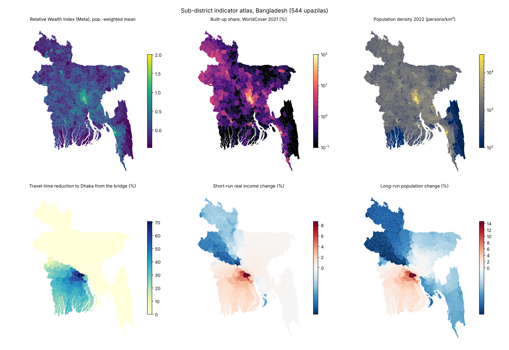
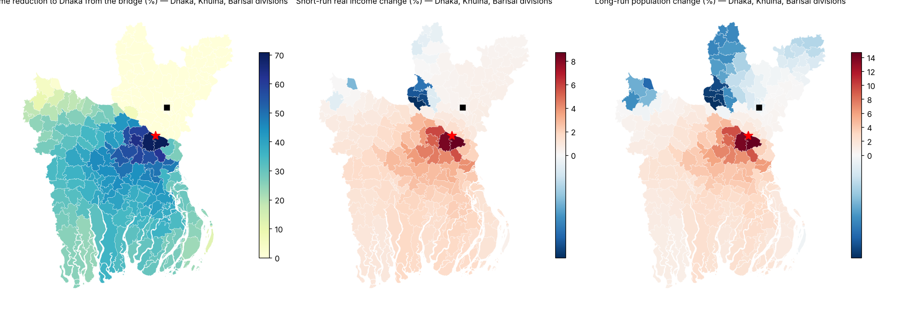

# Sub-District Indicator Atlas, Bangladesh (544 upazilas)

Companion to *Geospatial Monitoring of Land-Use Change, Sub-District Wealth, and the Padma Bridge in Bangladesh (2018–2026)*. All indicators are produced by the project pipeline from open data; see the technical report for sources and methods. Machine-readable files: `upazila_indicators.csv` (one row per upazila) and `division_summary.csv`.

## Indicator definitions

| Column | Definition | Source / method |
|---|---|---|
| `population_2022` | Resident population | HRSL (Meta/CIESIN) native 30 m pixels summed to 1 km and to upazila; national total scaled to the 2022 census (169.83 million) |
| `area_km2`, `pop_density_per_km2` | Land area and density | GADM 4.1 level-3 polygons, projected area |
| `rwi_meta` | Relative Wealth Index, population-weighted mean of grid points in the upazila | Meta Relative Wealth Index (Chi et al. 2022) |
| `built_share_wc2021_pct` | Share of upazila area classified built-up, % | ESA WorldCover 2021 (10 m), averaged on the 1 km grid |
| `d_log_tt_reduction`, `tt_reduction_pct` | Reduction in modelled road travel time to Dhaka attributable to the Padma Bridge: log difference and % | 500 m least-cost travel-time model (Overture roads, ferries, WorldCover water), with and without the bridge; population-weighted upazila mean |
| `treated_d_gt_0_1` | 1 if the log reduction exceeds 0.1 (about 10%) | Same |
| `wage_sr_pct`, `real_income_sr_pct` | Short-run (no migration) change in nominal wage and real income after the bridge, % | Two-sector quantitative spatial equilibrium model, main parameters (σ = 5, α_N = 0.30, κ = 1) |
| `population_lr_pct`, `real_income_lr_pct` | Long-run (with migration, ε = 3) change in population and real income, % | Same |

Model-based columns are counterfactual simulations under stated parameters, not observed changes; see the sensitivity analysis in the report (national welfare 0.30–0.79% across the parameter grid; 0.30–0.55% with the non-traded share held at its main value).

## Division summary (population-weighted)

| division | upazilas | population_m | rwi_meta | built_share_wc2021_pct | tt_reduction_pct | share_pop_treated | real_income_sr_pct | population_lr_pct |
|---|---|---|---|---|---|---|---|---|
| Barisal | 40 | 8.59 | -0.04 | 0.58 | 33.82 | 1.00 | 1.75 | 2.35 |
| Khulna | 64 | 17.13 | 0.14 | 3.25 | 30.40 | 0.95 | 1.23 | 1.43 |
| Dhaka | 129 | 46.46 | 0.65 | 22.95 | 6.87 | 0.15 | 0.87 | 0.72 |
| Sylhet | 38 | 12.37 | 0.12 | 0.82 | 0.00 | 0.00 | 0.22 | -0.47 |
| Chittagong | 111 | 33.39 | 0.33 | 5.84 | 0.01 | 0.00 | 0.19 | -0.53 |
| Mymensingh | 34 | 12.46 | 0.02 | 0.85 | 0.00 | 0.00 | 0.16 | -0.58 |
| Rangpur | 58 | 18.20 | -0.08 | 1.49 | 0.00 | 0.00 | -0.14 | -1.16 |
| Rajshahi | 70 | 21.23 | 0.10 | 2.33 | 0.01 | 0.00 | -0.21 | -1.24 |

## Maps

Red star: Padma Bridge; black square: Dhaka.

## Largest modelled gains (top 20 upazilas by short-run real income change)

| division | district | upazila | population_2022 | rwi_meta | built_share_wc2021_pct | tt_reduction_pct | real_income_sr_pct | population_lr_pct |
|---|---|---|---|---|---|---|---|---|
| Dhaka | Shariatpur | Zanjira | 192,525 | 0.16 | 0.60 | 70.76 | 8.71 | 14.69 |
| Dhaka | Madaripur | ShibChar | 332,589 | 0.37 | 0.70 | 69.74 | 8.28 | 13.93 |
| Dhaka | Faridpur | Sadarpur | 328,923 | 0.15 | 0.16 | 59.40 | 5.81 | 9.51 |
| Dhaka | Shariatpur | ShariatpurSadar | 215,288 | 0.26 | 0.47 | 61.70 | 5.62 | 9.21 |
| Dhaka | Faridpur | Bhanga | 193,148 | 0.40 | 0.65 | 63.73 | 5.20 | 8.42 |
| Dhaka | Madaripur | Rajoir | 277,458 | 0.17 | 0.34 | 58.16 | 4.50 | 7.25 |
| Dhaka | Gopalganj | Muksudpur | 254,897 | 0.56 | 0.15 | 56.27 | 4.49 | 7.19 |
| Dhaka | Madaripur | MadaripurSadar | 357,147 | 0.50 | 0.87 | 56.22 | 4.19 | 6.69 |
| Dhaka | Shariatpur | Damudya | 116,054 | 0.14 | 0.19 | 51.71 | 3.99 | 6.23 |
| Dhaka | Shariatpur | Gosairhat | 153,566 | -0.14 | 0.18 | 47.70 | 3.97 | 6.19 |
| Dhaka | Faridpur | Nagarkanda | 175,750 | 0.15 | 0.15 | 56.20 | 3.81 | 5.96 |
| Dhaka | Gopalganj | Kashiani | 241,827 | 0.32 | 0.17 | 53.80 | 3.70 | 5.80 |
| Dhaka | Faridpur | Alfadanga | 97,896 | 0.03 | 0.07 | 49.19 | 3.45 | 5.35 |
| Dhaka | Faridpur | CharBhadrasan | 99,472 | -0.17 | 0.15 | 44.94 | 3.14 | 4.74 |
| Barisal | Barisal | Gaurnadi | 207,771 | 0.09 | 0.32 | 48.88 | 3.02 | 4.63 |
| Dhaka | Madaripur | Kalkini | 266,844 | 0.11 | 0.17 | 49.29 | 3.02 | 4.56 |
| Dhaka | Gopalganj | GopalganjSadar | 333,777 | 0.27 | 0.57 | 49.21 | 2.96 | 4.53 |
| Barisal | Barisal | Agailjhara | 143,514 | -0.07 | 0.06 | 46.94 | 2.85 | 4.33 |
| Dhaka | Faridpur | FaridpurSadar | 571,003 | 0.25 | 1.08 | 42.67 | 2.75 | 4.10 |
| Khulna | Narail | NarailSadar | 258,486 | 0.02 | 0.32 | 45.21 | 2.74 | 4.09 |

## Largest modelled losses (10 upazilas)

| division | district | upazila | population_2022 | rwi_meta | built_share_wc2021_pct | tt_reduction_pct | real_income_sr_pct | population_lr_pct |
|---|---|---|---|---|---|---|---|---|
| Dhaka | Manikganj | Shibalaya | 182,039 | -0.01 | 0.40 | 0.00 | -0.37 | -1.42 |
| Dhaka | Manikganj | Ghior | 156,397 | 0.13 | 0.17 | 0.00 | -0.33 | -1.36 |
| Rajshahi | Pabna | Atgharia | 187,831 | -0.20 | 0.26 | 0.00 | -0.33 | -1.40 |
| Rajshahi | Natore | BagatiPara | 145,336 | -0.07 | 0.39 | 0.00 | -0.32 | -1.40 |
| Dhaka | Manikganj | Daulatpur | 256,027 | -0.05 | 0.03 | 0.00 | -0.31 | -1.35 |
| Rajshahi | Pabna | Sujanagar | 277,656 | -0.00 | 0.45 | 0.01 | -0.31 | -1.39 |
| Rajshahi | Natore | Lalpur | 394,141 | -0.07 | 0.62 | 0.00 | -0.30 | -1.38 |
| Rajshahi | Pabna | Ishwardi | 349,556 | 0.15 | 2.23 | 0.00 | -0.30 | -1.37 |
| Rajshahi | Rajshahi | Bagha | 212,703 | 0.01 | 0.44 | 0.00 | -0.30 | -1.38 |
| Rajshahi | Pabna | PabnaSadar | 698,033 | 0.30 | 2.27 | 0.19 | -0.30 | -1.37 |

## Fifteen most populous upazilas

| division | district | upazila | population_2022 | rwi_meta | built_share_wc2021_pct | tt_reduction_pct | real_income_sr_pct | population_lr_pct |
|---|---|---|---|---|---|---|---|---|
| Dhaka | Gazipur | GazipurSadar | 3,306,744 | 0.99 | 15.53 | 0.00 | 0.40 | -0.11 |
| Dhaka | Dhaka | Savar | 1,844,203 | 0.86 | 19.99 | 0.00 | 0.34 | -0.22 |
| Dhaka | Narayanganj | NarayanganjSadar | 1,711,956 | 1.30 | 46.07 | 0.00 | 0.61 | 0.28 |
| Dhaka | Dhaka | Keraniganj | 1,227,929 | 0.91 | 14.22 | 0.00 | 0.59 | 0.24 |
| Sylhet | Sylhet | SylhetSadar | 1,165,088 | 0.62 | 5.34 | 0.00 | 0.15 | -0.60 |
| Mymensingh | Mymensingh | MymensinghSadar | 1,018,646 | 0.25 | 3.61 | 0.00 | 0.24 | -0.42 |
| Dhaka | Dhaka | Badda | 936,663 | 1.37 | 35.12 | 0.00 | 0.39 | -0.13 |
| Dhaka | Dhaka | Jatrabari | 927,616 | 0.91 | 70.37 | 0.00 | 0.47 | 0.02 |
| Khulna | Jessore | Kotwali | 858,751 | 0.29 | 3.44 | 39.20 | 1.62 | 2.15 |
| Dhaka | Gazipur | Sreepur | 837,321 | 0.33 | 3.50 | 0.00 | 0.45 | -0.03 |
| Dhaka | Dhaka | Kafrul | 830,263 | 1.28 | 74.40 | 0.00 | 0.33 | -0.24 |
| Rangpur | Rangpur | RangpurSadar | 811,069 | 0.40 | 4.88 | 0.00 | -0.11 | -1.13 |
| Dhaka | Narsingdi | NarsingdiSadar | 808,543 | 0.52 | 6.60 | 0.00 | 0.54 | 0.15 |
| Dhaka | Gazipur | Kaliakair | 806,608 | 0.48 | 4.57 | 0.00 | 0.34 | -0.23 |
| Chittagong | Comilla | ComillaAdarshaSadar | 780,964 | 0.60 | 11.24 | 0.00 | 0.35 | -0.21 |

## Appendix: all 544 upazilas

Sorted by division, district, upazila. Columns as defined above.

| division | district | upazila | population_2022 | rwi_meta | built_share_wc2021_pct | tt_reduction_pct | real_income_sr_pct | population_lr_pct |
|---|---|---|---|---|---|---|---|---|
| Barisal | Barguna | Amtali | 187,079 | -0.23 | 0.25 | 32.01 | 1.75 | 2.35 |
| Barisal | Barguna | Bamna | 90,991 | 0.02 | 0.12 | 32.34 | 1.44 | 1.82 |
| Barisal | Barguna | BargunaSadar | 302,348 | -0.14 | 0.47 | 30.28 | 1.62 | 2.11 |
| Barisal | Barguna | Betagi | 80,713 | -0.14 | 0.14 | 31.98 | 1.64 | 2.15 |
| Barisal | Barguna | Patharghata | 177,231 | -0.07 | 0.26 | 28.66 | 1.26 | 1.49 |
| Barisal | Barisal | Agailjhara | 143,514 | -0.07 | 0.06 | 46.94 | 2.85 | 4.33 |
| Barisal | Barisal | Babuganj | 135,440 | 0.01 | 0.24 | 43.47 | 2.43 | 3.59 |
| Barisal | Barisal | Bakerganj | 290,383 | -0.12 | 0.15 | 37.97 | 2.08 | 2.94 |
| Barisal | Barisal | BanariPara | 140,217 | 0.24 | 0.20 | 40.19 | 2.21 | 3.19 |
| Barisal | Barisal | BarisalSadar(Kotwali) | 755,627 | 0.20 | 3.71 | 41.55 | 2.08 | 2.92 |
| Barisal | Barisal | Gaurnadi | 207,771 | 0.09 | 0.32 | 48.88 | 3.02 | 4.63 |
| Barisal | Barisal | Hizla | 149,179 | -0.34 | 0.02 | 31.01 | 2.25 | 3.14 |
| Barisal | Barisal | Mehendiganj | 192,311 | -0.09 | 0.11 | 29.00 | 1.73 | 2.29 |
| Barisal | Barisal | Muladi | 88,347 | 0.27 | 0.16 | 35.65 | 2.06 | 2.87 |
| Barisal | Barisal | Wazirpur | 249,447 | 0.01 | 0.13 | 43.03 | 2.51 | 3.68 |
| Barisal | Bhola | BholaSadar | 490,566 | 0.22 | 0.56 | 29.07 | 1.29 | 1.56 |
| Barisal | Bhola | Burhanuddin | 220,684 | 0.09 | 0.27 | 26.51 | 1.26 | 1.48 |
| Barisal | Bhola | CharFasson | 412,386 | -0.23 | 0.17 | 22.67 | 1.20 | 1.34 |
| Barisal | Bhola | Daulatkhan | 166,841 | 0.08 | 0.35 | 27.61 | 1.29 | 1.53 |
| Barisal | Bhola | Lalmohan | 294,133 | -0.10 | 0.21 | 24.67 | 1.18 | 1.34 |
| Barisal | Bhola | Manpura | 40,764 | -0.14 | 0.06 | 11.66 | 0.42 | -0.06 |
| Barisal | Bhola | Tazumuddin | 198,250 | -0.19 | 0.12 | 24.23 | 1.16 | 1.28 |
| Barisal | Jhalokati | JhalokatiSadar | 198,546 | 0.42 | 0.73 | 40.89 | 1.86 | 2.61 |
| Barisal | Jhalokati | Kanthalia | 127,650 | 0.09 | 0.11 | 34.99 | 1.54 | 2.01 |
| Barisal | Jhalokati | Nalchity | 180,654 | 0.02 | 0.17 | 40.85 | 2.14 | 3.09 |
| Barisal | Jhalokati | Rajapur | 150,743 | 0.02 | 0.14 | 37.29 | 1.67 | 2.26 |
| Barisal | Patuakhali | Bauphal | 314,382 | -0.14 | 0.15 | 33.94 | 1.83 | 2.50 |
| Barisal | Patuakhali | Dashmina | 200,396 | -0.40 | 0.08 | 28.11 | 1.39 | 1.68 |
| Barisal | Patuakhali | Dumki | 70,778 | -0.00 | 0.32 | 38.08 | 1.99 | 2.80 |
| Barisal | Patuakhali | Galachipa | 358,888 | -0.46 | 0.10 | 27.35 | 1.60 | 2.06 |
| Barisal | Patuakhali | KalaPara | 241,208 | -0.21 | 0.55 | 30.06 | 1.62 | 2.12 |
| Barisal | Patuakhali | Mirzaganj | 138,605 | -0.17 | 0.21 | 34.31 | 1.80 | 2.44 |
| Barisal | Patuakhali | PatuakhaliSadar | 458,895 | -0.00 | 0.85 | 36.24 | 1.90 | 2.64 |
| Barisal | Pirojpur | Bhandaria | 135,701 | -0.10 | 0.37 | 35.81 | 1.55 | 2.05 |
| Barisal | Pirojpur | Kawkhali | 79,068 | -0.05 | 0.19 | 37.15 | 1.59 | 2.09 |
| Barisal | Pirojpur | Mathbaria | 266,992 | -0.03 | 0.18 | 31.35 | 1.37 | 1.69 |
| Barisal | Pirojpur | Nazirpur | 176,301 | -0.35 | 0.08 | 37.57 | 2.10 | 2.96 |
| Barisal | Pirojpur | Nesarabad(Swarupkati) | 209,651 | 0.03 | 0.27 | 36.96 | 1.89 | 2.62 |
| Barisal | Pirojpur | PirojpurSadar | 202,992 | -0.01 | 0.40 | 36.89 | 1.56 | 2.07 |
| Barisal | Pirojpur | Zianagar | 62,113 | 0.13 | 0.10 | 33.73 | 1.56 | 2.04 |
| Chittagong | Bandarban | Alikadam | 146,498 | -0.17 | 0.01 | 0.00 | 0.08 | -0.72 |
| Chittagong | Bandarban | BandarbanSadar | 105,415 | 0.14 | 0.21 | 0.00 | 0.10 | -0.69 |
| Chittagong | Bandarban | Lama | 83,998 | -0.18 | 0.05 | 0.00 | 0.09 | -0.71 |
| Chittagong | Bandarban | Naikhongchhari | 85,175 | -0.40 | 0.07 | 0.00 | 0.07 | -0.74 |
| Chittagong | Bandarban | Rowangchhari | 41,055 | -0.30 | 0.06 | 0.00 | 0.10 | -0.68 |
| Chittagong | Bandarban | Ruma | 43,104 | -0.37 | 0.01 | 0.00 | 0.09 | -0.69 |
| Chittagong | Bandarban | Thanchi | 35,483 | -0.40 | 0.01 | 0.00 | 0.04 | -0.76 |
| Chittagong | Brahamanbaria | Akhaura | 166,536 | 0.30 | 1.95 | 0.00 | 0.33 | -0.25 |
| Chittagong | Brahamanbaria | Ashuganj | 205,154 | 0.32 | 3.89 | 0.00 | 0.41 | -0.10 |
| Chittagong | Brahamanbaria | Banchharampur | 325,032 | 0.22 | 0.60 | 0.00 | 0.50 | 0.07 |
| Chittagong | Brahamanbaria | Bijoynagar | 285,916 | 0.17 | 0.96 | 0.00 | 0.38 | -0.16 |
| Chittagong | Brahamanbaria | BrahmanbariaSadar | 604,204 | 0.48 | 4.42 | 0.00 | 0.36 | -0.20 |
| Chittagong | Brahamanbaria | Kasba | 382,314 | 0.06 | 0.95 | 0.00 | 0.37 | -0.17 |
| Chittagong | Brahamanbaria | Nabinagar | 575,417 | 0.12 | 0.70 | 0.00 | 0.44 | -0.05 |
| Chittagong | Brahamanbaria | Nasirnagar | 415,609 | 0.02 | 0.65 | 0.00 | 0.38 | -0.16 |
| Chittagong | Brahamanbaria | Sarail | 383,223 | 0.22 | 1.24 | 0.00 | 0.39 | -0.14 |
| Chittagong | Chandpur | ChandpurSadar | 506,033 | 0.52 | 1.53 | 0.26 | -0.04 | -0.87 |
| Chittagong | Chandpur | Faridganj | 431,290 | 0.20 | 0.18 | 0.00 | -0.03 | -0.88 |
| Chittagong | Chandpur | HaimChar | 101,264 | 0.53 | 0.15 | 1.87 | -0.03 | -0.87 |
| Chittagong | Chandpur | Hajiganj | 382,058 | 0.45 | 0.77 | 0.00 | 0.21 | -0.45 |
| Chittagong | Chandpur | Kachua | 388,223 | 0.06 | 0.24 | 0.00 | 0.52 | 0.09 |
| Chittagong | Chandpur | MatlabDakshin | 215,514 | 0.18 | 0.56 | 0.00 | 0.47 | 0.02 |
| Chittagong | Chandpur | MatlabUttar | 247,178 | 0.19 | 0.27 | 0.00 | 0.55 | 0.16 |
| Chittagong | Chandpur | Shahrasti | 216,467 | 0.19 | 0.31 | 0.00 | 0.20 | -0.48 |
| Chittagong | Chittagong | Anowara | 243,308 | 0.46 | 1.95 | 0.00 | 0.11 | -0.69 |
| Chittagong | Chittagong | Bakalia | 105,896 | 1.49 | 56.45 | 0.00 | 0.06 | -0.82 |
| Chittagong | Chittagong | Banshkhali | 433,199 | 0.23 | 0.38 | 0.00 | 0.11 | -0.67 |
| Chittagong | Chittagong | BayejidBostami | 483,459 | 1.18 | 17.07 | 0.00 | 0.06 | -0.81 |
| Chittagong | Chittagong | Boalkhali | 185,678 | 0.53 | 0.43 | 0.00 | 0.11 | -0.69 |
| Chittagong | Chittagong | Chandanaish | 303,179 | 0.18 | 0.43 | 0.00 | 0.11 | -0.70 |
| Chittagong | Chittagong | Chandgaon | 273,580 | 0.96 | 36.04 | 0.00 | 0.06 | -0.82 |
| Chittagong | Chittagong | ChittagongPort | 117,015 | 0.68 | 54.42 | 0.00 | 0.07 | -0.80 |
| Chittagong | Chittagong | DoubleMooring | 164,920 | 1.37 | 79.37 | 0.00 | 0.05 | -0.84 |
| Chittagong | Chittagong | Fatikchhari | 615,152 | -0.01 | 0.45 | 0.00 | 0.16 | -0.58 |
| Chittagong | Chittagong | Halishahar | 357,744 | 1.05 | 51.87 | 0.00 | 0.06 | -0.82 |
| Chittagong | Chittagong | Hathazari | 594,436 | 0.53 | 1.59 | 0.00 | 0.10 | -0.72 |
| Chittagong | Chittagong | Khulshi | 482,181 | 1.53 | 46.26 | 0.00 | 0.05 | -0.84 |
| Chittagong | Chittagong | Kotwali | 396,747 | 1.29 | 71.75 | 0.00 | 0.05 | -0.84 |
| Chittagong | Chittagong | Lohagara | 318,513 | 0.23 | 0.53 | 0.00 | 0.10 | -0.71 |
| Chittagong | Chittagong | Mirsharai | 407,852 | 0.18 | 0.65 | 0.00 | 0.20 | -0.51 |
| Chittagong | Chittagong | Pahartali | 200,807 | 1.38 | 43.53 | 0.00 | 0.06 | -0.83 |
| Chittagong | Chittagong | Panchlaish | 296,583 | 1.73 | 80.12 | 0.00 | 0.05 | -0.85 |
| Chittagong | Chittagong | Patenga | 285,978 | 0.93 | 36.77 | 0.00 | 0.08 | -0.77 |
| Chittagong | Chittagong | Patiya | 501,230 | 0.69 | 1.82 | 0.00 | 0.10 | -0.71 |
| Chittagong | Chittagong | Rangunia | 386,965 | 0.29 | 0.62 | 0.00 | 0.12 | -0.67 |
| Chittagong | Chittagong | Raozan | 356,259 | 0.30 | 0.58 | 0.00 | 0.10 | -0.71 |
| Chittagong | Chittagong | Sandwip | 344,431 | 0.11 | 0.10 | 0.00 | -0.01 | -0.87 |
| Chittagong | Chittagong | Satkania | 373,475 | 0.28 | 0.59 | 0.00 | 0.10 | -0.70 |
| Chittagong | Chittagong | Sitakunda | 661,677 | 0.64 | 4.36 | 0.00 | 0.12 | -0.68 |
| Chittagong | Comilla | Barura | 373,791 | 0.56 | 0.34 | 0.00 | 0.31 | -0.29 |
| Chittagong | Comilla | BrahmanPara | 224,787 | 0.18 | 0.54 | 0.00 | 0.43 | -0.07 |
| Chittagong | Comilla | Burichang | 271,878 | 0.39 | 1.63 | 0.00 | 0.42 | -0.10 |
| Chittagong | Comilla | Chandina | 466,226 | 0.08 | 0.95 | 0.00 | 0.51 | 0.08 |
| Chittagong | Comilla | Chauddagram | 586,068 | 0.28 | 1.25 | 0.00 | 0.30 | -0.32 |
| Chittagong | Comilla | ComillaAdarshaSadar | 780,964 | 0.60 | 11.24 | 0.00 | 0.35 | -0.21 |
| Chittagong | Comilla | ComillaSadarDakshin | 768,526 | 0.39 | 2.71 | 0.00 | 0.34 | -0.23 |
| Chittagong | Comilla | Daudkandi | 423,980 | 0.31 | 1.51 | 0.00 | 0.61 | 0.26 |
| Chittagong | Comilla | Debidwar | 497,338 | 0.29 | 0.82 | 0.00 | 0.46 | -0.01 |
| Chittagong | Comilla | Homna | 220,316 | 0.28 | 0.68 | 0.00 | 0.54 | 0.14 |
| Chittagong | Comilla | Laksam | 90,227 | 0.13 | 1.11 | 0.00 | 0.21 | -0.47 |
| Chittagong | Comilla | Manoharganj | 262,201 | 0.07 | 0.30 | 0.00 | 0.16 | -0.55 |
| Chittagong | Comilla | Meghna | 128,220 | 0.35 | 0.69 | 0.00 | 0.70 | 0.42 |
| Chittagong | Comilla | Muradnagar | 672,167 | 0.15 | 0.77 | 0.00 | 0.42 | -0.09 |
| Chittagong | Comilla | Nangalkot | 344,732 | 0.21 | 0.44 | 0.00 | 0.13 | -0.60 |
| Chittagong | Comilla | Titas | 221,250 | 0.34 | 0.78 | 0.00 | 0.59 | 0.22 |
| Chittagong | Cox'SBazar | Chakaria | 550,313 | 0.29 | 0.63 | 0.00 | 0.08 | -0.74 |
| Chittagong | Cox'SBazar | Cox'SBazarSadar | 540,969 | 0.40 | 3.31 | 0.00 | 0.07 | -0.76 |
| Chittagong | Cox'SBazar | Kutubdia | 151,627 | 0.19 | 0.68 | 0.00 | 0.07 | -0.73 |
| Chittagong | Cox'SBazar | Maheshkhali | 401,568 | 0.22 | 0.46 | 0.00 | 0.08 | -0.72 |
| Chittagong | Cox'SBazar | Pekua | 226,031 | 0.41 | 0.74 | 0.00 | 0.09 | -0.71 |
| Chittagong | Cox'SBazar | Ramu | 346,001 | 0.30 | 0.34 | 0.00 | 0.07 | -0.75 |
| Chittagong | Cox'SBazar | Teknaf | 317,359 | 0.20 | 1.16 | 0.00 | 0.06 | -0.76 |
| Chittagong | Cox'SBazar | Ukhia | 278,292 | 0.22 | 3.85 | 0.00 | 0.06 | -0.76 |
| Chittagong | Feni | Chhagalnaiya | 220,605 | 0.28 | 0.91 | 0.00 | 0.22 | -0.47 |
| Chittagong | Feni | Daganbhuiyan | 317,775 | 0.10 | 0.99 | 0.00 | 0.14 | -0.61 |
| Chittagong | Feni | FeniSadar | 576,779 | 0.47 | 3.28 | 0.00 | 0.23 | -0.46 |
| Chittagong | Feni | Fulgazi | 136,752 | 0.09 | 0.35 | 0.00 | 0.29 | -0.33 |
| Chittagong | Feni | Parshuram | 114,165 | 0.25 | 0.34 | 0.00 | 0.33 | -0.27 |
| Chittagong | Feni | Sonagazi | 327,406 | 0.14 | 0.23 | 0.00 | 0.17 | -0.56 |
| Chittagong | Khagrachhari | Dighinala | 124,165 | -0.14 | 0.04 | 0.00 | 0.20 | -0.49 |
| Chittagong | Khagrachhari | KhagrachhariSadar | 138,329 | -0.04 | 0.51 | 0.00 | 0.21 | -0.48 |
| Chittagong | Khagrachhari | Lakshmichhari | 18,047 | -0.37 | 0.02 | 0.00 | 0.19 | -0.52 |
| Chittagong | Khagrachhari | Mahalchhari | 91,702 | -0.20 | 0.05 | 0.00 | 0.21 | -0.48 |
| Chittagong | Khagrachhari | Manikchhari | 69,233 | 0.02 | 0.17 | 0.00 | 0.21 | -0.50 |
| Chittagong | Khagrachhari | Matiranga | 219,461 | -0.12 | 0.09 | 0.00 | 0.23 | -0.45 |
| Chittagong | Khagrachhari | Panchhari | 45,846 | -0.28 | 0.04 | 0.00 | 0.26 | -0.39 |
| Chittagong | Khagrachhari | Ramgarh | 48,905 | -0.14 | 0.14 | 0.00 | 0.24 | -0.44 |
| Chittagong | Lakshmipur | Kamalnagar | 302,807 | -0.22 | 0.14 | 0.00 | -0.01 | -0.84 |
| Chittagong | Lakshmipur | LakshmipurSadar | 735,113 | 0.19 | 0.42 | 0.00 | 0.01 | -0.82 |
| Chittagong | Lakshmipur | Ramganj | 392,547 | 0.20 | 0.29 | 0.00 | 0.11 | -0.65 |
| Chittagong | Lakshmipur | Ramgati | 279,562 | -0.13 | 0.19 | 0.00 | -0.03 | -0.87 |
| Chittagong | Lakshmipur | Roypur | 341,497 | 0.40 | 0.32 | 0.00 | -0.01 | -0.85 |
| Chittagong | Noakhali | Begumganj | 666,415 | 0.38 | 1.22 | 0.00 | 0.04 | -0.78 |
| Chittagong | Noakhali | Chatkhil | 298,276 | 0.24 | 0.28 | 0.00 | 0.14 | -0.60 |
| Chittagong | Noakhali | Companiganj | 404,905 | 0.16 | 0.44 | 0.00 | 0.13 | -0.62 |
| Chittagong | Noakhali | Hatiya | 693,559 | -0.14 | 0.15 | 0.00 | -0.18 | -1.13 |
| Chittagong | Noakhali | Kabirhat | 156,022 | 0.23 | 0.26 | 0.00 | 0.08 | -0.70 |
| Chittagong | Noakhali | NoakhaliSadar(Sudharam) | 683,458 | 0.18 | 0.89 | 0.00 | 0.03 | -0.80 |
| Chittagong | Noakhali | Senbagh | 346,593 | 0.08 | 0.54 | 0.00 | 0.09 | -0.69 |
| Chittagong | Noakhali | Sonaimuri | 408,769 | 0.25 | 0.41 | 0.00 | 0.11 | -0.65 |
| Chittagong | Noakhali | Subarnachar | 113,888 | -0.21 | 0.19 | 0.00 | 0.01 | -0.81 |
| Chittagong | Rangamati | BaghaiChhari | 132,102 | -0.24 | 0.02 | 0.00 | 0.18 | -0.52 |
| Chittagong | Rangamati | Barkal | 56,783 | -0.36 | 0.01 | 0.00 | 0.08 | -0.69 |
| Chittagong | Rangamati | BelaiChhari | 31,304 | -0.45 | 0.01 | 0.00 | 0.06 | -0.73 |
| Chittagong | Rangamati | JuraiChhari | 33,481 | -0.38 | 0.01 | 0.00 | 0.03 | -0.78 |
| Chittagong | Rangamati | Kaptai | 50,183 | 0.30 | 0.22 | 0.00 | 0.11 | -0.67 |
| Chittagong | Rangamati | Kawkhali(Betbunia) | 84,227 | 0.12 | 0.04 | 0.00 | 0.12 | -0.65 |
| Chittagong | Rangamati | Langadu | 72,890 | -0.33 | 0.02 | 0.00 | 0.17 | -0.54 |
| Chittagong | Rangamati | Naniarchar | 41,284 | -0.37 | 0.01 | 0.00 | 0.19 | -0.51 |
| Chittagong | Rangamati | Rajasthali | 31,488 | 0.22 | 0.06 | 0.00 | 0.11 | -0.67 |
| Chittagong | Rangamati | RangamatiSadar | 171,829 | 0.08 | 0.25 | 0.00 | 0.13 | -0.64 |
| Dhaka | Dhaka | Adabor | 223,674 | 1.30 | 96.54 | 0.00 | 0.35 | -0.20 |
| Dhaka | Dhaka | Badda | 936,663 | 1.37 | 35.12 | 0.00 | 0.39 | -0.13 |
| Dhaka | Dhaka | Bangshal | 180,060 | 1.26 | 89.19 | 0.00 | 0.39 | -0.13 |
| Dhaka | Dhaka | BimanBandar | 126,124 | 1.01 | 60.81 | 0.00 | 0.35 | -0.21 |
| Dhaka | Dhaka | Cantonment | 191,523 | 1.06 | 46.49 | 0.00 | 0.32 | -0.26 |
| Dhaka | Dhaka | ChakBazar | 230,007 | 1.33 | 78.87 | 0.00 | 0.41 | -0.09 |
| Dhaka | Dhaka | Dakshinkhan | 207,219 | 1.20 | 61.33 | 0.00 | 0.45 | -0.02 |
| Dhaka | Dhaka | DarusSalam | 157,228 | 0.55 | 66.53 | 0.00 | 0.35 | -0.20 |
| Dhaka | Dhaka | Demra | 441,237 | 1.07 | 33.73 | 0.00 | 0.52 | 0.11 |
| Dhaka | Dhaka | Dhamrai | 546,919 | 0.42 | 1.67 | 0.00 | 0.25 | -0.38 |
| Dhaka | Dhaka | Dhanmondi | 292,143 | 1.26 | 89.10 | 0.00 | 0.36 | -0.18 |
| Dhaka | Dhaka | Dohar | 441,813 | 0.55 | 0.80 | 0.00 | 1.26 | 1.46 |
| Dhaka | Dhaka | Gendaria | 47,173 | 2.00 | 97.64 | 0.00 | 0.44 | -0.03 |
| Dhaka | Dhaka | Gulshan | 219,696 | 1.02 | 75.74 | 0.00 | 0.32 | -0.26 |
| Dhaka | Dhaka | Hazaribagh | 188,393 | 1.26 | 72.54 | 0.00 | 0.40 | -0.11 |
| Dhaka | Dhaka | Jatrabari | 927,616 | 0.91 | 70.37 | 0.00 | 0.47 | 0.02 |
| Dhaka | Dhaka | Kadamtali | 454,428 | 1.24 | 78.92 | 0.00 | 0.51 | 0.10 |
| Dhaka | Dhaka | Kafrul | 830,263 | 1.28 | 74.40 | 0.00 | 0.33 | -0.24 |
| Dhaka | Dhaka | Kalabagan | 161,628 | 1.32 | 100.00 | 0.00 | 0.32 | -0.26 |
| Dhaka | Dhaka | KamrangirChar | 15,848 | 1.08 | 92.68 | 0.00 | 0.47 | 0.01 |
| Dhaka | Dhaka | Keraniganj | 1,227,929 | 0.91 | 14.22 | 0.00 | 0.59 | 0.24 |
| Dhaka | Dhaka | Khilgaon | 579,797 | 1.15 | 38.64 | 0.00 | 0.41 | -0.08 |
| Dhaka | Dhaka | Khilkhet | 144,025 | 1.14 | 33.08 | 0.00 | 0.48 | 0.04 |
| Dhaka | Dhaka | Kotwali | 71,922 | 1.26 | 99.65 | 0.00 | 0.42 | -0.06 |
| Dhaka | Dhaka | Lalbagh | 288,898 | 1.33 | 94.25 | 0.00 | 0.41 | -0.08 |
| Dhaka | Dhaka | Mirpur | 500,782 | 1.28 | 94.16 | 0.00 | 0.34 | -0.22 |
| Dhaka | Dhaka | Mohammadpur | 375,465 | 1.42 | 77.53 | 0.00 | 0.36 | -0.18 |
| Dhaka | Dhaka | Motijheel | 306,372 | 1.35 | 89.84 | 0.00 | 0.36 | -0.19 |
| Dhaka | Dhaka | Nawabganj | 291,033 | 0.34 | 0.38 | 0.00 | 0.94 | 0.86 |
| Dhaka | Dhaka | NewMarket | 357,303 | 1.55 | 75.17 | 0.00 | 0.35 | -0.20 |
| Dhaka | Dhaka | Pallabi | 449,677 | 1.42 | 77.06 | 0.00 | 0.36 | -0.19 |
| Dhaka | Dhaka | Paltan | 116,388 | 1.51 | 95.51 | 0.00 | 0.35 | -0.20 |
| Dhaka | Dhaka | Ramna | 255,800 | 1.76 | 79.17 | 0.00 | 0.34 | -0.22 |
| Dhaka | Dhaka | Rampura | 286,607 | 1.62 | 87.26 | 0.00 | 0.36 | -0.19 |
| Dhaka | Dhaka | Sabujbagh | 569,081 | 0.77 | 61.51 | 0.00 | 0.42 | -0.06 |
| Dhaka | Dhaka | Savar | 1,844,203 | 0.86 | 19.99 | 0.00 | 0.34 | -0.22 |
| Dhaka | Dhaka | ShahAli | 278,404 | 1.17 | 45.28 | 0.00 | 0.36 | -0.19 |
| Dhaka | Dhaka | Shahbagh | 293,327 | 1.54 | 57.34 | 0.00 | 0.37 | -0.17 |
| Dhaka | Dhaka | Sher-e-banglaNagar | 281,054 | 1.32 | 69.75 | 0.00 | 0.31 | -0.28 |
| Dhaka | Dhaka | Shyampur | 32,864 | 2.00 | 81.51 | 0.00 | 0.49 | 0.06 |
| Dhaka | Dhaka | Sutrapur | 217,223 | 1.26 | 89.29 | 0.00 | 0.39 | -0.12 |
| Dhaka | Dhaka | TejgaonInd.Area | 251,873 | 1.06 | 92.72 | 0.00 | 0.31 | -0.28 |
| Dhaka | Dhaka | Turag | 362,858 | 0.98 | 31.25 | 0.00 | 0.37 | -0.17 |
| Dhaka | Dhaka | UttarKhan | 201,655 | 1.08 | 20.02 | 0.00 | 0.40 | -0.11 |
| Dhaka | Dhaka | Uttara | 217,844 | 1.30 | 93.18 | 0.00 | 0.34 | -0.23 |
| Dhaka | Faridpur | Alfadanga | 97,896 | 0.03 | 0.07 | 49.19 | 3.45 | 5.35 |
| Dhaka | Faridpur | Bhanga | 193,148 | 0.40 | 0.65 | 63.73 | 5.20 | 8.42 |
| Dhaka | Faridpur | Boalmari | 219,207 | -0.05 | 0.22 | 41.73 | 2.53 | 3.71 |
| Dhaka | Faridpur | CharBhadrasan | 99,472 | -0.17 | 0.15 | 44.94 | 3.14 | 4.74 |
| Dhaka | Faridpur | FaridpurSadar | 571,003 | 0.25 | 1.08 | 42.67 | 2.75 | 4.10 |
| Dhaka | Faridpur | Madhukhali | 257,114 | -0.06 | 0.41 | 38.28 | 1.81 | 2.44 |
| Dhaka | Faridpur | Nagarkanda | 175,750 | 0.15 | 0.15 | 56.20 | 3.81 | 5.96 |
| Dhaka | Faridpur | Sadarpur | 328,923 | 0.15 | 0.16 | 59.40 | 5.81 | 9.51 |
| Dhaka | Faridpur | Saltha | 160,239 | -0.11 | 0.10 | 40.51 | 2.34 | 3.33 |
| Dhaka | Gazipur | GazipurSadar | 3,306,744 | 0.99 | 15.53 | 0.00 | 0.40 | -0.11 |
| Dhaka | Gazipur | Kaliakair | 806,608 | 0.48 | 4.57 | 0.00 | 0.34 | -0.23 |
| Dhaka | Gazipur | Kaliganj | 320,976 | 0.26 | 0.71 | 0.00 | 0.48 | 0.03 |
| Dhaka | Gazipur | KaliganjPaurashava | 140,907 | 0.55 | 8.09 | 0.00 | 0.49 | 0.05 |
| Dhaka | Gazipur | Kapasia | 547,716 | 0.12 | 0.49 | 0.00 | 0.43 | -0.05 |
| Dhaka | Gazipur | Sreepur | 837,321 | 0.33 | 3.50 | 0.00 | 0.45 | -0.03 |
| Dhaka | Gopalganj | GopalganjSadar | 333,777 | 0.27 | 0.57 | 49.21 | 2.96 | 4.53 |
| Dhaka | Gopalganj | Kashiani | 241,827 | 0.32 | 0.17 | 53.80 | 3.70 | 5.80 |
| Dhaka | Gopalganj | KotaliPara | 238,526 | -0.03 | 0.06 | 43.97 | 2.66 | 3.98 |
| Dhaka | Gopalganj | Muksudpur | 254,897 | 0.56 | 0.15 | 56.27 | 4.49 | 7.19 |
| Dhaka | Gopalganj | TungiPara | 78,059 | 0.21 | 0.12 | 44.19 | 2.60 | 3.86 |
| Dhaka | Kishoreganj | Austagram | 154,369 | 0.10 | 0.19 | 0.00 | 0.35 | -0.22 |
| Dhaka | Kishoreganj | Bajitpur | 277,344 | 0.15 | 0.50 | 0.00 | 0.41 | -0.10 |
| Dhaka | Kishoreganj | Bhairab | 377,957 | 0.51 | 3.29 | 0.00 | 0.43 | -0.08 |
| Dhaka | Kishoreganj | Hossainpur | 219,435 | 0.17 | 0.70 | 0.00 | 0.32 | -0.27 |
| Dhaka | Kishoreganj | Itna | 178,421 | -0.28 | 0.10 | 0.00 | 0.24 | -0.41 |
| Dhaka | Kishoreganj | Karimganj | 324,697 | 0.14 | 0.32 | 0.00 | 0.30 | -0.31 |
| Dhaka | Kishoreganj | Katiadi | 364,373 | 0.13 | 0.51 | 0.00 | 0.35 | -0.21 |
| Dhaka | Kishoreganj | KishoreganjSadar | 511,670 | 0.44 | 2.50 | 0.00 | 0.28 | -0.34 |
| Dhaka | Kishoreganj | KuliarChar | 203,590 | 0.24 | 0.39 | 0.00 | 0.42 | -0.08 |
| Dhaka | Kishoreganj | Mithamain | 139,920 | -0.14 | 0.09 | 0.00 | 0.26 | -0.38 |
| Dhaka | Kishoreganj | Nikli | 151,859 | 0.11 | 0.42 | 0.00 | 0.37 | -0.17 |
| Dhaka | Kishoreganj | Pakundia | 264,958 | 0.07 | 0.39 | 0.00 | 0.36 | -0.20 |
| Dhaka | Kishoreganj | Tarail | 181,602 | 0.13 | 0.30 | 0.00 | 0.25 | -0.41 |
| Dhaka | Madaripur | Kalkini | 266,844 | 0.11 | 0.17 | 49.29 | 3.02 | 4.56 |
| Dhaka | Madaripur | MadaripurSadar | 357,147 | 0.50 | 0.87 | 56.22 | 4.19 | 6.69 |
| Dhaka | Madaripur | Rajoir | 277,458 | 0.17 | 0.34 | 58.16 | 4.50 | 7.25 |
| Dhaka | Madaripur | ShibChar | 332,589 | 0.37 | 0.70 | 69.74 | 8.28 | 13.93 |
| Dhaka | Manikganj | Daulatpur | 256,027 | -0.05 | 0.03 | 0.00 | -0.31 | -1.35 |
| Dhaka | Manikganj | Ghior | 156,397 | 0.13 | 0.17 | 0.00 | -0.33 | -1.36 |
| Dhaka | Manikganj | Harirampur | 143,437 | -0.06 | 0.05 | 6.53 | 0.43 | -0.05 |
| Dhaka | Manikganj | ManikganjSadar | 349,067 | 0.32 | 0.95 | 0.00 | -0.05 | -0.88 |
| Dhaka | Manikganj | Saturia | 159,153 | 0.17 | 0.42 | 0.00 | -0.05 | -0.89 |
| Dhaka | Manikganj | Shibalaya | 182,039 | -0.01 | 0.40 | 0.00 | -0.37 | -1.42 |
| Dhaka | Manikganj | Singair | 303,239 | 0.40 | 0.64 | 0.00 | 0.47 | 0.03 |
| Dhaka | Munshiganj | Gazaria | 182,484 | 0.40 | 2.39 | 0.00 | 0.68 | 0.39 |
| Dhaka | Munshiganj | Lohajang | 183,396 | 0.48 | 1.29 | 0.83 | 1.79 | 2.42 |
| Dhaka | Munshiganj | MunshiganjSadar | 416,487 | 0.48 | 4.18 | 0.00 | 0.82 | 0.66 |
| Dhaka | Munshiganj | Serajdikhan | 302,766 | 0.39 | 1.51 | 0.00 | 1.06 | 1.09 |
| Dhaka | Munshiganj | Sreenagar | 313,364 | 0.31 | 0.92 | 0.00 | 1.45 | 1.80 |
| Dhaka | Munshiganj | Tongibari | 229,045 | 0.02 | 0.76 | 0.00 | 1.14 | 1.22 |
| Dhaka | Narayanganj | Araihazar | 473,535 | 0.43 | 2.25 | 0.00 | 0.64 | 0.31 |
| Dhaka | Narayanganj | Bandar | 381,048 | 0.76 | 17.54 | 0.00 | 0.62 | 0.30 |
| Dhaka | Narayanganj | NarayanganjSadar | 1,711,956 | 1.30 | 46.07 | 0.00 | 0.61 | 0.28 |
| Dhaka | Narayanganj | Rupganj | 689,529 | 0.78 | 10.44 | 0.00 | 0.56 | 0.19 |
| Dhaka | Narayanganj | Sonargaon | 614,198 | 0.43 | 5.79 | 0.00 | 0.66 | 0.36 |
| Dhaka | Narsingdi | Belabo | 254,738 | 0.29 | 0.42 | 0.00 | 0.47 | 0.01 |
| Dhaka | Narsingdi | Manohardi | 331,184 | 0.20 | 0.45 | 0.00 | 0.45 | -0.03 |
| Dhaka | Narsingdi | NarsingdiSadar | 808,543 | 0.52 | 6.60 | 0.00 | 0.54 | 0.15 |
| Dhaka | Narsingdi | Palash | 252,025 | 0.47 | 2.96 | 0.00 | 0.48 | 0.04 |
| Dhaka | Narsingdi | Roypura | 578,542 | 0.12 | 0.39 | 0.00 | 0.51 | 0.09 |
| Dhaka | Narsingdi | Shibpur | 432,563 | 0.48 | 1.25 | 0.00 | 0.53 | 0.12 |
| Dhaka | Rajbari | BaliaKandi | 233,337 | 0.01 | 0.22 | 27.92 | 1.28 | 1.51 |
| Dhaka | Rajbari | Goalandaghat | 134,319 | 0.05 | 0.37 | 20.71 | 0.65 | 0.43 |
| Dhaka | Rajbari | Kalukhali | 135,092 | -0.06 | 0.16 | 24.44 | 1.02 | 1.03 |
| Dhaka | Rajbari | Pangsha | 279,694 | -0.14 | 0.58 | 21.71 | 0.88 | 0.77 |
| Dhaka | Rajbari | RajbariSadar | 399,150 | 0.19 | 0.45 | 27.59 | 1.25 | 1.46 |
| Dhaka | Shariatpur | Bhedarganj | 368,771 | -0.21 | 0.11 | 26.74 | 1.95 | 2.60 |
| Dhaka | Shariatpur | Damudya | 116,054 | 0.14 | 0.19 | 51.71 | 3.99 | 6.23 |
| Dhaka | Shariatpur | Gosairhat | 153,566 | -0.14 | 0.18 | 47.70 | 3.97 | 6.19 |
| Dhaka | Shariatpur | Naria | 235,607 | -0.15 | 0.25 | 31.38 | 2.47 | 3.50 |
| Dhaka | Shariatpur | ShariatpurSadar | 215,288 | 0.26 | 0.47 | 61.70 | 5.62 | 9.21 |
| Dhaka | Shariatpur | Zanjira | 192,525 | 0.16 | 0.60 | 70.76 | 8.71 | 14.69 |
| Dhaka | Tangail | Basail | 185,524 | 0.23 | 0.32 | 0.00 | 0.12 | -0.63 |
| Dhaka | Tangail | Bhuapur | 161,001 | 0.05 | 0.30 | 0.00 | -0.05 | -0.94 |
| Dhaka | Tangail | Delduar | 222,413 | 0.34 | 0.32 | 0.00 | 0.05 | -0.76 |
| Dhaka | Tangail | Dhanbari | 206,389 | -0.01 | 0.79 | 0.00 | -0.03 | -0.91 |
| Dhaka | Tangail | Ghatail | 443,115 | -0.03 | 0.55 | 0.00 | 0.02 | -0.81 |
| Dhaka | Tangail | Gopalpur | 217,211 | 0.02 | 0.18 | 0.00 | -0.04 | -0.92 |
| Dhaka | Tangail | Kalihati | 424,599 | 0.31 | 0.77 | 0.00 | -0.01 | -0.88 |
| Dhaka | Tangail | Madhupur | 344,184 | -0.07 | 0.61 | 0.00 | -0.03 | -0.91 |
| Dhaka | Tangail | Mirzapur | 491,766 | 0.18 | 1.40 | 0.00 | 0.27 | -0.35 |
| Dhaka | Tangail | Nagarpur | 285,532 | 0.08 | 0.10 | 0.00 | -0.27 | -1.27 |
| Dhaka | Tangail | Sakhipur | 323,613 | 0.12 | 0.46 | 0.00 | 0.22 | -0.45 |
| Dhaka | Tangail | TangailSadar | 573,813 | 0.45 | 1.83 | 0.00 | 0.04 | -0.79 |
| Khulna | Bagerhat | BagerhatSadar | 321,885 | 0.18 | 0.58 | 40.18 | 1.85 | 2.58 |
| Khulna | Bagerhat | Chitalmari | 157,852 | 0.26 | 0.11 | 41.20 | 2.24 | 3.24 |
| Khulna | Bagerhat | Fakirhat | 138,005 | 0.29 | 0.39 | 42.47 | 2.00 | 2.84 |
| Khulna | Bagerhat | Kachua | 87,936 | 0.09 | 0.17 | 37.55 | 1.83 | 2.52 |
| Khulna | Bagerhat | Mollahat | 108,244 | 0.19 | 0.16 | 44.70 | 2.60 | 3.88 |
| Khulna | Bagerhat | Mongla | 180,405 | 0.04 | 0.19 | 35.85 | 1.75 | 2.35 |
| Khulna | Bagerhat | Morrelganj | 235,542 | -0.27 | 0.08 | 34.76 | 1.75 | 2.35 |
| Khulna | Bagerhat | Rampal | 119,165 | 0.12 | 0.20 | 37.51 | 1.82 | 2.47 |
| Khulna | Bagerhat | Sarankhola | 109,500 | -0.26 | 0.03 | 33.21 | 1.65 | 2.16 |
| Khulna | Chuadanga | Alamdanga | 369,977 | 0.13 | 1.61 | 19.49 | 0.42 | -0.06 |
| Khulna | Chuadanga | ChuadangaSadar | 375,198 | 0.21 | 2.96 | 26.02 | 0.84 | 0.69 |
| Khulna | Chuadanga | Damurhuda | 304,948 | 0.07 | 3.10 | 24.37 | 0.80 | 0.61 |
| Khulna | Chuadanga | JibanNagar | 189,578 | 0.02 | 2.17 | 24.32 | 0.83 | 0.68 |
| Khulna | Jessore | Abhaynagar | 312,101 | 0.27 | 1.41 | 40.12 | 1.66 | 2.23 |
| Khulna | Jessore | BagherPara | 274,334 | -0.03 | 0.19 | 39.03 | 2.13 | 3.02 |
| Khulna | Jessore | Chaugachha | 342,700 | 0.00 | 1.12 | 32.66 | 1.18 | 1.32 |
| Khulna | Jessore | Jhikargachha | 335,328 | 0.03 | 0.84 | 34.46 | 1.61 | 2.10 |
| Khulna | Jessore | Keshabpur | 288,997 | 0.25 | 0.42 | 34.57 | 1.42 | 1.79 |
| Khulna | Jessore | Kotwali | 858,751 | 0.29 | 3.44 | 39.20 | 1.62 | 2.15 |
| Khulna | Jessore | Manirampur | 472,248 | 0.01 | 0.26 | 36.23 | 1.61 | 2.11 |
| Khulna | Jessore | Sharsha | 401,571 | 0.08 | 1.39 | 34.23 | 1.52 | 1.93 |
| Khulna | Jhenaidah | Harinakunda | 221,508 | -0.03 | 0.26 | 27.77 | 0.99 | 0.95 |
| Khulna | Jhenaidah | JhenaidahSadar | 507,947 | 0.16 | 0.82 | 30.94 | 1.12 | 1.21 |
| Khulna | Jhenaidah | Kaliganj | 309,863 | 0.12 | 0.46 | 31.34 | 1.07 | 1.15 |
| Khulna | Jhenaidah | Kotchandpur | 172,193 | -0.00 | 1.00 | 27.39 | 0.96 | 0.95 |
| Khulna | Jhenaidah | Maheshpur | 309,513 | 0.03 | 0.96 | 27.38 | 1.13 | 1.23 |
| Khulna | Jhenaidah | Shailkupa | 422,338 | -0.13 | 0.35 | 25.84 | 0.89 | 0.78 |
| Khulna | Khulna | Batiaghata | 178,136 | 0.28 | 1.19 | 38.94 | 1.56 | 2.07 |
| Khulna | Khulna | Dacope | 141,281 | -0.04 | 0.07 | 31.49 | 1.56 | 1.98 |
| Khulna | Khulna | Daulatpur | 129,581 | 1.14 | 22.57 | 39.54 | 1.15 | 1.38 |
| Khulna | Khulna | Dighalia | 213,525 | 0.34 | 1.64 | 39.91 | 1.45 | 1.89 |
| Khulna | Khulna | Dumuria | 274,001 | 0.16 | 0.34 | 36.23 | 1.56 | 2.02 |
| Khulna | Khulna | Khalishpur | 139,803 | 1.04 | 47.89 | 40.42 | 1.19 | 1.45 |
| Khulna | Khulna | KhanJahanAli | 71,997 | 0.56 | 9.74 | 39.41 | 1.18 | 1.44 |
| Khulna | Khulna | KhulnaSadar | 241,505 | 1.09 | 72.10 | 41.28 | 1.23 | 1.53 |
| Khulna | Khulna | Koyra | 194,714 | -0.34 | 0.03 | 23.88 | 0.97 | 0.92 |
| Khulna | Khulna | Paikgachha | 257,017 | 0.08 | 0.26 | 31.93 | 1.30 | 1.57 |
| Khulna | Khulna | Phultala | 50,634 | 0.15 | 1.55 | 39.79 | 1.53 | 2.01 |
| Khulna | Khulna | Rupsa | 219,324 | 0.43 | 1.84 | 41.55 | 1.53 | 2.04 |
| Khulna | Khulna | Sonadanga | 143,377 | 1.07 | 61.86 | 40.84 | 1.17 | 1.43 |
| Khulna | Khulna | Terokhada | 83,395 | 0.11 | 0.08 | 42.84 | 2.20 | 3.18 |
| Khulna | Kushtia | Bheramara | 232,603 | 0.32 | 2.00 | 1.95 | -0.16 | -1.10 |
| Khulna | Kushtia | Daulatpur | 558,064 | -0.04 | 1.23 | 4.71 | 0.06 | -0.70 |
| Khulna | Kushtia | Khoksa | 158,741 | -0.00 | 0.57 | 20.11 | 0.73 | 0.49 |
| Khulna | Kushtia | Kumarkhali | 378,582 | 0.05 | 0.73 | 18.59 | 0.59 | 0.23 |
| Khulna | Kushtia | KushtiaSadar | 536,965 | 0.31 | 3.82 | 19.33 | 0.43 | -0.05 |
| Khulna | Kushtia | Mirpur | 403,141 | 0.12 | 1.69 | 13.59 | 0.10 | -0.64 |
| Khulna | Magura | MaguraSadar | 413,504 | 0.26 | 0.53 | 34.86 | 1.55 | 2.00 |
| Khulna | Magura | Mohammadpur | 177,132 | -0.08 | 0.14 | 35.19 | 1.78 | 2.38 |
| Khulna | Magura | Shalikha | 180,674 | -0.16 | 0.18 | 33.49 | 1.40 | 1.74 |
| Khulna | Magura | Sreepur | 194,174 | -0.04 | 0.20 | 33.14 | 1.52 | 1.92 |
| Khulna | Meherpur | Gangni | 292,728 | 0.18 | 2.79 | 9.67 | -0.04 | -0.87 |
| Khulna | Meherpur | MeherpurSadar | 286,587 | 0.33 | 4.13 | 18.56 | 0.46 | 0.01 |
| Khulna | Meherpur | MujibNagar | 110,392 | 0.06 | 4.75 | 19.07 | 0.54 | 0.16 |
| Khulna | Narail | Kalia | 286,817 | 0.16 | 0.36 | 44.26 | 2.67 | 3.96 |
| Khulna | Narail | Lohagara | 293,068 | -0.05 | 0.22 | 44.82 | 2.55 | 3.73 |
| Khulna | Narail | NarailSadar | 258,486 | 0.02 | 0.32 | 45.21 | 2.74 | 4.09 |
| Khulna | Satkhira | Assasuni | 219,090 | -0.09 | 0.11 | 27.84 | 1.10 | 1.20 |
| Khulna | Satkhira | Debhata | 142,108 | -0.04 | 0.15 | 30.01 | 1.16 | 1.33 |
| Khulna | Satkhira | Kalaroa | 229,289 | -0.01 | 0.34 | 33.15 | 1.45 | 1.81 |
| Khulna | Satkhira | Kaliganj | 216,384 | -0.10 | 0.16 | 27.64 | 1.13 | 1.25 |
| Khulna | Satkhira | SatkhiraSadar | 651,263 | 0.19 | 1.03 | 30.79 | 1.18 | 1.35 |
| Khulna | Satkhira | Shyamnagar | 338,969 | -0.00 | 0.05 | 25.42 | 1.07 | 1.13 |
| Khulna | Satkhira | Tala | 308,314 | 0.16 | 0.32 | 32.46 | 1.19 | 1.39 |
| Mymensingh | Jamalpur | Bakshiganj | 186,189 | -0.13 | 0.33 | 0.00 | -0.06 | -0.97 |
| Mymensingh | Jamalpur | Dewanganj | 329,792 | -0.17 | 0.33 | 0.00 | -0.08 | -0.99 |
| Mymensingh | Jamalpur | Islampur | 370,158 | -0.15 | 0.54 | 0.00 | -0.07 | -0.97 |
| Mymensingh | Jamalpur | JamalpurSadar | 694,164 | 0.19 | 1.18 | 0.00 | -0.03 | -0.92 |
| Mymensingh | Jamalpur | Madarganj | 297,555 | -0.24 | 0.75 | 0.00 | -0.07 | -0.97 |
| Mymensingh | Jamalpur | Melandaha | 336,497 | 0.00 | 0.54 | 0.00 | -0.06 | -0.96 |
| Mymensingh | Jamalpur | Sarishabari | 352,016 | 0.10 | 0.46 | 0.00 | -0.05 | -0.94 |
| Mymensingh | Mymensingh | Bhaluka | 499,338 | 0.23 | 2.22 | 0.00 | 0.41 | -0.10 |
| Mymensingh | Mymensingh | Dhobaura | 206,717 | -0.10 | 0.16 | 0.00 | 0.22 | -0.47 |
| Mymensingh | Mymensingh | Fulbaria | 461,429 | -0.01 | 0.50 | 0.00 | 0.27 | -0.38 |
| Mymensingh | Mymensingh | Gaffargaon | 495,590 | 0.11 | 0.45 | 0.00 | 0.36 | -0.19 |
| Mymensingh | Mymensingh | Gauripur | 419,058 | -0.08 | 0.40 | 0.00 | 0.23 | -0.45 |
| Mymensingh | Mymensingh | Haluaghat | 365,073 | -0.18 | 0.20 | 0.00 | 0.21 | -0.48 |
| Mymensingh | Mymensingh | Ishwarganj | 393,559 | -0.04 | 0.41 | 0.00 | 0.26 | -0.39 |
| Mymensingh | Mymensingh | Muktagachha | 428,973 | -0.07 | 0.87 | 0.00 | 0.12 | -0.64 |
| Mymensingh | Mymensingh | MymensinghSadar | 1,018,646 | 0.25 | 3.61 | 0.00 | 0.24 | -0.42 |
| Mymensingh | Mymensingh | Nandail | 472,694 | -0.03 | 0.30 | 0.00 | 0.26 | -0.39 |
| Mymensingh | Mymensingh | Phulpur | 652,491 | -0.01 | 0.30 | 0.00 | 0.25 | -0.41 |
| Mymensingh | Mymensingh | Trishal | 464,577 | 0.11 | 1.24 | 0.00 | 0.35 | -0.22 |
| Mymensingh | Netrakona | Atpara | 179,985 | -0.10 | 0.17 | 0.00 | 0.19 | -0.52 |
| Mymensingh | Netrakona | Barhatta | 202,671 | -0.09 | 0.33 | 0.00 | 0.20 | -0.49 |
| Mymensingh | Netrakona | Durgapur | 250,096 | -0.01 | 0.22 | 0.00 | 0.20 | -0.50 |
| Mymensingh | Netrakona | Kalmakanda | 301,084 | 0.02 | 0.12 | 0.00 | 0.19 | -0.52 |
| Mymensingh | Netrakona | Kendua | 352,249 | -0.10 | 0.31 | 0.00 | 0.21 | -0.47 |
| Mymensingh | Netrakona | Khaliajuri | 104,285 | -0.29 | 0.03 | 0.00 | 0.17 | -0.55 |
| Mymensingh | Netrakona | Madan | 182,288 | 0.00 | 0.29 | 0.00 | 0.19 | -0.52 |
| Mymensingh | Netrakona | Mohanganj | 193,350 | -0.22 | 0.14 | 0.00 | 0.19 | -0.52 |
| Mymensingh | Netrakona | NetrokonaSadar | 485,466 | 0.19 | 1.01 | 0.00 | 0.21 | -0.48 |
| Mymensingh | Netrakona | Purbadhala | 304,745 | -0.23 | 0.18 | 0.00 | 0.24 | -0.43 |
| Mymensingh | Sherpur | Jhenaigati | 176,746 | -0.19 | 0.18 | 0.00 | -0.06 | -0.97 |
| Mymensingh | Sherpur | Nakla | 188,366 | 0.17 | 0.23 | 0.00 | 0.10 | -0.69 |
| Mymensingh | Sherpur | Nalitabari | 267,778 | 0.01 | 0.26 | 0.00 | 0.08 | -0.73 |
| Mymensingh | Sherpur | SherpurSadar | 542,785 | 0.20 | 1.45 | 0.00 | -0.05 | -0.95 |
| Mymensingh | Sherpur | Sreebardi | 281,931 | -0.13 | 0.16 | 0.00 | -0.06 | -0.97 |
| Rajshahi | Bogra | Adamdighi | 231,915 | 0.09 | 2.29 | 0.00 | -0.22 | -1.29 |
| Rajshahi | Bogra | BograSadar | 631,220 | 0.80 | 8.30 | 0.00 | -0.11 | -1.12 |
| Rajshahi | Bogra | Dhunat | 331,361 | -0.07 | 0.40 | 0.00 | -0.10 | -1.05 |
| Rajshahi | Bogra | Dhupchanchia | 209,913 | 0.02 | 2.71 | 0.00 | -0.19 | -1.22 |
| Rajshahi | Bogra | Gabtali | 368,353 | 0.13 | 0.50 | 0.00 | -0.13 | -1.14 |
| Rajshahi | Bogra | Kahaloo | 255,388 | -0.09 | 2.05 | 0.00 | -0.15 | -1.17 |
| Rajshahi | Bogra | Nandigram | 199,719 | -0.09 | 1.13 | 0.00 | -0.22 | -1.28 |
| Rajshahi | Bogra | Sariakandi | 295,832 | -0.19 | 0.38 | 0.00 | -0.13 | -1.09 |
| Rajshahi | Bogra | Shajahanpur | 336,140 | 0.25 | 2.72 | 0.00 | -0.12 | -1.13 |
| Rajshahi | Bogra | Sherpur | 394,956 | 0.29 | 2.34 | 0.00 | -0.08 | -1.05 |
| Rajshahi | Bogra | Shibganj | 436,964 | -0.04 | 2.02 | 0.00 | -0.14 | -1.15 |
| Rajshahi | Bogra | Sonatola | 234,475 | -0.16 | 0.52 | 0.00 | -0.15 | -1.16 |
| Rajshahi | Joypurhat | Akkelpur | 148,450 | 0.16 | 1.34 | 0.00 | -0.23 | -1.30 |
| Rajshahi | Joypurhat | JoypurhatSadar | 293,395 | 0.31 | 2.16 | 0.00 | -0.17 | -1.21 |
| Rajshahi | Joypurhat | Kalai | 163,540 | -0.09 | 2.63 | 0.00 | -0.14 | -1.16 |
| Rajshahi | Joypurhat | Khetlal | 105,286 | -0.13 | 2.17 | 0.00 | -0.15 | -1.17 |
| Rajshahi | Joypurhat | Panchbibi | 276,870 | -0.08 | 1.37 | 0.00 | -0.17 | -1.20 |
| Rajshahi | Naogaon | Atrai | 224,098 | -0.04 | 0.85 | 0.00 | -0.26 | -1.34 |
| Rajshahi | Naogaon | Badalgachhi | 211,810 | -0.18 | 0.90 | 0.00 | -0.22 | -1.29 |
| Rajshahi | Naogaon | Dhamoirhat | 201,037 | -0.17 | 0.87 | 0.00 | -0.22 | -1.28 |
| Rajshahi | Naogaon | Mahadebpur | 329,094 | -0.14 | 1.39 | 0.00 | -0.23 | -1.30 |
| Rajshahi | Naogaon | Manda | 406,241 | -0.13 | 0.71 | 0.00 | -0.25 | -1.32 |
| Rajshahi | Naogaon | NaogaonSadar | 430,939 | 0.28 | 2.39 | 0.00 | -0.22 | -1.29 |
| Rajshahi | Naogaon | Niamatpur | 279,143 | -0.22 | 1.54 | 0.00 | -0.25 | -1.32 |
| Rajshahi | Naogaon | Patnitala | 257,612 | -0.12 | 1.24 | 0.00 | -0.23 | -1.30 |
| Rajshahi | Naogaon | Porsha | 148,404 | -0.05 | 2.10 | 0.00 | -0.24 | -1.31 |
| Rajshahi | Naogaon | Raninagar | 193,313 | -0.03 | 1.19 | 0.00 | -0.24 | -1.31 |
| Rajshahi | Naogaon | Sapahar | 178,716 | -0.14 | 2.39 | 0.00 | -0.23 | -1.30 |
| Rajshahi | Natore | BagatiPara | 145,336 | -0.07 | 0.39 | 0.00 | -0.32 | -1.40 |
| Rajshahi | Natore | Baraigram | 235,735 | 0.00 | 0.52 | 0.00 | -0.29 | -1.36 |
| Rajshahi | Natore | Gurudaspur | 233,656 | 0.15 | 0.90 | 0.00 | -0.27 | -1.34 |
| Rajshahi | Natore | Lalpur | 394,141 | -0.07 | 0.62 | 0.00 | -0.30 | -1.38 |
| Rajshahi | Natore | NatoreSadar | 509,936 | 0.20 | 1.09 | 0.00 | -0.26 | -1.34 |
| Rajshahi | Natore | Singra | 415,490 | -0.01 | 0.59 | 0.00 | -0.25 | -1.31 |
| Rajshahi | Nawabganj | Bholahat | 126,526 | 0.01 | 3.19 | 0.00 | -0.25 | -1.33 |
| Rajshahi | Nawabganj | Gomastapur | 324,799 | 0.18 | 2.79 | 0.00 | -0.24 | -1.32 |
| Rajshahi | Nawabganj | Nachole | 162,871 | -0.25 | 1.20 | 0.00 | -0.25 | -1.33 |
| Rajshahi | Nawabganj | NawabganjSadar | 575,276 | 0.31 | 3.34 | 0.00 | -0.25 | -1.33 |
| Rajshahi | Nawabganj | Shibganj | 664,613 | -0.01 | 2.89 | 0.00 | -0.25 | -1.33 |
| Rajshahi | Pabna | Atgharia | 187,831 | -0.20 | 0.26 | 0.00 | -0.33 | -1.40 |
| Rajshahi | Pabna | Bera | 341,291 | 0.04 | 0.43 | 0.00 | -0.27 | -1.33 |
| Rajshahi | Pabna | Bhangura | 149,217 | 0.03 | 0.34 | 0.00 | -0.29 | -1.36 |
| Rajshahi | Pabna | Chatmohar | 320,635 | 0.01 | 0.32 | 0.00 | -0.28 | -1.35 |
| Rajshahi | Pabna | Faridpur | 170,275 | 0.03 | 0.30 | 0.00 | -0.29 | -1.36 |
| Rajshahi | Pabna | Ishwardi | 349,556 | 0.15 | 2.23 | 0.00 | -0.30 | -1.37 |
| Rajshahi | Pabna | PabnaSadar | 698,033 | 0.30 | 2.27 | 0.19 | -0.30 | -1.37 |
| Rajshahi | Pabna | Santhia | 414,792 | 0.08 | 0.47 | 0.00 | -0.28 | -1.34 |
| Rajshahi | Pabna | Sujanagar | 277,656 | -0.00 | 0.45 | 0.01 | -0.31 | -1.39 |
| Rajshahi | Rajshahi | Bagha | 212,703 | 0.01 | 0.44 | 0.00 | -0.30 | -1.38 |
| Rajshahi | Rajshahi | Baghmara | 422,221 | -0.15 | 0.84 | 0.00 | -0.28 | -1.36 |
| Rajshahi | Rajshahi | Boalia | 209,268 | 1.13 | 51.62 | 0.00 | -0.19 | -1.26 |
| Rajshahi | Rajshahi | Charghat | 243,246 | 0.21 | 0.87 | 0.00 | -0.26 | -1.33 |
| Rajshahi | Rajshahi | Durgapur | 198,848 | -0.10 | 0.43 | 0.00 | -0.27 | -1.34 |
| Rajshahi | Rajshahi | Godagari | 446,165 | -0.10 | 1.58 | 0.00 | -0.25 | -1.33 |
| Rajshahi | Rajshahi | Matihar | 64,133 | 1.04 | 22.61 | 0.00 | -0.20 | -1.27 |
| Rajshahi | Rajshahi | Mohanpur | 186,568 | 0.02 | 2.39 | 0.00 | -0.24 | -1.32 |
| Rajshahi | Rajshahi | Paba | 465,473 | 0.37 | 2.18 | 0.00 | -0.23 | -1.30 |
| Rajshahi | Rajshahi | Puthia | 238,369 | 0.05 | 0.74 | 0.00 | -0.25 | -1.33 |
| Rajshahi | Rajshahi | Rajpara | 99,847 | 0.88 | 37.44 | 0.00 | -0.20 | -1.27 |
| Rajshahi | Rajshahi | ShahMakhdum | 54,159 | 1.33 | 24.42 | 0.00 | -0.19 | -1.26 |
| Rajshahi | Rajshahi | Tanore | 224,576 | -0.19 | 1.31 | 0.00 | -0.26 | -1.34 |
| Rajshahi | Sirajganj | Belkuchi | 501,831 | 0.09 | 0.67 | 0.00 | -0.08 | -1.00 |
| Rajshahi | Sirajganj | Chauhali | 149,570 | -0.13 | 0.11 | 0.00 | -0.11 | -1.05 |
| Rajshahi | Sirajganj | Kamarkhanda | 209,578 | 0.21 | 0.64 | 0.00 | -0.08 | -1.01 |
| Rajshahi | Sirajganj | Kazipur | 314,303 | -0.15 | 0.12 | 0.00 | -0.09 | -1.03 |
| Rajshahi | Sirajganj | Royganj | 387,498 | 0.12 | 0.80 | 0.00 | -0.11 | -1.07 |
| Rajshahi | Sirajganj | Shahjadpur | 626,757 | 0.22 | 0.73 | 0.00 | -0.16 | -1.15 |
| Rajshahi | Sirajganj | SirajganjSadar | 680,832 | 0.34 | 1.41 | 0.00 | -0.05 | -0.97 |
| Rajshahi | Sirajganj | Tarash | 231,451 | -0.02 | 0.43 | 0.00 | -0.20 | -1.22 |
| Rajshahi | Sirajganj | UllahPara | 591,232 | 0.08 | 0.57 | 0.00 | -0.09 | -1.05 |
| Rangpur | Dinajpur | Biral | 272,853 | -0.30 | 2.42 | 0.00 | -0.14 | -1.17 |
| Rangpur | Dinajpur | Birampur | 245,866 | -0.15 | 3.35 | 0.00 | -0.13 | -1.15 |
| Rangpur | Dinajpur | Birganj | 376,819 | -0.19 | 1.76 | 0.00 | -0.13 | -1.15 |
| Rangpur | Dinajpur | Bochaganj | 181,514 | -0.27 | 2.55 | 0.00 | -0.14 | -1.17 |
| Rangpur | Dinajpur | Chirirbandar | 333,748 | -0.05 | 2.23 | 0.00 | -0.12 | -1.14 |
| Rangpur | Dinajpur | DinajpurSadar | 565,620 | 0.37 | 5.67 | 0.00 | -0.12 | -1.15 |
| Rangpur | Dinajpur | Fulbari | 228,928 | -0.21 | 3.82 | 0.00 | -0.13 | -1.15 |
| Rangpur | Dinajpur | Ghoraghat | 144,290 | -0.12 | 2.58 | 0.00 | -0.14 | -1.15 |
| Rangpur | Dinajpur | Hakimpur | 88,633 | 0.03 | 4.12 | 0.00 | -0.13 | -1.15 |
| Rangpur | Dinajpur | Kaharole | 175,883 | -0.28 | 2.21 | 0.00 | -0.12 | -1.15 |
| Rangpur | Dinajpur | Khansama | 179,215 | -0.31 | 1.23 | 0.00 | -0.13 | -1.15 |
| Rangpur | Dinajpur | Nawabganj | 249,642 | -0.29 | 2.73 | 0.00 | -0.15 | -1.16 |
| Rangpur | Dinajpur | Parbatipur | 395,208 | -0.03 | 4.22 | 0.00 | -0.13 | -1.15 |
| Rangpur | Gaibandha | Fulchhari | 193,955 | -0.40 | 0.07 | 0.00 | -0.19 | -1.19 |
| Rangpur | Gaibandha | GaibandhaSadar | 489,079 | 0.02 | 0.54 | 0.00 | -0.14 | -1.16 |
| Rangpur | Gaibandha | Gobindaganj | 576,799 | -0.01 | 1.21 | 0.00 | -0.14 | -1.15 |
| Rangpur | Gaibandha | Palashbari | 269,449 | -0.07 | 0.63 | 0.00 | -0.14 | -1.15 |
| Rangpur | Gaibandha | Sadullapur | 321,505 | -0.22 | 0.28 | 0.00 | -0.14 | -1.16 |
| Rangpur | Gaibandha | Saghatta | 286,170 | -0.15 | 0.38 | 0.00 | -0.18 | -1.19 |
| Rangpur | Gaibandha | Sundarganj | 498,512 | -0.11 | 0.18 | 0.00 | -0.17 | -1.19 |
| Rangpur | Kurigram | Bhurungamari | 275,066 | -0.00 | 0.37 | 0.00 | -0.14 | -1.15 |
| Rangpur | Kurigram | CharRajibpur | 98,668 | -0.02 | 0.35 | 0.00 | -0.08 | -1.00 |
| Rangpur | Kurigram | Chilmari | 207,407 | 0.27 | 0.15 | 0.00 | -0.16 | -1.17 |
| Rangpur | Kurigram | KurigramSadar | 365,394 | -0.00 | 0.63 | 0.00 | -0.14 | -1.17 |
| Rangpur | Kurigram | Nageshwari | 462,101 | -0.13 | 0.29 | 0.00 | -0.15 | -1.17 |
| Rangpur | Kurigram | Phulbari | 196,491 | -0.28 | 0.16 | 0.00 | -0.16 | -1.19 |
| Rangpur | Kurigram | Rajarhat | 227,903 | -0.13 | 0.20 | 0.00 | -0.15 | -1.17 |
| Rangpur | Kurigram | Raumari | 207,037 | -0.14 | 0.61 | 0.00 | -0.10 | -1.03 |
| Rangpur | Kurigram | Ulipur | 479,190 | -0.14 | 0.14 | 0.00 | -0.14 | -1.12 |
| Rangpur | Lalmonirhat | Aditmari | 266,588 | -0.02 | 0.34 | 0.00 | -0.14 | -1.16 |
| Rangpur | Lalmonirhat | Hatibandha | 251,290 | -0.25 | 0.34 | 0.00 | -0.15 | -1.17 |
| Rangpur | Lalmonirhat | Kaliganj | 297,692 | 0.00 | 0.45 | 0.00 | -0.13 | -1.16 |
| Rangpur | Lalmonirhat | LalmonirhatSadar | 369,144 | -0.03 | 0.65 | 0.00 | -0.13 | -1.15 |
| Rangpur | Lalmonirhat | Patgram | 252,830 | -0.16 | 1.14 | 0.00 | -0.15 | -1.18 |
| Rangpur | Nilphamari | Dimla | 391,279 | -0.28 | 0.41 | 0.00 | -0.14 | -1.17 |
| Rangpur | Nilphamari | Domar | 340,176 | 0.01 | 0.76 | 0.00 | -0.13 | -1.16 |
| Rangpur | Nilphamari | Jaldhaka | 330,867 | -0.16 | 0.53 | 0.00 | -0.14 | -1.16 |
| Rangpur | Nilphamari | Kishoreganj | 231,796 | -0.15 | 0.64 | 0.00 | -0.12 | -1.14 |
| Rangpur | Nilphamari | NilphamariSadar | 464,700 | -0.09 | 1.15 | 0.00 | -0.12 | -1.15 |
| Rangpur | Nilphamari | Saidpur | 304,590 | 0.57 | 5.60 | 0.00 | -0.11 | -1.13 |
| Rangpur | Panchagarh | Atwari | 163,820 | -0.30 | 0.64 | 0.00 | -0.15 | -1.18 |
| Rangpur | Panchagarh | Boda | 220,739 | -0.23 | 0.53 | 0.00 | -0.13 | -1.16 |
| Rangpur | Panchagarh | Debiganj | 295,547 | -0.11 | 0.95 | 0.00 | -0.13 | -1.16 |
| Rangpur | Panchagarh | PanchagarhSadar | 392,501 | -0.17 | 1.01 | 0.00 | -0.14 | -1.17 |
| Rangpur | Panchagarh | Tentulia | 141,244 | -0.06 | 1.00 | 0.00 | -0.17 | -1.20 |
| Rangpur | Rangpur | Badarganj | 318,687 | -0.23 | 1.86 | 0.00 | -0.13 | -1.15 |
| Rangpur | Rangpur | Gangachara | 449,427 | -0.10 | 0.33 | 0.00 | -0.13 | -1.15 |
| Rangpur | Rangpur | Kaunia | 224,849 | 0.22 | 0.89 | 0.00 | -0.15 | -1.17 |
| Rangpur | Rangpur | MithaPukur | 599,452 | -0.10 | 0.87 | 0.00 | -0.13 | -1.15 |
| Rangpur | Rangpur | Pirgachha | 331,304 | -0.16 | 0.31 | 0.00 | -0.17 | -1.19 |
| Rangpur | Rangpur | Pirganj | 429,510 | -0.21 | 0.96 | 0.00 | -0.15 | -1.17 |
| Rangpur | Rangpur | RangpurSadar | 811,069 | 0.40 | 4.88 | 0.00 | -0.11 | -1.13 |
| Rangpur | Rangpur | Taraganj | 142,238 | -0.21 | 1.03 | 0.00 | -0.12 | -1.14 |
| Rangpur | Thakurgaon | Baliadangi | 228,988 | -0.11 | 1.34 | 0.00 | -0.15 | -1.18 |
| Rangpur | Thakurgaon | Haripur | 180,627 | -0.32 | 2.31 | 0.00 | -0.25 | -1.31 |
| Rangpur | Thakurgaon | Pirganj | 251,913 | -0.21 | 1.94 | 0.00 | -0.16 | -1.20 |
| Rangpur | Thakurgaon | Ranisankail | 238,407 | -0.25 | 2.05 | 0.00 | -0.19 | -1.23 |
| Rangpur | Thakurgaon | ThakurgaonSadar | 685,391 | -0.16 | 1.63 | 0.00 | -0.14 | -1.17 |
| Sylhet | Habiganj | Ajmiriganj | 81,454 | -0.06 | 0.13 | 0.00 | 0.28 | -0.34 |
| Sylhet | Habiganj | Bahubal | 243,726 | -0.02 | 0.46 | 0.00 | 0.30 | -0.30 |
| Sylhet | Habiganj | Baniachong | 486,944 | -0.12 | 0.35 | 0.00 | 0.25 | -0.39 |
| Sylhet | Habiganj | Chunarughat | 347,678 | -0.27 | 0.20 | 0.00 | 0.33 | -0.27 |
| Sylhet | Habiganj | HabiganjSadar | 390,861 | 0.25 | 1.71 | 0.00 | 0.31 | -0.29 |
| Sylhet | Habiganj | Lakhai | 156,134 | -0.09 | 0.32 | 0.00 | 0.36 | -0.20 |
| Sylhet | Habiganj | Madhabpur | 409,312 | 0.10 | 1.17 | 0.00 | 0.36 | -0.20 |
| Sylhet | Habiganj | Nabiganj | 354,032 | 0.04 | 0.24 | 0.00 | 0.26 | -0.39 |
| Sylhet | Maulvibazar | Barlekha | 345,011 | 0.11 | 0.12 | 0.00 | 0.20 | -0.50 |
| Sylhet | Maulvibazar | Juri | 133,420 | -0.02 | 0.18 | 0.00 | 0.22 | -0.46 |
| Sylhet | Maulvibazar | Kamalganj | 268,276 | 0.03 | 0.29 | 0.00 | 0.28 | -0.35 |
| Sylhet | Maulvibazar | Kulaura | 436,075 | 0.10 | 0.25 | 0.00 | 0.23 | -0.44 |
| Sylhet | Maulvibazar | MaulviBazarSadar | 444,522 | 0.48 | 0.67 | 0.00 | 0.24 | -0.44 |
| Sylhet | Maulvibazar | Rajnagar | 291,318 | 0.07 | 0.19 | 0.00 | 0.23 | -0.44 |
| Sylhet | Maulvibazar | Sreemangal | 401,489 | 0.28 | 0.59 | 0.00 | 0.28 | -0.34 |
| Sylhet | Sunamganj | Bishwambarpur | 184,527 | 0.31 | 0.06 | 0.00 | 0.15 | -0.59 |
| Sylhet | Sunamganj | Chhatak | 465,675 | 0.11 | 0.32 | 0.00 | 0.19 | -0.52 |
| Sylhet | Sunamganj | DakshinSunamganj | 237,396 | 0.03 | 0.05 | 0.00 | 0.20 | -0.50 |
| Sylhet | Sunamganj | Derai | 297,135 | -0.17 | 0.08 | 0.00 | 0.20 | -0.49 |
| Sylhet | Sunamganj | Dharampasha | 284,723 | -0.29 | 0.04 | 0.00 | 0.18 | -0.53 |
| Sylhet | Sunamganj | Dowarabazar | 287,175 | -0.09 | 0.12 | 0.00 | 0.16 | -0.58 |
| Sylhet | Sunamganj | Jagannathpur | 330,398 | -0.01 | 0.11 | 0.00 | 0.24 | -0.42 |
| Sylhet | Sunamganj | Jamalganj | 163,139 | -0.08 | 0.08 | 0.00 | 0.16 | -0.58 |
| Sylhet | Sunamganj | Sulla | 109,779 | -0.38 | 0.02 | 0.00 | 0.18 | -0.53 |
| Sylhet | Sunamganj | SunamganjSadar | 349,367 | 0.08 | 0.54 | 0.00 | 0.18 | -0.55 |
| Sylhet | Sunamganj | Tahirpur | 269,174 | 0.01 | 0.10 | 0.00 | 0.11 | -0.66 |
| Sylhet | Sylhet | Balaganj | 412,491 | 0.21 | 0.23 | 0.00 | 0.24 | -0.43 |
| Sylhet | Sylhet | BeaniBazar | 342,566 | 0.35 | 0.26 | 0.00 | 0.17 | -0.55 |
| Sylhet | Sylhet | Bishwanath | 236,021 | -0.04 | 0.16 | 0.00 | 0.20 | -0.51 |
| Sylhet | Sylhet | Companiganj | 251,014 | 0.13 | 0.47 | 0.00 | 0.19 | -0.52 |
| Sylhet | Sylhet | DakshinSurma | 331,065 | 0.32 | 0.56 | 0.00 | 0.16 | -0.59 |
| Sylhet | Sylhet | Fenchuganj | 164,766 | 0.27 | 0.34 | 0.00 | 0.21 | -0.48 |
| Sylhet | Sylhet | Golabganj | 429,382 | 0.16 | 0.26 | 0.00 | 0.18 | -0.55 |
| Sylhet | Sylhet | Gowainghat | 371,979 | -0.17 | 0.32 | 0.00 | 0.19 | -0.52 |
| Sylhet | Sylhet | Jaintiapur | 239,855 | -0.05 | 0.23 | 0.00 | 0.18 | -0.54 |
| Sylhet | Sylhet | Kanaighat | 357,392 | 0.15 | 0.12 | 0.00 | 0.18 | -0.53 |
| Sylhet | Sylhet | SylhetSadar | 1,165,088 | 0.62 | 5.34 | 0.00 | 0.15 | -0.60 |
| Sylhet | Sylhet | Zakiganj | 301,317 | 0.06 | 0.13 | 0.00 | 0.17 | -0.55 |

